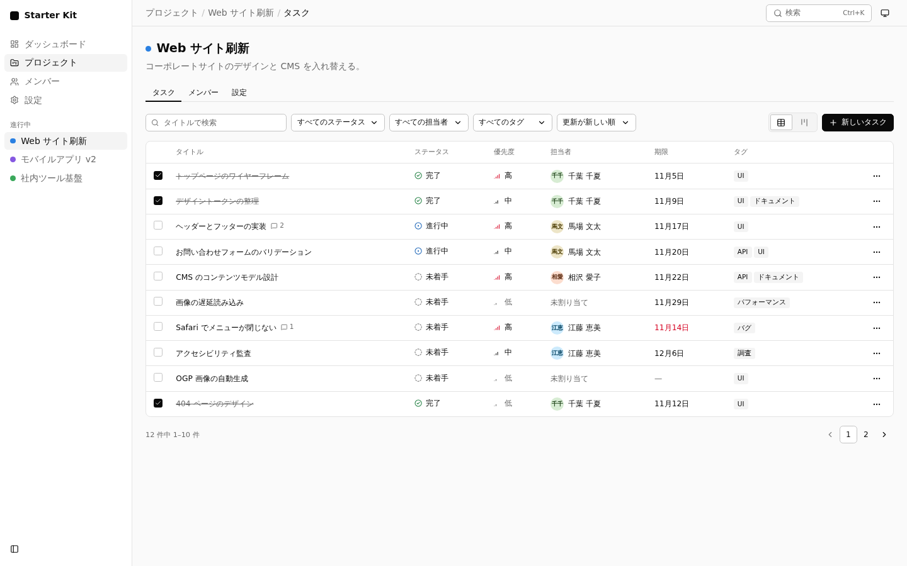
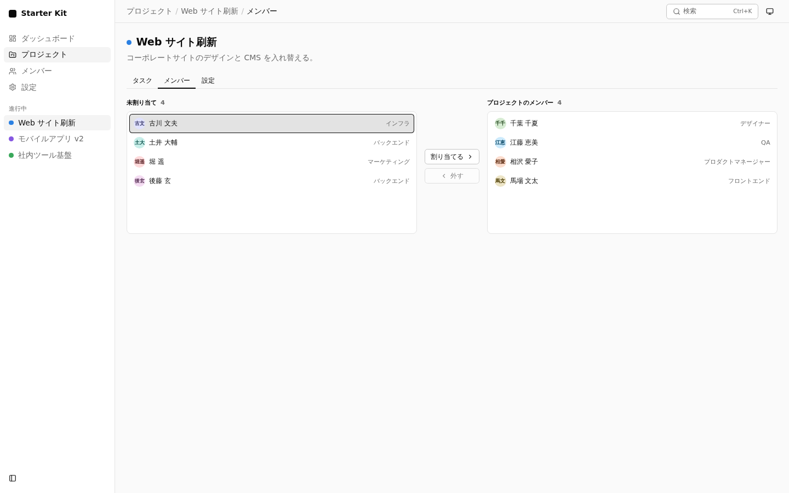
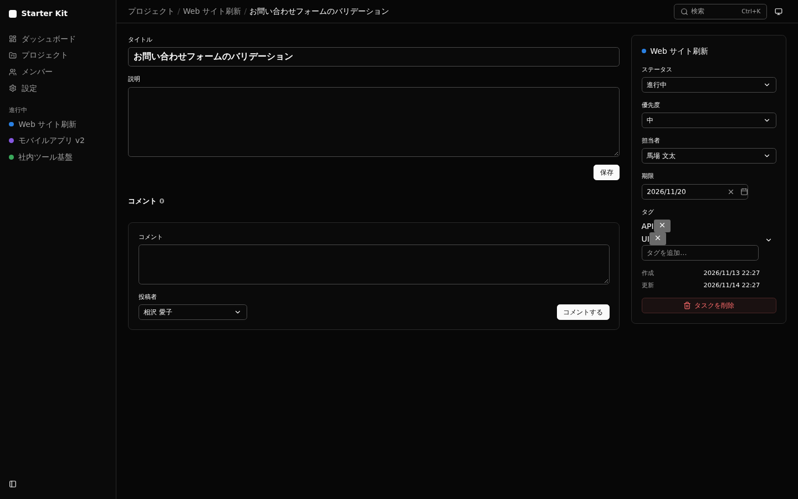
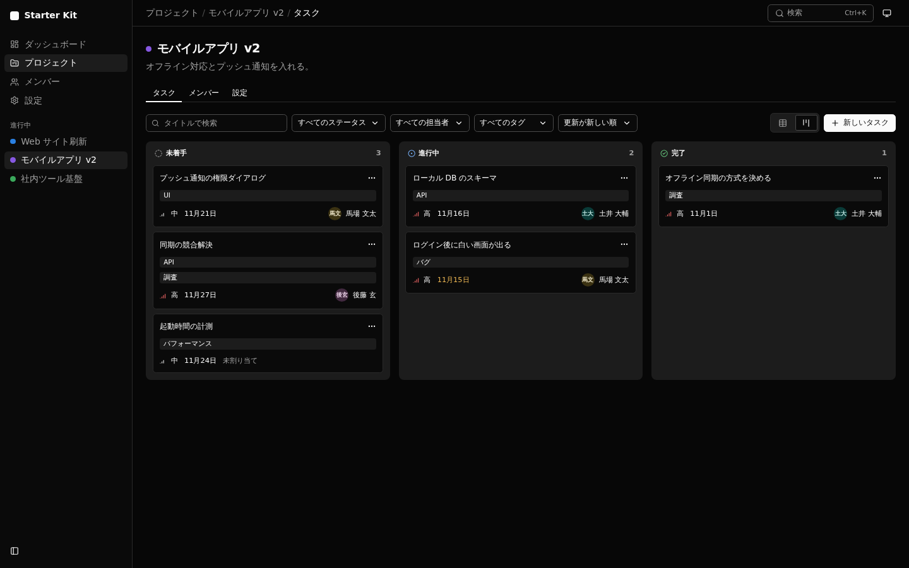
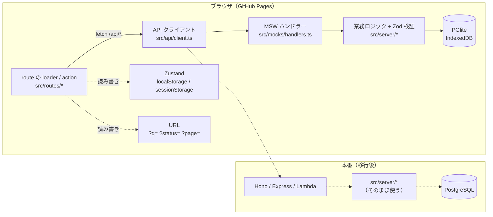
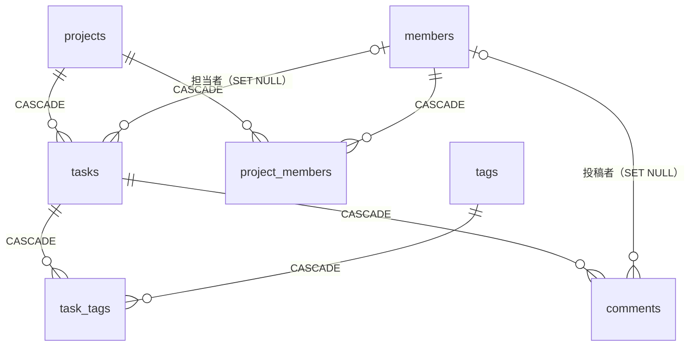

# pglite-drizzle-msw-sample

ブラウザの中だけで動く「小さなプロジェクト管理」アプリのスターターキットです。
PostgreSQL（[PGlite](https://pglite.dev/)）をブラウザで動かし、[Drizzle ORM](https://orm.drizzle.team/) で扱い、
[MSW](https://mswjs.io/) でブラウザ内に API を立てています。UI は Vercel の [UI SDK](https://ui-sdk.dev/)（ヘッドレス UI）で組んでいます。

**デモ: https://daisuke-awaji.github.io/pglite-drizzle-msw-sample/**


| タスク一覧（絞り込み・ページング） | トランスファーリスト（独自 primitive） |
|---|---|
|  |  |
| **タスク詳細（ダーク）** | **ボード表示（ダーク）** |
|  |  |

## 技術スタック

| 役割 | 使っているもの |
|---|---|
| 画面 | React 19 / TypeScript / Vite |
| UI 部品 | [@ui-sdk/react](https://ui-sdk.dev/)（`web.css` をトークンで調整）/ [Lucide](https://lucide.dev/icons) |
| ルーティング・データ取得 | React Router（データルーター: `loader` / `action` / `useFetcher`） |
| クライアントの状態 | Zustand（`persist` で localStorage / sessionStorage） |
| 検証 | Zod（サーバー層と画面で同じスキーマを使う） |
| DB | PGlite（IndexedDB に保存）+ Drizzle ORM + drizzle-kit |
| API | MSW（Service Worker） |
| テスト | Vitest + Testing Library + `@ui-sdk/core/testing`、DB は Node 上の PGlite |

## 使い方

```bash
npm ci
npm run dev        # http://localhost:5173/
npm test           # サーバー層（本物の PostgreSQL）・独自 primitive・エージェントのテスト
npm run lint
npm run build      # dist/ に出力（404.html も作る）
```

初回は PGlite の WASM とデータ（gzip 後でおよそ 5MB）を読み込むので数秒かかります。
データはブラウザごとに IndexedDB へ保存され、初回起動時にサンプルデータが入ります。設定画面から初期化できます。

## 構成



画面は `fetch('/api/...')` しか知りません。`src/server` は HTTP にも PGlite にも依存せず、Drizzle の `db` を受け取るだけなので、
本番では MSW の代わりにサーバーのルーティングから同じ関数を呼べば移行できます（[後述](#本番の-postgresql-に移行する)）。

## データの持ち方

どこに置くかは「誰と共有するか」「いつまで残すか」で決めています。設定画面の「データの保存先」にも同じ表があります。

| 置き場所 | 中身 | 残る期間 | コード |
|---|---|---|---|
| PostgreSQL（PGlite → IndexedDB） | プロジェクト・タスク・メンバーなど | 消すまで | `src/server/*`、`src/db/*` |
| URL のクエリ | 検索語・絞り込み・並び順・ページ | 共有・リロード・戻るで再現 | `loader` が `request.url` から読む、`SearchParamInput`、`ParamSelect` |
| Zustand + localStorage | テーマ・サイドバー・表とボードの切り替え・API の遅延 | 端末に残る | `src/stores/preferences.ts` |
| Zustand + sessionStorage | 書きかけのタスク（下書き） | タブを閉じるまで | `src/stores/drafts.ts` |
| コンポーネントの状態 | ダイアログの開閉など | 画面にいる間 | UI SDK の `defaultOpen` やコントローラー |

サーバーのデータはすべて React Router の `loader` が読み、`action` が書きます。`action` が成功すると、表示中のルートの
`loader` が自動で読み直されるので、サイドバーやダッシュボードの数字を手で同期する必要はありません。
Zustand のストアは React の外（`loader`、`action`、MSW のハンドラー）からも `getState()` で読み書きできます。

## リレーション



| 関係 | 例 | どこで扱っているか |
|---|---|---|
| 1:N（CASCADE） | プロジェクトを消すとタスク・コメント・タグの紐付けも消える | `src/db/schema.ts`、設定タブの削除 |
| N:1（SET NULL） | メンバーを消すと担当タスクは未割り当てに、コメントは投稿者なしで残る | メンバー画面の削除（確認文に影響件数を出す） |
| N:N（中間テーブル） | プロジェクト ⇔ メンバー、タスク ⇔ タグ | トランスファーリスト、タグの Combobox |
| DB の外の業務ルール | 担当者はそのプロジェクトのメンバーに限る。外したメンバーの担当タスクは未割り当てに戻す | `src/server/tasks.ts`、`src/server/projects.ts`（トランザクション） |
| 集計 | 件数・進み具合・期限切れ | `db.$count`、`count(*) filter (...)`、`group by`（`src/server/dashboard.ts`） |
| 関連をたどる取得 | タスク詳細でプロジェクト・メンバー・タグ・コメントを一度に取る | Drizzle のリレーショナルクエリ（`db.query.tasks.findFirst({ with })`） |

## UI のパターン

| パターン | 画面 | 主な UI SDK の部品 |
|---|---|---|
| アプリシェル（折りたためるサイドバー、パンくず、読み込み中の線） | すべて | Toggle、`handle.crumb`、`useNavigation` |
| コマンドパレット（⌘K / Ctrl+K） | すべて | Dialog + Command |
| テーマ切り替え（システム / ライト / ダーク） | 上部のメニュー、設定 | Menu（RadioGroup）、SegmentedControl |
| 一覧の検索・絞り込み・並べ替え・ページング（URL が状態を持つ） | タスク | Input、Select、Pagination（`render={<Link />}`） |
| 表とボードの切り替え | タスク | SegmentedControl |
| 楽観的更新（送信中は先に結果を見せる） | タスクの完了、トランスファーリスト | Checkbox + `useFetcher().formData` |
| 行ごとのメニューと共有の確認ダイアログ | タスク、メンバー | Menu、`createConfirm` + AlertDialog |
| 作成ダイアログ（下書き保存、項目ごとのエラー） | タスク、プロジェクト、メンバー | Dialog、Field、Select、DatePicker、Combobox（複数） |
| 1 つのダイアログを追加と編集で使い回す | メンバー | `createDialogController` の `payload` |
| ルートと連動したタブ | プロジェクト | Tabs（`render={<NavLink />}`） |
| 明示的に保存するフォームと、変えたらすぐ保存する項目 | タスク詳細 | Button、Select、DatePicker、Combobox |
| 危険な操作の確認 | プロジェクト設定、設定 | AlertDialog（`onOpenChange` の `returnValue`） |
| トースト | すべての保存 | `toast()`（`action` から直接呼ぶ） |
| 独自のコンポーネント | プロジェクトのメンバー | `definePrimitive` で作ったトランスファーリスト |

### 独自 primitive: トランスファーリスト

`src/components/transfer-list/` は、UI SDK にない部品を behavior から組み立てる例です
（[azukiazusa さんの記事](https://azukiazusa.dev/blog/ui-sdk-agent-ready-behaviors/) のトランスファーリストを元にしています）。

- 各リストは Tab で 1 回だけ止まり、↑↓ / Home / End で移動（`createRovingFocus`）
- Space で選択（複数可）、Enter で選択中の項目（なければフォーカス中の項目）を反対側へ移動
- 移動後は移動元に残った最も近い項目へ、なければ移動先へフォーカス（`createFocusRecovery`）
- 移動した人数を読み上げ（`announce`）、値は親が持つ（`value` / `onValueChange`）
- エージェントには `assign` / `unassign` を公開し、名前でも id でも指定できる

### エージェントから操作する

`src/agent.ts` で `createAgent()` を作り、`window.agent` に置いています。開発者ツールのコンソールで試せます。

```js
agent.snapshot() // 画面上の部品・値・呼べる操作の一覧

await agent.act({
  steps: [
    { ref: '新しいタスク', action: 'press' },
    { ref: 'タイトル', action: 'setValue', args: ['エージェントのタスク'] },
    { ref: '優先度', action: 'setValue', args: ['高'] },
    { ref: '新しいタスク', action: 'press', args: ['作成'] },
  ],
})

// プロジェクトの「メンバー」タブで
await agent.act({ steps: [{ ref: 'プロジェクトメンバーの割り当て', action: 'assign', args: [['古川 文夫']] }] })
```

削除や初期化のボタンには `data-agent-confirm` を付けてあり、エージェントが押そうとすると
「エージェントの操作を許可しますか？」と人に確認します（`allow`）。

## テスト

| ファイル | 確かめていること |
|---|---|
| `src/server/server.test.ts` | Node 上の PGlite に本番と同じマイグレーションを流し、CASCADE / SET NULL、担当者の業務ルール、部分更新、検証エラー、絞り込み・ページング、集計 |
| `src/components/transfer-list/*.test.ts(x)` | キーボード、フォーカス、`aria-selected` / `aria-disabled`、読み上げ、変更の取り消し、サーバー描画、エージェントの操作 |
| `src/routes/project-tasks.test.tsx` | すべての部品に名前があること、エージェントが絞り込み（URL に入る）・タスク作成・完了ができること |

## GitHub Pages に公開する

`main` に push すると `.github/workflows/deploy.yml` が lint・テスト・ビルドをして公開します
（Settings → Pages の Source は「GitHub Actions」）。`https://<user>.github.io/<repo>/` で動くよう、ビルド時に
`BASE_PATH=/<repo>/` を渡し、ルーター・Service Worker・API のパスもそれに合わせています。
`/projects/1` のような URL を直接開けるように、ビルドで `index.html` を `404.html` に複製しています。

## 本番の PostgreSQL に移行する

DB の接続を差し替え、MSW のハンドラーと同じことをサーバーで書きます。例（Hono + node-postgres）:

```ts
import { Hono } from 'hono'
import { drizzle } from 'drizzle-orm/node-postgres'
import { migrate } from 'drizzle-orm/node-postgres/migrator'
import * as schema from './src/db/schema'
import { HttpError } from './src/server/core'
import { createTask, listTasks } from './src/server/tasks'

const db = drizzle(process.env.DATABASE_URL!, { schema })
await migrate(db, { migrationsFolder: './drizzle' }) // ブラウザと同じ drizzle/*.sql を流す

const app = new Hono().basePath('/api')
app.onError((e, c) =>
  e instanceof HttpError
    ? c.json({ error: e.message, fieldErrors: e.fieldErrors }, e.status as 400)
    : c.json({ error: 'サーバーでエラーが発生しました' }, 500),
)
app.get('/projects/:id/tasks', async (c) => c.json(await listTasks(db, Number(c.req.param('id')), c.req.query())))
app.post('/projects/:id/tasks', async (c) => c.json(await createTask(db, Number(c.req.param('id')), await c.req.json()), 201))
export default app
```

フロントは `VITE_USE_MOCK=false VITE_API_BASE=https://api.example.com/api npm run build` でビルドすると、
MSW のハンドラーと PGlite がバンドルから外れます。

### スキーマを変える

1. `src/db/schema.ts` を編集する
2. `npm run db:generate -- --name <変更内容>` で `drizzle/` に SQL が増える
3. リロードすると、ブラウザ内の DB に未適用のマイグレーションだけが流れる（データは残る）

## ディレクトリ

```
src/
  routes/       画面ごとの loader / action / Component（router.tsx で並べる）
  components/   フォームの部品、表示の部品、コマンドパレット、確認ダイアログ、transfer-list/
  stores/       Zustand（preferences: localStorage、drafts: sessionStorage）
  api/          fetch だけの API クライアント
  mocks/        MSW（HTTP ⇔ src/server の橋渡し）
  server/       業務ロジック（本番にそのまま持っていく）
  shared/       Zod スキーマ・DTO の型・enum（DB・API・画面で共有）
  db/           Drizzle のスキーマと、ブラウザ用の PGlite 起動・マイグレーター
drizzle/        drizzle-kit が生成したマイグレーション SQL
```

## 注意

- **UI SDK はベータ版です。** `@ui-sdk/*` は `0.1.0-beta.2` に固定しています。更新するときは `npm test` とブラウザでの確認をしてください。
- **Drizzle の内部 API を使っています。** Drizzle 標準のマイグレーターは Node 専用なので、`src/db/migrate.browser.ts` で内部の `dialect.migrate` を呼んでいます。
- **1 つの表だけを select すると、Drizzle は列名を表名なしで出力します。** `sql` テンプレートで相関サブクエリを書くと `"id"` が内側の表の列になってしまうので、件数は `db.$count` で書いています（`src/server/projects.ts`）。
- GitHub Pages で URL を直接開くと、画面は正しく出ますが HTTP のステータスは 404 です（`404.html` を使う SPA の制約）。
