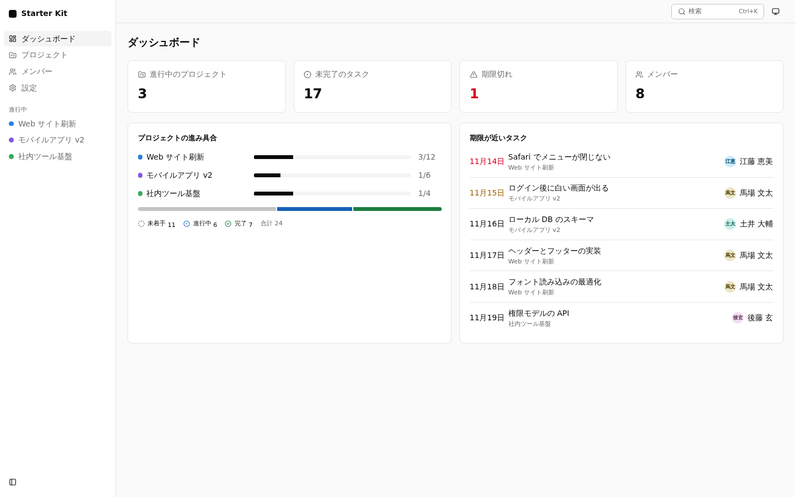
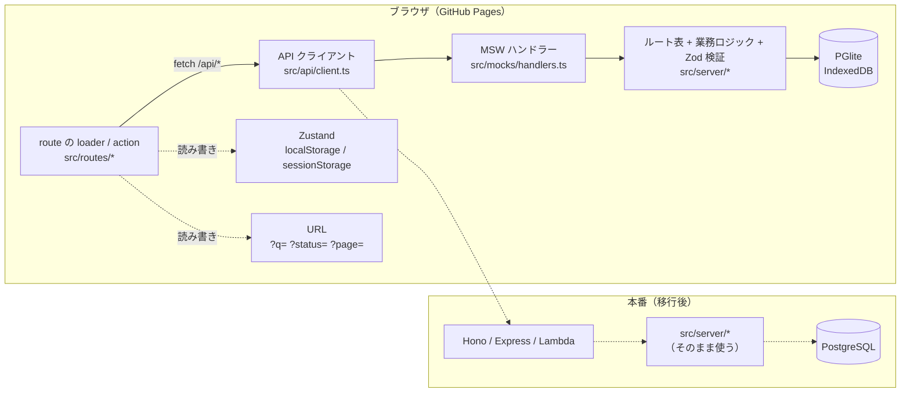
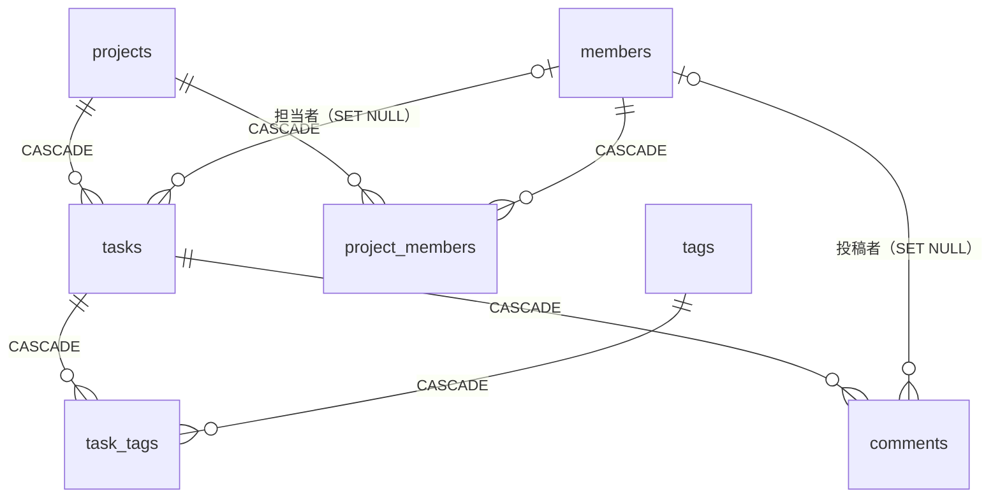
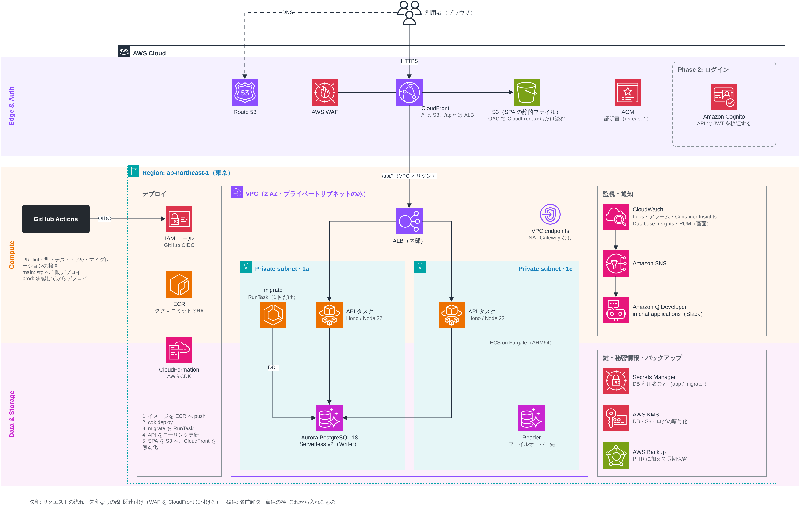

# pglite-drizzle-msw-sample

ブラウザの中だけで動く「小さなプロジェクト管理」アプリのスターターキットです。
PostgreSQL（[PGlite](https://pglite.dev/)）をブラウザで動かし、[Drizzle ORM](https://orm.drizzle.team/) で扱い、
[MSW](https://mswjs.io/) でブラウザ内に API を立てています。UI は Vercel の [UI SDK](https://ui-sdk.dev/)（ヘッドレス UI）で組んでいます。

**デモ: https://daisuke-awaji.github.io/pglite-drizzle-msw-sample/**



| タスク一覧（絞り込み・ページング） | トランスファーリスト（独自 primitive） |
|---|---|
|  |  |
| **タスク詳細（ダーク）** | **ボード表示（ダーク）** |
|  |  |

## 技術スタック

| 役割 | 使っているもの |
|---|---|
| 画面 | React 19 / TypeScript / Vite |
| UI 部品 | [@ui-sdk/react](https://ui-sdk.dev/)（`web.css` をトークンで調整）/ [Lucide](https://lucide.dev/icons) |
| ルーティング・データ取得 | React Router（データルーター: `loader` / `action` / `useFetcher`） |
| クライアントの状態 | Zustand（`persist` で localStorage / sessionStorage） |
| 検証 | Zod（サーバー層と画面で同じスキーマを使う） |
| DB | PGlite（IndexedDB に保存）+ Drizzle ORM + drizzle-kit |
| API | MSW（Service Worker） |
| テスト | Vitest + Testing Library（unit / integration）、Playwright + axe-core（e2e）、v8 のカバレッジ |
| 静的検査 | oxlint（react / jsx-a11y / import / vitest / promise）、TypeScript の strict |

## 使い方

```bash
npm ci
npm run dev               # http://localhost:5173/
npm run check             # lint + 型 + unit/integration（カバレッジの基準つき）。push の前にこれを通す
npm run test:e2e          # ビルドして Chromium で操作する（初回は npx playwright install chromium）
npm run build             # dist/ に出力（404.html も作る）
```

| コマンド | 内容 |
|---|---|
| `npm run test:watch` | unit テストだけを監視モードで（保存のたびに数秒で終わる） |
| `npm run test:unit` / `test:integration` | 層ごとに実行 |
| `npm run test:coverage` | カバレッジ付きで全部。`coverage/index.html` に結果 |
| `npm run lint` / `typecheck` | 警告も失敗として扱う |
| `npm run check:migrations` | マイグレーションの検査（適用済みのものを書き換えていないか・順番・危ない ALTER）。[後述](#マイグレーションalterの決まり) |

初回は PGlite の WASM とデータ（gzip 後でおよそ 5MB）を読み込むので数秒かかります。
データはブラウザごとに IndexedDB へ保存され、初回起動時にサンプルデータが入ります。設定画面から初期化できます。

## 構成



画面は `fetch('/api/...')` しか知りません。`src/server` は HTTP にも PGlite にも依存せず、Drizzle の `db` を受け取るだけなので、
本番では MSW の代わりにサーバーへ同じルート表を登録すれば移行できます（[後述](#本番の-postgresql-に移行する)）。
AWS での本番の構成・デプロイ・運用の計画は [本番環境（AWS）](#本番環境aws) にあります。

## データの持ち方

どこに置くかは「誰と共有するか」「いつまで残すか」で決めています。設定画面の「データの保存先」にも同じ表があります。

| 置き場所 | 中身 | 残る期間 | コード |
|---|---|---|---|
| PostgreSQL（PGlite → IndexedDB） | プロジェクト・タスク・メンバーなど | 消すまで | `src/server/*`、`src/db/*` |
| URL のクエリ | 検索語・絞り込み・並び順・ページ | 共有・リロード・戻るで再現 | `loader` が `request.url` から読む、`SearchParamInput`、`ParamSelect` |
| Zustand + localStorage | テーマ・サイドバー・表とボードの切り替え・API の遅延 | 端末に残る | `src/stores/preferences.ts` |
| Zustand + sessionStorage | 書きかけのタスク（下書き） | タブを閉じるまで | `src/stores/drafts.ts` |
| コンポーネントの状態 | ダイアログの開閉など | 画面にいる間 | UI SDK の `defaultOpen` やコントローラー |

サーバーのデータはすべて React Router の `loader` が読み、`action` が書きます。`action` が成功すると、表示中のルートの
`loader` が自動で読み直されるので、サイドバーやダッシュボードの数字を手で同期する必要はありません。
Zustand のストアは React の外（`loader`、`action`、MSW のハンドラー）からも `getState()` で読み書きできます。

## リレーション



| 関係 | 例 | どこで扱っているか |
|---|---|---|
| 1:N（CASCADE） | プロジェクトを消すとタスク・コメント・タグの紐付けも消える | `src/db/schema.ts`、設定タブの削除 |
| N:1（SET NULL） | メンバーを消すと担当タスクは未割り当てに、コメントは投稿者なしで残る | メンバー画面の削除（確認文に影響件数を出す） |
| N:N（中間テーブル） | プロジェクト ⇔ メンバー、タスク ⇔ タグ | トランスファーリスト、タグの Combobox |
| DB の外の業務ルール | 担当者はそのプロジェクトのメンバーに限る。外したメンバーの担当タスクは未割り当てに戻す | `src/server/tasks.ts`、`src/server/projects.ts`（トランザクション） |
| 集計 | 件数・進み具合・期限切れ | `db.$count`、`count(*) filter (...)`、`group by`（`src/server/dashboard.ts`） |
| 関連をたどる取得 | タスク詳細でプロジェクト・メンバー・タグ・コメントを一度に取る | Drizzle のリレーショナルクエリ（`db.query.tasks.findFirst({ with })`） |

## UI のパターン

| パターン | 画面 | 主な UI SDK の部品 |
|---|---|---|
| アプリシェル（折りたためるサイドバー、パンくず、読み込み中の線） | すべて | Toggle、`handle.crumb`、`useNavigation` |
| コマンドパレット（⌘K / Ctrl+K） | すべて | Dialog + Command |
| テーマ切り替え（システム / ライト / ダーク） | 上部のメニュー、設定 | Menu（RadioGroup）、SegmentedControl |
| 一覧の検索・絞り込み・並べ替え・ページング（URL が状態を持つ） | タスク | Input、Select、Pagination（`render={<Link />}`） |
| 表とボードの切り替え | タスク | SegmentedControl |
| 楽観的更新（送信中は先に結果を見せる） | タスクの完了、トランスファーリスト | Checkbox + `useFetcher().formData` |
| 行ごとのメニューと共有の確認ダイアログ | タスク、メンバー | Menu、`createConfirm` + AlertDialog |
| 作成ダイアログ（下書き保存、項目ごとのエラー） | タスク、プロジェクト、メンバー | Dialog、Field、Select、DatePicker、Combobox（複数） |
| 1 つのダイアログを追加と編集で使い回す | メンバー | `createDialogController` の `payload` |
| ルートと連動したタブ | プロジェクト | Tabs（`render={<NavLink />}`） |
| 明示的に保存するフォームと、変えたらすぐ保存する項目 | タスク詳細 | Button、Select、DatePicker、Combobox |
| 危険な操作の確認 | プロジェクト設定、設定 | AlertDialog（`onOpenChange` の `returnValue`） |
| トースト | すべての保存 | `toast()`（`action` から直接呼ぶ） |
| 独自のコンポーネント | プロジェクトのメンバー | `definePrimitive` で作ったトランスファーリスト |

### 独自 primitive: トランスファーリスト

`src/components/transfer-list/` は、UI SDK にない部品を behavior から組み立てる例です
（[azukiazusa さんの記事](https://azukiazusa.dev/blog/ui-sdk-agent-ready-behaviors/) のトランスファーリストを元にしています）。

- 各リストは Tab で 1 回だけ止まり、↑↓ / Home / End で移動（`createRovingFocus`）
- Space で選択（複数可）、Enter で選択中の項目（なければフォーカス中の項目）を反対側へ移動
- 移動後は移動元に残った最も近い項目へ、なければ移動先へフォーカス（`createFocusRecovery`）
- 移動した人数を読み上げ（`announce`）、値は親が持つ（`value` / `onValueChange`）
- エージェントには `assign` / `unassign` を公開し、名前でも id でも指定できる

### エージェントから操作する

`src/agent.ts` で `createAgent()` を作り、`window.agent` に置いています。開発者ツールのコンソールで試せます。

```js
agent.snapshot() // 画面上の部品・値・呼べる操作の一覧

await agent.act({
  steps: [
    { ref: '新しいタスク', action: 'press' },
    { ref: 'タイトル', action: 'setValue', args: ['エージェントのタスク'] },
    { ref: '優先度', action: 'setValue', args: ['高'] },
    { ref: '新しいタスク', action: 'press', args: ['作成'] },
  ],
})

// プロジェクトの「メンバー」タブで
await agent.act({ steps: [{ ref: 'プロジェクトメンバーの割り当て', action: 'assign', args: [['古川 文夫']] }] })
```

削除や初期化のボタンには `data-agent-confirm` を付けてあり、エージェントが押そうとすると
「エージェントの操作を許可しますか？」と人に確認します（`allow`）。

## エラーの扱い

失敗を「利用者が次に何をすればよいか」で分け、どの画面でも同じ出し方にしています。

| 失敗 | 例 | 画面での出し方 | 実装 |
|---|---|---|---|
| 入力の誤り | 400（項目ごとのエラー付き） | 項目の下に出し、`aria-invalid` を付ける。入力は消さない | `validate` / `run`（`src/routes/lib.ts`） |
| やり直しても変わらない | 404・403・409 | 画面: 状態コードと理由。保存: トースト | `load` が `data(..., { status })` にする |
| やり直せば直りうる | 通信断・5xx・429 | 画面: 「再試行」ボタン。保存: トースト | `ApiError.retryable` |
| 想定外の例外 | 描画中の例外、JSON でない応答 | 「問題が発生しました」と再読み込み。内部の文言は出さない（開発時だけ詳細を出す） | `ErrorView`、`reportError` |
| 起動の失敗 | IndexedDB・Service Worker が使えない | 理由と対処、データを消してやり直すボタン | `src/boot-error.ts` |

- エラーの画面に切り替わったら、見出しへフォーカスを移します（スクリーンリーダーでも気づける）。
- サイドバーと設定画面は API が失敗しても表示するので、行き止まりになりません。
- 保存していない変更があるときは、画面の移動とタブを閉じる前に確認します（`useUnsavedChanges`）。
- 想定外のエラーは `src/lib/report-error.ts` に集まります。本番では Sentry や CloudWatch RUM へ送る処理をここに足してください。

**障害シミュレーション**: 設定画面で「保存だけ失敗させる」「すべて失敗させる」「サーバーにつながらない」を選ぶと、
モック API がその通りに失敗します。「API の遅延」と組み合わせると、読み込み中の表示も確かめられます。
この設定は保存されず、ページを読み込み直すと元に戻ります。

## スマートフォンとアクセシビリティ

WCAG 2.2 AA を目標にし、e2e で axe-core（重大・深刻な違反が 0 件）を全画面・ライト/ダーク・デスクトップ/スマートフォンで確かめています。

- **720px 以下**: サイドバーは左から出るドロワー、パンくずは「戻る」リンク、表はカード、絞り込みは開閉式、ダイアログは画面下からのシート。
  Select と Menu は、指で開くと画面下からのシートになります（`presentation="auto"`）。
- **タッチ端末**: 押せる部品を 44px 以上にします（`@media (pointer: coarse)` で `--ui-spacing` を広げる）。入力欄は 16px にして iOS の拡大を防ぎます。
- **キーボード**: 最初の Tab で「メインコンテンツへ移動」。画面を移ると見出しへフォーカスを移し、「〇〇を表示しました」と読み上げます。
  検索欄の入力中など、同じ画面で URL だけが変わるときはフォーカスを奪いません。
- **色**: フォーカスの輪は背景と 3:1 以上。期限切れは色だけでなくアイコンでも示します。動きを減らす設定と強制カラーにも対応しています。
- タブのタイトルは「いまの画面 | Starter Kit」になります（エラーのときはエラーの見出し）。

## テスト

| 層 | 置き場所 | 何を確かめるか | 速さ |
|---|---|---|---|
| unit | `src/**/*.test.ts(x)` | 部品（キーボード・フォーカス・ARIA）、エラーの出し分け、起動失敗の画面、**層の依存**（`src/architecture.test.ts`） | 数秒 |
| integration | `src/**/*.integration.test.ts(x)` | 本物の PostgreSQL（PGlite）に本番と同じマイグレーションを流して、サーバー層・**全エンドポイント**・**画面**（本物のルート定義を本物の API につないで描画） | 1 分ほど |
| e2e | `e2e/*.spec.ts` | ビルドしたアプリを Chromium で操作。全画面の axe・はみ出し・フォーカス・ドロワー・タッチの大きさ、主な業務の流れ、障害シミュレーション、起動失敗 | 数分 |

テストの決まり:

- **コンソールのエラー・警告は失敗にします**（unit/integration は `src/test/console.ts`、e2e は `e2e/fixtures.ts`）。わざと出すテストだけ `allowConsole()` / `allowConsoleErrors()` で許可します。
- **テストは乱数順で走ります。** 前のテストのデータを当てにしないでください。DB はテストごとに複製し直します（`src/test/db.ts`）。
- **エンドポイントを足したら `src/api/api.integration.test.ts` にもケースを足します。** すべてのハンドラーにケースがあるかを、最後のテストが確かめます。
- **DB を使うテストは `*.integration.test.*` に置きます。** unit が遅くならないよう、構造テストが確かめます。
- **カバレッジの基準**（`vitest.config.ts`）を下回ると CI が落ちます。基準は上げてよいですが、理由なく下げないでください。
  数字より「壊れても気づけない振る舞いがないか」を見てください（エラーの分岐、境界値、権限、状態の遷移）。

構造テスト（`src/architecture.test.ts`）で、次の依存を禁止しています。

- `src/server` から HTTP・画面・ブラウザ用の DB（本番のバックエンドにそのまま移せるように）
- `src/shared` から Zod 以外
- 画面（`routes`・`components`）から `server`・`db`・`mocks`（必ず API クライアントを通す）
- 本番のコードからテスト用のコード

## 新しい画面・機能を足すとき

1. 入力の形を `src/shared/schemas.ts` に Zod で書く（サーバー層と画面の両方で使う）
2. 業務ロジックを `src/server/*.ts` に書き、`*.integration.test.ts` で本物の DB に対して確かめる
3. `src/server/routes.ts` にルートを 1 行足し（MSW にも本番にも同じ表が登録される）、`src/api/client.ts` に関数を足し、`api.integration.test.ts` にケースを足す
4. `src/routes/*.tsx` に `loader` / `action` / `Component` を書き、`router.tsx` に並べる。`handle.crumb` でパンくずとタブのタイトルが決まる
   - 読み込みは `load()`、保存は `validate()` と `run()` を通す（エラーの出し方がそろう）
   - 表には `table-stack` クラスと各セルの `data-label` を付ける（スマートフォンでカードになる）
   - アイコンだけのボタンには `aria-label` を付ける
5. `app.integration.test.tsx` に画面のテストを、`e2e/pages.spec.ts` の一覧に URL を足す
6. `npm run check` と `npm run test:e2e` を通す

## GitHub Pages に公開する

push すると `.github/workflows/ci.yml` が lint・型・unit/integration（カバレッジ）・e2e を走らせ、
`main` のときだけビルドして公開します
（Settings → Pages の Source は「GitHub Actions」）。`https://<user>.github.io/<repo>/` で動くよう、ビルド時に
`BASE_PATH=/<repo>/` を渡し、ルーター・Service Worker・API のパスもそれに合わせています。
`/projects/1` のような URL を直接開けるように、ビルドで `index.html` を `404.html` に複製しています。

## 本番の PostgreSQL に移行する

DB の接続を差し替え、MSW が登録しているのと同じルート表（`src/server/routes.ts`）をサーバーに登録します。
HTTP の決まり（パスの ID の検証、壊れた JSON は 400、POST は 201、本文がなければ 204、想定外の例外は中身を隠して 500）は
`src/server/http.ts` の `respond` に入っていて、Web 標準の `Request` / `Response` だけで書いてあるので、そのまま使えます。
例（Hono + node-postgres）:

```ts
import { Hono } from 'hono'
import { drizzle } from 'drizzle-orm/node-postgres'
import { migrate } from 'drizzle-orm/node-postgres/migrator'
import * as schema from './src/db/schema'
import { respond } from './src/server/http'
import { routes } from './src/server/routes'

const db = drizzle(process.env.DATABASE_URL!, { schema })
await migrate(db, { migrationsFolder: './drizzle' }) // ブラウザと同じ drizzle/*.sql を流す

const app = new Hono().basePath('/api')
for (const route of routes) {
  app.on(route.method, route.path, (c) => respond(route, { db, request: c.req.raw, params: c.req.param() }))
}
export default app
```

本番に持っていかないもの:

- `src/mocks/`（MSW、サンプルデータ `seed.ts`、DB の状態表示 `admin.ts`、`/_debug`・`/_reset`・障害シミュレーション）
- `src/db/client.browser.ts` と `src/db/migrate.browser.ts`（ブラウザ内の PGlite 用）

フロントは `VITE_USE_MOCK=false VITE_API_BASE=https://api.example.com/api npm run build` でビルドすると、
MSW・PGlite・開発用の機能（設定画面の「API の遅延」「障害シミュレーション」「データの保存先」、`window.agent`）が
バンドルから外れます。`npm run check:no-mock-build` で、外れていることを確かめられます（CI でも走ります）。

まだ入っていないもの（顧客案件で足す）:

- **認証と認可。** サーバー層の関数は「誰が呼んだか」を受け取りません。ログインを入れたら、コメントの投稿者などは
  クライアントから受け取らずにログイン中の利用者にし、プロジェクトのメンバーかどうかで読み書きを制限してください。

### スキーマを変える

1. `src/db/schema.ts` を編集する
2. `npm run db:generate -- --name <変更内容>` で `drizzle/` に SQL が増える。**生成された SQL は必ず読む**
3. `npm run check:migrations` を通す（警告が出たら [ALTER の書き方](docs/production.md#alter-の書き方) に従って書き直すか、PR で理由を書く）
4. リロードすると、ブラウザ内の DB に未適用のマイグレーションだけが流れる（データは残る）

`main` に入ったマイグレーションは書き換えません（本番やデモの利用者の DB にはもう流れているため）。決まりは [後述](#マイグレーションalterの決まり) です。

## 本番環境（AWS）



本番に載せるときの構成と手順の**計画**です（AWS 側はまだ作っていません）。設計の判断、環境ごとの設定、手順書を含めた全体は
[docs/production.md](docs/production.md)、図の元は [docs/architecture/aws-production.drawio](docs/architecture/aws-production.drawio) です。

| 帯 | 構成 | ポイント |
|---|---|---|
| Edge & Auth | Route 53 → CloudFront（AWS WAF）→ `/*` は S3、`/api/*` は ALB | 画面と API を同じドメインで配るので、CORS もビルドの設定もいらない（API の向き先は既定で `/api`）。ログイン（Cognito）は Phase 4 |
| Compute | CloudFront の VPC オリジン → 内部 ALB → ECS on Fargate（2 AZ） | `src/server/routes.ts` を Hono に登録したサーバー。ALB はインターネットに出さない。NAT Gateway は置かず VPC endpoints で出る |
| Data & Storage | Aurora PostgreSQL 18 Serverless v2（Writer + 別 AZ の Reader）、Secrets Manager、KMS、AWS Backup | ブラウザの PGlite（PostgreSQL 18.6）と同じメジャーバージョン。DB の利用者はアプリ用（読み書きだけ）とマイグレーション用に分ける |

`src/server` はそのまま使えます。本物の PostgreSQL 18.6 に node-postgres でつなぎ、結合テスト 78 件が通ることを確かめてあります。

> 今の API には認証がありません。認証（Phase 4）が入るまでは、本番のデータを載せて公開せず、WAF で社内の IP だけを通すなど入口で絞ってください。

### デプロイの流れ

`main` に入ると stg へ自動で、GitHub Environments で承認すると prod へ、同じ手順で入ります（GitHub Actions から OIDC で AWS に入る）。順番は入れ替えません。

1. イメージを ECR に push（タグはコミット SHA）し、画面を `VITE_USE_MOCK=false` でビルドする
2. migrate のタスク定義だけを新しいイメージにする（`cdk deploy <env>-Migrate`）
3. **マイグレーションを RunTask で 1 回だけ流す。** 失敗したらここで止まり、API も画面も古いまま
4. API をローリング更新する（失敗やアラームで ECS が前のバージョンに戻す）
5. 画面の JS・CSS を置いてから `index.html` を置き、`index.html` のキャッシュだけを消す（古い JS は消さない）
6. スモークテスト（`/api/readyz` と、データを変えない主な画面）

戻すときは、API と画面は前のコミット SHA で出し直します。DB のスキーマは戻さず、直すマイグレーションを足して前に進めます。

### マイグレーション（ALTER）の決まり

Drizzle の migrator は、未適用のマイグレーションを 1 つのトランザクションで流し、適用済みかを `when`（生成した時刻）だけで決めます。
この性質と、ALTER のロックの振る舞いを PostgreSQL 18.6 で確かめた結果から、次の決まりにしています（詳しくは [docs/production.md#マイグレーション](docs/production.md#マイグレーション)）。

- **流すのはデプロイの中で 1 回だけ、API より先。** 実行役は advisory lock で同時に流さず、`lock_timeout` でロック待ちのまま普通の SELECT まで止めることを防ぎ、あきらめたら待ってやり直す。
- **1 つ前の API と、開いたままの画面が動くこと。** 列を消す・名前を変える・型を変えるは、1 回のリリースでしない。「足す → 移す → 切り替える → 消す」とリリースをまたぐ。
- **`main` に入ったものは書き換えない。** 書き換えても適用済みの DB には反映されない（Drizzle は hash を照合しない）。間違いは直すマイグレーションを足す。
- **ほかのブランチのマイグレーションが先に `main` に入ったら、自分のものを作り直す。** `when` が古いままマージすると、本番では**エラーにならずに飛ばされる**（再現して確かめた）。
- **ロックが長くなる ALTER は書き方を変える。**

| やりたいこと | そのまま書くと | 安全な書き方 |
|---|---|---|
| 行ごとに違う DEFAULT の列を足す・列の型を変える | 表全体を書き直し、その間は読み書きが止まる | NULL 可の新しい列を足し、バッチで埋めてから切り替える |
| NOT NULL にする | 全行を読む間止まる | `CHECK ... NOT VALID` → `VALIDATE` → `SET NOT NULL` |
| 既存の表に索引を足す | 作り終わるまで書き込みが止まる | 事前の SQL で `CREATE INDEX CONCURRENTLY`、マイグレーションは `IF NOT EXISTS` |
| 外部キー・CHECK を足す | 全行を確かめる間ロックを持つ | `NOT VALID` で足し、`VALIDATE CONSTRAINT` を分ける |
| enum に値を足す | 同じデプロイの後続で使うと失敗する | 足すデプロイと使うデプロイを分ける |

`npm run check:migrations`（CI でも実行）は、次を見つけたら**失敗**にします: `when` の順番の逆転、`main` にあるマイグレーションの書き換え・削除、
journal に載っていない SQL、`CONCURRENTLY`。上の表の書き方は**警告**にし、レビューで判断します。`drizzle-kit check` も一緒に流します
（スナップショットの衝突は見つけるが、`when` の順番だけが崩れたときは警告だけで成功するため、両方を流す）。

### 運用

- **監視**: CloudFront・ALB の 5xx と応答時間、正常なタスクの数、Aurora の ACU・接続数・デッドロック、画面の JS エラー（CloudWatch RUM）、費用。アラームは Slack に送る。
- **バックアップ**: Aurora の PITR（35 日）と AWS Backup（月 1 回を 1 年）。目標は RPO 5 分・RTO 2 時間（案）。3 か月に 1 回、stg で復元を練習する。
- **手順書**: デプロイ・マイグレーションの失敗、DB のフェイルオーバー、誤って消したデータの復元、DB に直接入るとき、秘密情報のローテーション、メジャーバージョンアップ（[docs/production.md#手順書ランブック](docs/production.md#手順書ランブック)）。
- **進め方**: Phase 0（この計画とマイグレーションの検査。済み）→ 1 サーバー（`server/`・Dockerfile・本物の PostgreSQL での CI）→ 2 基盤（CDK）→ 3 デプロイ → 4 認証 → 5 本番の開始。

## ディレクトリ

```
src/
  routes/       画面ごとの loader / action / Component（router.tsx で並べる）
  components/   フォームの部品、表示の部品、コマンドパレット、確認ダイアログ、transfer-list/
  stores/       Zustand（preferences: localStorage、drafts: sessionStorage）
  api/          fetch だけの API クライアント（ApiError で失敗の種類を分ける）
  lib/          画面で共通に使うフック（未保存の確認・オンライン状態）とエラーの記録
  mocks/        MSW（ルート表を登録するだけ）、サンプルデータ、開発用のエンドポイント（本番には持っていかない）
  server/       業務ロジックと HTTP の境界（routes.ts・http.ts）。本番にそのまま持っていく
  shared/       Zod スキーマ・DTO の型・enum（DB・API・画面で共有）
  db/           Drizzle のスキーマと、ブラウザ用の PGlite 起動・マイグレーター
  test/         テストの道具（DB の複製、本物の API、画面の描画、コンソールの監視）
e2e/            Playwright の e2e（fixtures.ts に共通の確認）
drizzle/        drizzle-kit が生成したマイグレーション SQL（main に入ったものは書き換えない）
scripts/        ビルドとマイグレーションの検査（check-no-mock-build.mjs、check-migrations.mjs）
docs/           スクリーンショット、本番の計画（production.md）、構成図（architecture/）
```

## 注意

- **UI SDK はベータ版です。** `@ui-sdk/*` は `0.1.0-beta.2` に固定しています。更新するときは `npm test` とブラウザでの確認をしてください。
- **Drizzle の内部 API を使っています。** Drizzle 標準のマイグレーターは Node 専用なので、`src/db/migrate.browser.ts` で内部の `dialect.migrate` を呼んでいます。
- **1 つの表だけを select すると、Drizzle は列名を表名なしで出力します。** `sql` テンプレートで相関サブクエリを書くと `"id"` が内側の表の列になってしまうので、件数は `db.$count` で書いています（`src/server/projects.ts`）。
- GitHub Pages で URL を直接開くと、画面は正しく出ますが HTTP のステータスは 404 です（`404.html` を使う SPA の制約）。
