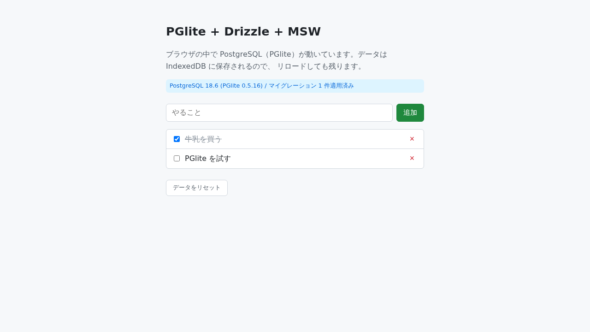
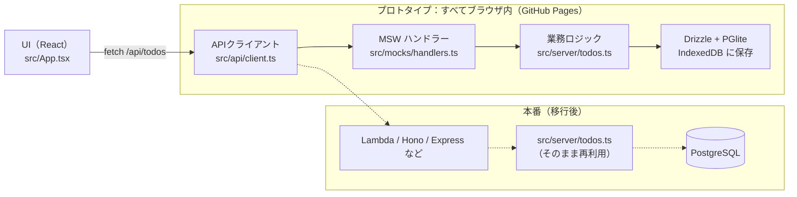

# pglite-drizzle-msw-sample

GitHub Pages だけで動く「将来 PostgreSQL に移行する前提」のプロトタイプの最小サンプルです。
ブラウザの中で PostgreSQL（[PGlite](https://pglite.dev/)）を動かし、[Drizzle ORM](https://orm.drizzle.team/) で操作し、
[MSW](https://mswjs.io/) でブラウザ内に API サーバーを立てます。



UI は `fetch('/api/...')` しか知らないので、本番では MSW を外してバックエンドに向けるだけで移行できます。

## 構成



| パス | 役割 | 本番に移行するとき |
|---|---|---|
| `src/db/schema.ts` | テーブル定義（Drizzle） | **そのまま使う** |
| `drizzle/*.sql` | マイグレーション SQL（drizzle-kit で生成） | **そのまま本番 DB に流す** |
| `src/server/todos.ts` | 業務ロジック・バリデーション | **そのまま使う**（`db` を差し替えるだけ） |
| `src/shared/types.ts` | API の入出力の型 | そのまま使う |
| `src/api/client.ts` | UI から API を呼ぶ fetch | そのまま使う（`VITE_API_BASE` で接続先を変える） |
| `src/mocks/handlers.ts` | HTTP ↔ 業務ロジックの橋渡し | サーバーのルーティングに書き直す（薄いので数十行） |
| `src/db/client.browser.ts` / `migrate.browser.ts` | PGlite の起動とブラウザ用マイグレーター | 不要になる |

## 使い方

```bash
npm install
npm run dev          # http://localhost:5173/
npm run build        # dist/ に出力
npm run typecheck
```

初回は PGlite の WASM とデータファイル（gzip 後で合計およそ 5MB）を読み込むので数秒かかります。2 回目以降はブラウザのキャッシュが効きます。
データはブラウザの IndexedDB に保存されるので、リロードしても残ります（ブラウザごと・端末ごとに別のデータです）。

### スキーマを変える

1. `src/db/schema.ts` を編集する
2. `npm run db:generate -- --name <変更内容>` で `drizzle/` に SQL が追加される
3. リロードすると、ブラウザ内の DB に未適用のマイグレーションだけが流れる（既存データは残る）

マイグレーション履歴は本番と同じ `drizzle.__drizzle_migrations` テーブルに記録されます。

## GitHub Pages に公開する

1. このリポジトリを GitHub に push する
2. **Settings → Pages → Build and deployment → Source** を **GitHub Actions** にする
3. `main` に push すると `.github/workflows/deploy.yml` がビルドして公開する

`https://<user>.github.io/<repo>/` のサブパスで動くよう、ビルド時に `BASE_PATH=/<repo>/` を渡しています。
Service Worker（`mockServiceWorker.js`）と API のパスもこのベースパスを基準にしています。

## 本番の PostgreSQL に移行する

DB への接続を差し替え、MSW ハンドラーと同じことをサーバー側で書きます。例（Hono + node-postgres）:

```ts
import { Hono } from 'hono'
import { drizzle } from 'drizzle-orm/node-postgres'
import { migrate } from 'drizzle-orm/node-postgres/migrator'
import * as schema from './src/db/schema'
import { createTodo, listTodos } from './src/server/todos'

const db = drizzle(process.env.DATABASE_URL!, { schema })
await migrate(db, { migrationsFolder: './drizzle' }) // 同じ drizzle/*.sql を流す

const app = new Hono()
app.get('/api/todos', async (c) => c.json(await listTodos(db)))
app.post('/api/todos', async (c) => c.json(await createTodo(db, await c.req.json()), 201))
// ...
```

フロントエンドは `VITE_USE_MOCK=false VITE_API_BASE=https://api.example.com npm run build` でビルドします。
`VITE_USE_MOCK=false` のときは MSW のハンドラーと PGlite がバンドルに含まれず、JS は 70KB 程度（gzip 後）になります。

## 制約と注意点

- **データはブラウザ内だけ**：ユーザー間の共有や端末間の同期はできません。同時アクセスや権限の確認は本番に移ってからになります。
- **PGlite は 1 接続**：コネクションプールやロックの挙動は本番と違います。
- **公開リポジトリ・公開サイト**：ビルドに含めたデータ（seed など）は誰でも見られます。
- `src/db/migrate.browser.ts` は Drizzle の内部 API（`dialect.migrate`）を使っています。Drizzle を更新したら動作を確認してください。
- ビルド時に PGlite 由来の `eval` の警告が出ますが、動作には影響しません。

## API

| メソッド | パス | 内容 |
|---|---|---|
| GET | `/api/todos` | 一覧 |
| POST | `/api/todos` | 追加 `{ "title": string }` |
| PATCH | `/api/todos/:id` | 更新 `{ "title"?: string, "done"?: boolean }` |
| DELETE | `/api/todos/:id` | 削除 |
| POST | `/api/_reset` | 全件削除（プロトタイプ専用） |
| GET | `/api/_debug` | PostgreSQL のバージョンとマイグレーション履歴（プロトタイプ専用） |
