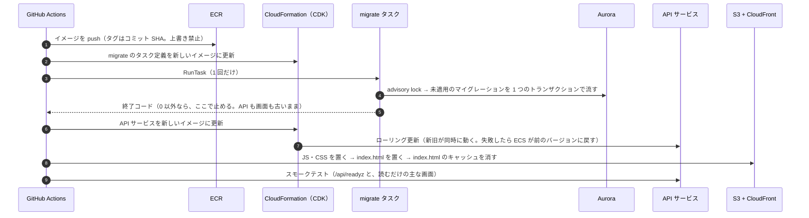
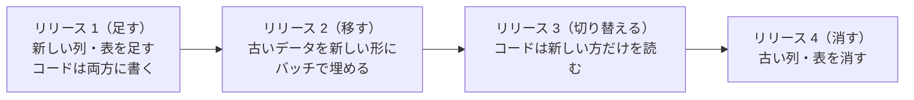

# 本番環境（AWS）の計画

このキットを顧客案件の本番に載せるときの、AWS の構成・デプロイの手順・マイグレーション（ALTER）の流し方・運用の計画です。

| 項目 | 内容 |
|---|---|
| 状態 | **計画**（AWS 側はまだ作っていません。ここにある構成はまだどこにも構築していません） |
| 最終更新 | 2026-11-15 |
| 前提 | リージョンは東京（ap-northeast-1）。画面は今の SPA、サーバーは `src/server` をそのまま使う |
| このリポジトリで済んでいるもの | 構成図、この計画、マイグレーションの検査（`npm run check:migrations`、CI で実行） |

目次: [構成](#構成) / [設計の判断](#設計の判断) / [環境](#環境) / [リポジトリに足すもの](#リポジトリに足すもの) / [デプロイ](#デプロイ) / [マイグレーション](#マイグレーション) / [運用](#運用) / [進め方](#進め方) / [未確定のこと](#未確定のこと)

## 構成


元の図は [`architecture/aws-production.drawio`](architecture/aws-production.drawio) です（draw.io で開いて編集し、「ファイル → エクスポート → PNG（拡大率 200%）」で同じ名前に書き出す）。

| 帯 | 置くもの | 役割 |
|---|---|---|
| Edge & Auth | Route 53、CloudFront、AWS WAF、S3、ACM、（Phase 2）Cognito | 1 つのドメインで画面と API を配る。`/*` は S3 の SPA、`/api/*` は ALB へ。WAF でよくある攻撃と大量アクセスを止める |
| Compute | 内部 ALB、ECS on Fargate（API タスク・migrate タスク）、VPC endpoints | Hono で `src/server/routes.ts` を登録した Node のサーバー。2 つの AZ に 1 つずつ置く。マイグレーションは同じイメージを 1 回だけ RunTask で流す |
| Data & Storage | Aurora PostgreSQL 18 Serverless v2、Secrets Manager、KMS、AWS Backup | Writer に読み書きを集め、Reader は別 AZ のフェイルオーバー先にする。DB の利用者はアプリ用とマイグレーション用に分ける |

リクエストの流れ:

1. 利用者が `https://app.example.com` を開くと、CloudFront が S3 から `index.html` と JS・CSS を返す（S3 は OAC で CloudFront からしか読めない）
2. 画面の `fetch('/api/...')` は同じドメインなので、CloudFront が VPC オリジン経由で**インターネットに出ていない内部 ALB** へ送る（CORS もクッキーの設定もいらない）
3. ALB は 2 つの API タスクに振り分け、タスクは Aurora の Writer に接続する
4. タスクはプライベートサブネットだけに置き、ECR・CloudWatch Logs・Secrets Manager・S3 へは VPC endpoints で出る（NAT Gateway は置かない）

## 設計の判断

| 決めたこと | 選んだもの | 主な理由 | 選ばなかったもの |
|---|---|---|---|
| API の実行環境 | ECS on Fargate（ARM64） | 接続プールを持ち続けられるので、トランザクションの多い `src/server` に合う。マイグレーションも同じイメージを RunTask で流せる | Lambda: 接続の管理に RDS Proxy か Data API が要る。Data API は今の node-postgres の経路と型の扱いが違い、確かめ直しになる。ECS Express Mode: インターネットに出る ALB を自動で作るので、CloudFront の VPC オリジンで ALB を隠す構成と合わない |
| DB | Aurora PostgreSQL 18（Serverless v2） | ブラウザの PGlite 0.5 が **PostgreSQL 18.6** なので、プロトタイプと本番のメジャーバージョンがそろう。開発・検証環境は使わない間 0 ACU で止められる | RDS for PostgreSQL: 安いが、容量の自動調整とフェイルオーバーの速さで Aurora を選ぶ。Aurora DSQL: PostgreSQL 16 互換で、使えない機能があり、確かめ直しになる |
| 画面と API の入口 | CloudFront 1 つ（同じドメイン） | 画面の API の向き先は既定で `/api` なので、ビルドの設定がいらない。WAF も 1 か所でよい | API 用に別ドメイン: CORS とクッキーの設定が増える |
| ALB を公開しない | CloudFront の VPC オリジン + 内部 ALB | ALB を直接たたけないので、WAF を迂回されない | 公開 ALB + ヘッダーの合言葉: 設定の漏れで迂回される |
| 外への通信 | VPC endpoints だけ（NAT なし） | API は外部の API を呼ばない。出口がないので、乗っ取られても外へ送りにくい | NAT Gateway: 外部の API を呼ぶようになったら足す |
| DB の認証 | Secrets Manager のパスワード（利用者ごと） | 1 秒あたりの新しい接続数の上限がない。ローテーションも Secrets Manager に任せられる | IAM 認証: 新しい接続の数に上限があり、DB 側のメモリも要る |
| IaC | AWS CDK（TypeScript） | アプリと同じ言語で書け、型で間違いに気づける | Terraform: チームに知見があるなら差し替えてよい |
| CI/CD | GitHub Actions（OIDC で AWS に入る） | 今の CI をそのまま伸ばせる。長期のアクセスキーを持たない | CodePipeline: GitHub の承認・レビューと二重になる |
| 認証 | Phase 2 で Amazon Cognito | 画面のログインは Cognito のマネージドログイン、API は JWT を検証する（Hono のミドルウェア） | ALB の認証機能: CloudFront を前に置くと扱いにくい |

> **認証を入れる前に、本番のデータを載せて公開しないでください。** 今の API には「誰が呼んだか」がありません（README の「まだ入っていないもの」）。
> 認証が間に合わないときは、WAF で社内の IP アドレスだけを通すなど、入口で絞ってから使い始めます。

## 環境

AWS アカウントを環境ごとに分けます（間違えて本番を壊さない、権限と請求を分けられる）。値は最初の目安で、負荷試験のあとで見直します。

| | dev | stg | prod |
|---|---|---|---|
| 目的 | 開発者が自由に試す | 本番と同じ手順でデプロイを確かめる。マイグレーションのリハーサル | 本番 |
| デプロイ | 手動（`cdk deploy`） | `main` に入ったら自動 | GitHub Environments の承認のあと |
| Aurora | Writer のみ、0〜4 ACU（自動で一時停止） | Writer のみ、0〜8 ACU（自動で一時停止） | Writer + Reader（別 AZ）、1〜16 ACU（停止しない） |
| API タスク | 1 | 2 | 2〜10（CPU とリクエスト数で増減） |
| 削除保護 | なし | あり | あり |
| バックアップ | 1 日 | 7 日 | 35 日（PITR）+ AWS Backup で月 1 回を 1 年 |
| ログの保存 | 7 日 | 30 日 | 90 日（長く残す決まりがあれば S3 へ書き出す） |

- 自動で一時停止した Aurora は、最初の接続から 15 秒ほどで戻ります。dev / stg では接続のタイムアウトを 15 秒より長くし、接続に失敗したらやり直すようにします。
- 本番の最小 ACU を 0 にしないのは、朝一番の利用者を 15 秒待たせないためです。

## リポジトリに足すもの

今のリポジトリには `src/server`（業務ロジック・ルート表・HTTP の境界）があり、サーバーの入口・コンテナ・IaC はまだありません。Phase 1〜3 で次を足します。

```
server/
  app.ts            Hono に src/server/routes.ts を登録する（README の例と同じ）。/api/healthz を足す
  main.ts           @hono/node-server で起動。SIGTERM で受付を止め、処理中のリクエストを待ってから接続を閉じる
  db.ts             node-postgres の接続プール（DATABASE_URL、プールの上限、タイムアウト）
  migrate.ts        マイグレーションの実行役（後述）。事前 SQL（--pre）も流せる
  log.ts            1 行 1 JSON のログ（リクエスト ID・ルート・状態コード・所要時間。本文や個人情報は出さない）
Dockerfile          node:22 系の slim、ARM64。npm ci --omit=dev、非 root で動かす
infra/              AWS CDK
  bin/app.ts        環境（dev / stg / prod）ごとにスタックを並べる
  lib/network.ts    VPC・サブネット・VPC endpoints
  lib/data.ts       Aurora・Secrets Manager・KMS・AWS Backup
  lib/migrate.ts    migrate のタスク定義（API より先に更新するので、別のスタックにする）
  lib/api.ts        ECS クラスター・サービス・内部 ALB・自動スケール・アラーム
  lib/edge.ts       CloudFront・S3・WAF・CloudFront Function（SPA のパスを index.html に）・Route 53
  lib/ci.ts         GitHub OIDC の IDプロバイダーとデプロイ用の IAM ロール
  lib/monitoring.ts ダッシュボード・アラーム・SNS・チャット通知
.github/workflows/
  deploy.yml        main → stg、承認 → prod（後述の手順）
```

`src/server` は書き換えません。本物の PostgreSQL 18.6 に node-postgres でつなぎ、結合テスト（`src/**/*.integration.test.*`、78 件）を全部流して通ることを確かめてあります
（テスト用の DB の作り方だけを一時的に差し替えて確かめた。Phase 1 で `TEST_DATABASE_URL` を渡すと本物の PostgreSQL を使うようにし、CI でも流す）。

サーバーで気をつけること:

- **ALB との keep-alive**: Node の `keepAliveTimeout` を ALB のアイドルタイムアウト（既定 60 秒）より長くします（例: 65 秒）。短いと、ALB が切れた接続を使って 502 を返すことがあります。
- **止め方**: ECS は SIGTERM を送ってから 30 秒（`stopTimeout`）待ちます。ALB の登録解除の待ち時間（既定 300 秒）は 30 秒に縮め、その間に処理中のリクエストを終えます。
- **ヘルスチェック**: ALB の `/api/healthz` は DB を見ません（DB のフェイルオーバー中に全タスクが入れ替えられるのを防ぐ）。DB まで確かめる `/api/readyz` は、デプロイ後のスモークテストで使います。
- **接続数**: 「タスクの最大数 × プールの上限」が Aurora の `max_connections`（最大 ACU で決まる）を超えないようにします。CDK で式にして、どちらかを変えたら気づけるようにします。
- **Node のバージョン**: CI と同じ 22 にそろえます。Node 22 のサポートは 2027 年 4 月までなので、それまでに 24 へ上げます。

## デプロイ

### 初回の構築（環境ごとに 1 回）

1. **アカウントと人の入り方**: dev / stg / prod のアカウントを用意し、人は IAM Identity Center から入る（IAM ユーザーとアクセスキーは作らない）。
2. **CDK の準備**: `npx cdk bootstrap aws://<アカウント>/ap-northeast-1 aws://<アカウント>/us-east-1`
   （CloudFront に付ける ACM の証明書と WAF は us-east-1 に作るため、両方のリージョンで行う）。
3. **ドメイン**: Route 53 のホストゾーンを用意し、`lib/edge.ts` で証明書（DNS 検証）とレコードを作る。
4. **基盤**: `npx cdk deploy <env>-Network <env>-Data`。Aurora の管理者のパスワードは RDS が Secrets Manager で管理し、ローテーションも任せる（`ManageMasterUserPassword`）。
5. **DB の利用者を作る（1 回だけ、管理者で）**: アプリ用（`app`）とマイグレーション用（`migrator`）を分ける。パスワードは CDK が Secrets Manager に作り、
   `db-bootstrap` タスク（migrate と同じイメージ）が読み出して次の SQL を流す。

   ```sql
   CREATE ROLE migrator LOGIN PASSWORD :'migrator_password';
   CREATE ROLE app LOGIN PASSWORD :'app_password';
   GRANT CONNECT ON DATABASE app TO migrator, app;
   GRANT CREATE ON DATABASE app TO migrator;            -- Drizzle は毎回 CREATE SCHEMA IF NOT EXISTS "drizzle" を流すので必要
   GRANT USAGE, CREATE ON SCHEMA public TO migrator;
   GRANT USAGE ON SCHEMA public TO app;
   -- migrator が作った表・連番に、app が読み書きできるようにする（DDL はできない）
   ALTER DEFAULT PRIVILEGES FOR ROLE migrator IN SCHEMA public GRANT SELECT, INSERT, UPDATE, DELETE ON TABLES TO app;
   ALTER DEFAULT PRIVILEGES FOR ROLE migrator IN SCHEMA public GRANT USAGE, SELECT ON SEQUENCES TO app;
   ```

   この権限で、`migrator` がマイグレーションを流せること、`app` が読み書きでき `DROP TABLE`・`ALTER TABLE`・`TRUNCATE` は拒否されることを、PostgreSQL 18.6 で確かめてあります。
   `GRANT CREATE ON DATABASE` がないと、`drizzle` スキーマがすでにあっても migrator は `permission denied for database` で失敗します。
6. **GitHub**: `npx cdk deploy <env>-Ci` で OIDC の ID プロバイダーとデプロイ用ロールを作る。ロールの信頼ポリシーは、このリポジトリのその環境
   （`repo:<owner>/<repo>:environment:production` など）からだけ引き受けられるように絞る。GitHub Environments の `production` には承認者を設定する。
7. 最初のリリースを、次の「いつものリリース」の手順で流す。

### いつものリリース

`main` に入ると stg へ自動で、承認すると prod へ同じ手順で入ります。順番に意味があり、入れ替えません。



1. **ビルド**: イメージ（`docker buildx build --platform linux/arm64`）と画面（`VITE_USE_MOCK=false npm run build`）。
   同じドメインで配るので `VITE_API_BASE` はいりません（既定で `/api`）。`check:no-mock-build` と同じ検査をここでも通す。
2. **migrate のタスク定義を更新**: `npx cdk deploy <env>-Migrate -c imageTag=<SHA>`。API のスタックと分けてあるので、API はまだ古いままです。
3. **マイグレーション**: RunTask で 1 回だけ流し、終わるのを待って終了コードを確かめる。

   ```bash
   TASK=$(aws ecs run-task --cluster "$CLUSTER" --task-definition "$ENV-migrate" --launch-type FARGATE \
     --network-configuration "awsvpcConfiguration={subnets=[$SUBNETS],securityGroups=[$MIGRATE_SG]}" \
     --query 'tasks[0].taskArn' --output text)
   aws ecs wait tasks-stopped --cluster "$CLUSTER" --tasks "$TASK"   # 最大 10 分。長いものは待ちを繰り返す
   test "$(aws ecs describe-tasks --cluster "$CLUSTER" --tasks "$TASK" \
     --query 'tasks[0].containers[0].exitCode' --output text)" = 0
   ```

4. **API**: `npx cdk deploy <env>-Api -c imageTag=<SHA>`。新しいタスクが正常になってから古いタスクを止め、
   正常にならない・アラームが鳴ったときは ECS が前のバージョンに戻します（デプロイのサーキットブレーカーとアラームによるロールバック）。
5. **画面**: ファイル名にハッシュが付いた JS・CSS（`assets/`）を先に置き、`index.html` を最後に置く。
   古いファイルは消しません。ビルドには後から読み込む JS（例: `assets/sheet-presentation-*.js`）があり、開いたままの画面が古いものを読みに来るためです。
   消すなら「直近の数回のビルドに含まれないもの」だけにします（日付で消すと、変わらずに使い続けているファイルまで消える）。

   ```bash
   aws s3 sync dist/assets "s3://$BUCKET/assets" --cache-control 'public,max-age=31536000,immutable'
   aws s3 sync dist "s3://$BUCKET" --exclude 'assets/*' --exclude index.html --exclude 404.html --cache-control 'public,max-age=300'
   aws s3 cp dist/index.html "s3://$BUCKET/index.html" --cache-control 'no-cache'
   aws cloudfront create-invalidation --distribution-id "$DIST" --paths /index.html
   ```

6. **スモークテスト**: `/api/readyz` と、データを変えない主な画面を Playwright で開く。失敗したら通知し、prod への承認を止める。

画面の URL（`/projects/1` など）は、CloudFront Function でファイル名のないパスを `/index.html` に書き換えて返します。
CloudFront の「カスタムエラーレスポンス」はディストリビューション全体に効き、API の 404（JSON）まで `index.html` に変えてしまうので使いません。

### 戻すとき

| 戻したいもの | やり方 | 前提 |
|---|---|---|
| API | 前のコミット SHA で `cdk deploy <env>-Api -c imageTag=<前の SHA>` | 同じリリースの DB の変更が「足すだけ」であること（[互換性の決まり](#互換性の決まり)） |
| 画面 | 前のビルド（GitHub Actions の成果物に残す）の `index.html` を置き直し、キャッシュを消す | JS・CSS を消していないこと |
| DB のスキーマ | **戻しません。** 直すマイグレーションを足して前に進める | Drizzle に down マイグレーションはない |
| DB のデータ（誤って消した・壊した） | PITR で**別のクラスター**に復元し、必要な行を戻す（[運用](#データを誤って消した)） | バックアップの保存期間内であること |

## マイグレーション

スキーマの変更は、今と同じく `src/db/schema.ts` を直して `npm run db:generate -- --name <変更内容>` で `drizzle/` に SQL を足します。
ブラウザの PGlite も本番の Aurora も、同じ `drizzle/*.sql` を同じ Drizzle の処理（`dialect.migrate`）で流します。

### Drizzle の migrator の性質（確かめたこと）

drizzle-orm 0.45.4 のソースを読み、PostgreSQL 18.6 で動かして確かめました。運用の決まりは、ほとんどがここから来ています。

| 性質 | 何が起きるか | 決まり |
|---|---|---|
| 未適用のマイグレーションを **1 つのトランザクション**で流す | 2 本目が失敗すると 1 本目も戻る（中途半端に残らない） | 失敗したら直して流し直せばよい |
| 同じトランザクションなので、`CREATE INDEX CONCURRENTLY` は書けない | `cannot run inside a transaction block` で必ず失敗する | [事前の SQL](#索引を足す既存の表) に分ける。`check:migrations` が失敗にする |
| 同じトランザクションなので、enum に足した値をあとのマイグレーションで使えない | `unsafe use of new value` で失敗する（1 本ずつ流せば通る） | 値を足すデプロイと、使うデプロイを分ける |
| 適用済みかどうかは「最後に適用したものの `when` より新しいか」だけで決める | `when` が古いマイグレーションは**エラーにならず黙って飛ばされる** | [並行して作ったマイグレーション](#並行して作ったマイグレーション)。`check:migrations` が失敗にする |
| 適用済みのファイルの hash を照合しない | 適用済みのファイルを書き換えても、何も起きない（気づけない） | 適用済みのものは変えない。`check:migrations` が `main` との差を失敗にする |
| 同時に流すことを防がない | 2 つ同時に流すと、片方が `duplicate key` で失敗する | 実行役が advisory lock を取る（下記） |
| 毎回 `CREATE SCHEMA IF NOT EXISTS "drizzle"` を流す | スキーマがあっても、DB への `CREATE` 権限がないと失敗する | migrator に `GRANT CREATE ON DATABASE` |

`drizzle-kit check` も CI で流します。並行して作ったマイグレーションのスナップショットの衝突は見つけて失敗にしますが、
衝突を手で直して `when` の順番だけが崩れた状態では**警告を出すだけで成功します**（確かめた）。そのため `scripts/check-migrations.mjs` を足しました。

### 流し方（実行役）

マイグレーションはアプリの起動時には流しません（タスクが 2 つ同時に起動すると同時に流れる。失敗したタスクが再起動を繰り返す）。
デプロイの手順の中で、migrate タスクを 1 回だけ動かします。実行役（`server/migrate.ts`、Phase 1 で作る）の中身:

```ts
import { drizzle } from 'drizzle-orm/node-postgres'
import { migrate } from 'drizzle-orm/node-postgres/migrator'
import pg from 'pg'

const LOCK_ID = 727_001 // このアプリのマイグレーション用の固定値

for (let attempt = 1; ; attempt++) {
  // 接続は 1 本だけにする（advisory lock と SET はその接続にだけ効く）
  const client = new pg.Client({ connectionString: process.env.MIGRATOR_DATABASE_URL, application_name: 'migrate', connectionTimeoutMillis: 30_000 })
  await client.connect()
  try {
    await client.query('SELECT pg_advisory_lock($1)', [LOCK_ID]) // 同時に流さない（2 つ目は 1 つ目が終わるのを待つ）
    await client.query(`SET lock_timeout = '5s'`) // ロックを待つ間、ほかの読み書きを止めない
    await client.query(`SET statement_timeout = '15min'`)
    await migrate(drizzle(client), { migrationsFolder: './drizzle' })
    break
  } catch (e) {
    const code = (e as { cause?: { code?: string } }).cause?.code
    if (code !== '55P03' || attempt >= 5) throw e // 55P03 = lock_timeout。全体が戻っているので、待ってやり直してよい
    await new Promise((r) => setTimeout(r, 5_000 * attempt))
  } finally {
    await client.end()
  }
}
```

**`lock_timeout` が要る理由**（確かめたこと）: `ALTER TABLE` は一瞬で終わる変更でも、表の最も強いロックを取ります。
長いトランザクション（集計や、閉じ忘れた接続）がその表を読んでいる間、`ALTER` はロックを待ち、**その後ろに並んだ普通の `SELECT` まで止まります**。

| | ALTER | 後から来た SELECT |
|---|---|---|
| `lock_timeout` なし | 前のトランザクションが終わるまで待つ | 一緒に止まる（3 秒で打ち切った） |
| `lock_timeout = '1s'` | 1 秒であきらめて失敗する（`55P03`） | 待たずに返る |

あきらめたマイグレーションは全体が戻っているので、少し待ってやり直します（上のコードで、長いトランザクションが終わったあとの 2 回目に成功することを確かめた）。
5 回やり直しても通らないときは、`pg_stat_activity` で長いトランザクションを探します（[運用](#マイグレーションが失敗した)）。

### 互換性の決まり

ローリング更新の間は**新旧の API が同時に動き**、利用者の画面は**開いたままの古い JS** が新しい API を呼びます。
マイグレーションは API より先に流すので、次の 2 つを守ります。

1. **新しいスキーマで、1 つ前のバージョンの API が動くこと**（列を消す・名前を変える・型を変えるは、1 回のリリースではしない）
2. **新しい API が、1 つ前のバージョンの画面からのリクエストを受け付けること**（必須の項目を増やすときは、まず省略可で受ける）

壊す変更は「足す → 移す → 消す」（expand / contract）に分け、リリースをまたいで進めます。



Drizzle は `select()` でスキーマに書いた列を名前で並べます。列を消すマイグレーションを流したあとも古い API はその列を読もうとするので、
「コードから消すリリース」と「DB から消すリリース」は必ず分けます。

### ALTER の書き方

`check:migrations` は、新しく足したマイグレーションにこの表の「そのまま書くと危ないもの」があると、CI で警告を出します（失敗にはしない。レビューで判断する）。
「書き直す」はテーブル全体を新しいファイルに書き直すこと（その間は読み書きが止まる）で、20 万行の表で `relfilenode` が変わるかを見て確かめました。

| やりたいこと | そのまま書くと | 安全な書き方 |
|---|---|---|
| 列を足す（NULL 可、または定数の DEFAULT 付き） | 書き直さない。速い | そのまま。`now()` の DEFAULT も書き直さない（確かめた） |
| 列を足す（`gen_random_uuid()` など、行ごとに違う DEFAULT） | **書き直す** | NULL 可で足す → バッチで埋める → DEFAULT と NOT NULL を付ける |
| NOT NULL にする | 全行を読み終わるまで止まる | `ADD CONSTRAINT ... CHECK (col IS NOT NULL) NOT VALID` → 次のマイグレーションで `VALIDATE CONSTRAINT` → `SET NOT NULL` → CHECK を消す（有効な CHECK があると `SET NOT NULL` は表を読まない。確かめた） |
| 列の型を変える（`integer → bigint`、`text → varchar(500)` など） | **書き直す** | 新しい列を足して移す（名前の変更と同じ手順）。`varchar(n) → text` のように広げるだけなら書き直さない（確かめた） |
| 索引を足す（既存の表） | 作り終わるまで書き込みが止まる | [下記](#索引を足す既存の表) |
| 外部キー・CHECK を足す（既存の表） | 全行を確かめる間ロックを持つ | `NOT VALID` で足し、`VALIDATE CONSTRAINT` を別のマイグレーションにする（VALIDATE の間も読み書きはできる） |
| UNIQUE を足す（既存の表） | 索引を作り終わるまで書き込みが止まる | 事前の SQL で `CREATE UNIQUE INDEX CONCURRENTLY`、マイグレーションで `ADD CONSTRAINT ... UNIQUE USING INDEX` |
| enum に値を足す | 同じデプロイの後続で使うと失敗する（確かめた） | 足すデプロイと、使う（DEFAULT にする・書き込む）デプロイを分ける。画面とサーバーの Zod スキーマも、使うリリースで足す |
| enum の値を消す | PostgreSQL にはできない（名前の変更はできる） | 新しい型を作って列を移す。値が増減しそうなものは、enum ではなく `text` + CHECK にしておく |
| 列・表を消す、名前を変える | 動いている古い API が壊れる | [互換性の決まり](#互換性の決まり)の 4 段階。drizzle-kit が「名前の変更か」と聞いてきたら、本番では「新しく作る」を選ぶ |
| たくさんの行を書き換える | 1 つの長いトランザクションになり、ロックが長くなる | マイグレーションに書かない。ID の範囲で少しずつ更新するバッチを、migrate と同じイメージの別のタスクで流す（何度流しても同じ結果になるように書く） |

自分で SQL を書くとき（`NOT VALID` の CHECK など）は、`npm run db:generate -- --custom --name <内容>` で空のマイグレーションを作って書きます。
生成された SQL は必ず読み、PR の説明に「ロックの種類と長さ」「1 つ前の API で動くか」を書きます。

#### 例: NOT NULL の列を足す（`tasks.estimate`）

| リリース | マイグレーション | コード |
|---|---|---|
| 1 | `ADD COLUMN estimate integer`（NULL 可） | 書くときは必ず値を入れる。読むときは NULL を許す |
| 2 | （バッチ）`UPDATE tasks SET estimate = 0 WHERE estimate IS NULL AND id BETWEEN ...` を少しずつ | 変更なし |
| 3 | `ADD CONSTRAINT tasks_estimate_nn CHECK (estimate IS NOT NULL) NOT VALID` → `VALIDATE CONSTRAINT` → `SET NOT NULL` → `DROP CONSTRAINT tasks_estimate_nn` | スキーマに `.notNull()` を付ける |

#### 索引を足す（既存の表）

`CONCURRENTLY` はマイグレーションに書けないので、2 つに分けます。

1. **事前の SQL**（`drizzle/pre/<タグ>.sql`、何度流しても同じになるように書く）を、デプロイの手順でマイグレーションの前に流す（実行役の `--pre`。トランザクションの外で 1 文ずつ流す）

   ```sql
   CREATE INDEX CONCURRENTLY IF NOT EXISTS "tasks_due_date_idx" ON "tasks" ("due_date");
   ```

2. **マイグレーション**は drizzle-kit が生成したものに `IF NOT EXISTS` を足す。本番ではすでにあるので何もせず、ブラウザの PGlite とテストの DB ではここで作られる

   ```sql
   CREATE INDEX IF NOT EXISTS "tasks_due_date_idx" ON "tasks" USING btree ("due_date");
   ```

この 2 段で通ることを PostgreSQL 18.6 で確かめてあります。`CONCURRENTLY` が途中で失敗すると**使えない索引（INVALID）が残り、`IF NOT EXISTS` はそれを「ある」とみなします**。
事前の SQL を流す前に `SELECT indexrelid::regclass FROM pg_index WHERE NOT indisvalid` で探し、あれば `DROP INDEX CONCURRENTLY` してから流し直します（実行役で自動にする）。

### 並行して作ったマイグレーション

ブランチ A と B が同じ `main` から別々にマイグレーションを作り、**B の方が先に生成した（`when` が小さい）のに、A が先にマージされた**場合です。
B をそのままマージすると、本番（A まで適用済み）では **B のマイグレーションが黙って飛ばされます**（列が増えないまま、API がその列を読んで 500 になる）。
これを PostgreSQL 18.6 で再現し、`check:migrations` が失敗にすることを確かめました。

直し方は 1 つだけです。**`main` にマイグレーションが入ったら、自分のマイグレーションを消して作り直す。**

```bash
git fetch origin && git rebase origin/main      # drizzle/meta がぶつかったら、いったんどちらでもよいので解決して進める
git checkout origin/main -- drizzle/meta        # スナップショットと _journal.json を main の状態に戻す
git rm drizzle/<自分のマイグレーション>.sql      # 自分の SQL を消す（スキーマの変更 src/db/schema.ts は残す）
npm run db:generate -- --name <変更内容>        # main の最新のあとに、新しい番号と when で作り直される
npm run check:migrations
```

自分のスナップショットは、分岐元の次の番号（main に入ったものと同じ番号）なので、`git checkout origin/main -- drizzle/meta` で main のものに置き換わります。

`main` にマージしたマイグレーションは「適用済み」として扱い、書き換えません（stg には `main` に入った時点で流れています）。間違えていたら、直すマイグレーションを足します。

### リハーサル

次のどれかに当たるマイグレーションは、prod に流す前に、**prod の Aurora のクローン**で流して時間とロックを測ります。

- `check:migrations` が警告を出したもの
- 10 万行を超える表への ALTER、バッチでの書き換え

Aurora のクローンは書き込みのあった分だけ容量を使う（copy-on-write）ので、数分で作れて、終わったら消します。stg のデータは少ないので、時間の見積もりには使えません。

### 失敗したとき

| 起きたこと | 状態 | やること |
|---|---|---|
| `lock_timeout` で 5 回失敗した | 何も変わっていない。API は古いまま | 長いトランザクションを探して終わらせ（[運用](#マイグレーションが失敗した)）、デプロイをやり直す |
| SQL のエラー（型の誤りなど） | 何も変わっていない（全体が戻る） | 直す PR を出す。適用されていないので、同じマイグレーションを書き換えてよい（stg で流れていなければ） |
| stg では通り、prod で失敗した | prod は何も変わっていない。stg は適用済み | 書き換えない。直すマイグレーションを足し、stg と prod の両方に流す |
| 事前の SQL（CONCURRENTLY）が途中で失敗した | INVALID の索引が残る | 上の手順で消してから流し直す |
| マイグレーションは通ったが、新しい API が動かない | スキーマは新しい、API は ECS が古いバージョンに戻す | 互換性の決まりを守っていれば、古い API のまま動く。直して出し直す |

### ブラウザの PGlite との違い

- メジャーバージョン（18）をそろえます。PGlite を上げたら、Aurora のメジャーバージョンアップを計画します（逆も）。
- 拡張機能（`pg_trgm` など）を使うときは、PGlite と Aurora の両方にあるかを確かめてから使います。
- この節の決まり（`when` の順番、適用済みのファイルを変えない）は、デモサイトの利用者の IndexedDB にある DB にも同じように効きます。

## 運用

### 監視とアラーム

アラームは「利用者が困っているか」と「このままだと困るか」に絞り、SNS からチャット（Amazon Q Developer in chat applications、Slack）へ送ります。
しきい値は最初の目安で、1 か月動かしてから見直します。

| 見るもの | アラームの条件（目安） | 鳴ったら |
|---|---|---|
| ALB: ターゲットの 5xx の割合 | 5 分間で 1% を超える | ログで `level=error` を見る。直前にデプロイしていれば戻す |
| ALB: 応答時間（p95） | 5 分間 1 秒を超える | Database Insights で遅い SQL を探す。ACU が上限に張り付いていないか |
| ALB: 正常なターゲットの数 | 2 を下回る状態が 5 分 | ECS のイベントでタスクが止まった理由を見る |
| ECS: CPU・メモリ | 15 分間 80% を超える | 自動スケールの上限に届いていないか |
| Aurora: ACU の使用率 | 15 分間、最大 ACU の 80% を超える | 最大 ACU を上げる、遅い SQL を直す |
| Aurora: 接続数 | `max_connections` の 80% を超える | タスク数 × プールの上限を見直す |
| Aurora: デッドロック | 1 回でも | ログの SQL を見て、更新の順番をそろえる |
| CloudFront: 5xx の割合 | 5 分間で 1% を超える | オリジン（ALB）側か、CloudFront 側かを切り分ける |
| アプリのログ: 想定外の例外 | `respond` の 500（`console.error`）が 5 分で 10 件 | スタックトレースを見る（利用者には中身を見せていない） |
| 画面: JS のエラー | CloudWatch RUM のエラー数が普段の 3 倍 | `src/lib/report-error.ts` から RUM へ送る（Phase 1 で足す） |
| デプロイ: migrate の失敗 | 終了コードが 0 以外 | パイプラインが止まり通知する。[マイグレーションが失敗した](#マイグレーションが失敗した) |
| 費用 | AWS Budgets で月の予算の 80% | Cost Explorer でサービスごとに見る |

ダッシュボードは 1 枚にし、上から「利用者から見た状態（CloudFront・ALB）」「API（ECS）」「DB（Aurora）」の順に並べます。

### ログ

- API は 1 行 1 JSON で出します: 時刻、リクエスト ID（ALB の `X-Amzn-Trace-Id`）、メソッド、**ルートの形**（`/projects/:id/tasks`。実際の ID は別の項目）、状態コード、所要時間。
- 本文・クエリ文字列の検索語・メールアドレスは出しません。500 のときだけ、例外のメッセージとスタックトレースを出します。
- マイグレーションは、流したタグ・所要時間・やり直しの回数を出します。

### バックアップと復旧

| 目標 | 値（案） | どう実現するか |
|---|---|---|
| RPO（失ってよいデータ） | 5 分 | Aurora の継続的なバックアップ（PITR、35 日） |
| RTO（戻るまでの時間） | 2 時間 | PITR で新しいクラスターに復元し、アプリの接続先を切り替える（手順を stg で練習しておく） |
| 長期の保管 | 1 年 | AWS Backup で月 1 回のスナップショット |

**3 か月に 1 回、stg で復元の練習をします**（復元にかかった時間を測り、RTO を見直す）。練習していないバックアップは、戻せるかどうか分かりません。

### 手順書（ランブック）

#### デプロイが失敗した

1. GitHub Actions のどの手順で止まったかを見る。migrate より前なら、何も変わっていない。
2. API の更新で止まったら、ECS がすでに前のバージョンに戻しているかを確かめる（サービスのイベント）。戻っていなければ、前の SHA で `cdk deploy <env>-Api` する。
3. 画面のアップロードで止まったら、もう一度流す（何度流しても同じ結果になる）。

#### マイグレーションが失敗した

1. migrate タスクのログで、失敗した文とエラーコードを見る。
2. `55P03`（lock_timeout）なら、長いトランザクションを探す。

   ```sql
   SELECT pid, usename, application_name, state, now() - xact_start AS 経過, left(query, 120)
   FROM pg_stat_activity WHERE xact_start IS NOT NULL ORDER BY xact_start LIMIT 10;
   ```

   アプリの接続なら終わるのを待つ。閉じ忘れなら `SELECT pg_cancel_backend(pid)`（それでも残れば `pg_terminate_backend`）。そのあとデプロイをやり直す。
3. SQL のエラーなら、何も変わっていない。[失敗したとき](#失敗したとき)の表に従って直す。

#### DB がフェイルオーバーした

Writer が落ちると、Aurora は別 AZ の Reader を Writer にします。その間（数十秒）、API は 500 を返し、接続プールの古い接続は切れます。
node-postgres のプールは切れた接続を捨てて作り直すので、アプリの再起動はいりません。
ただし `pool.on('error', ...)` を必ず付けておきます（付けないと、待機中の接続が切れたときにプロセスが落ちる）。
終わったら、5xx が止まったことと、元の Writer が Reader として戻ったことを確かめます。

#### データを誤って消した

1. いつ消したかを、ログ（DELETE のリクエスト）と利用者の話から決める。
2. その少し前の時刻で、PITR で**新しいクラスター**に復元する（本番のクラスターは上書きしない）。
3. 復元したクラスターから必要な行だけを取り出し、本番に入れ直す（ID がぶつからないか、関連する行も含めて確かめる）。
4. 全体を戻すしかないときは、アプリの接続先を復元したクラスターに切り替える。それ以降に書かれたデータは失われるので、利用者に知らせてから行う。

#### DB に直接入る

ふだんは入りません。調べ物や障害の対応で必要なときは、**CloudShell の VPC 環境**から、読み取り専用の利用者（Phase 2 で作る）でつなぎます。
管理者のパスワードは、手順書に書いた承認を得てから Secrets Manager で取り出し、使い終わったらローテーションします。

#### 秘密情報のローテーション

- 管理者: RDS が管理し、自動でローテーションする。
- `app` / `migrator`: Secrets Manager のローテーションで、2 つの利用者を交互に使う方式にする（切り替えの瞬間に接続が切れない）。
  タスクは起動時にパスワードを受け取るので、ローテーションのあとに API サービスを入れ替える（EventBridge で自動にする）。

#### DB のメジャーバージョンアップ

PGlite のメジャーバージョンが上がったら計画します。RDS の Blue/Green デプロイで新しいバージョンの環境を作り、stg で一通り確かめてから切り替えます。
アプリ側は、同じバージョンの PostgreSQL で結合テストを通してから進めます。

### セキュリティの基本

- アカウント全体: CloudTrail（全リージョン）、GuardDuty、Security Hub、IAM Access Analyzer を有効にする。
- 人は IAM Identity Center から入り、本番の権限は普段は読み取りだけにする。書き込みは承認つきで一時的に渡す。
- デプロイ用の IAM ロールは環境ごとに分け、GitHub の環境（`environment:production`）からだけ引き受けられるようにする。
- DB・S3・ログ・Secrets Manager は KMS で暗号化する。S3 はパブリックアクセスをすべて止め、CloudFront（OAC）からだけ読めるようにする。
- WAF: AWS のマネージドルール（よくある攻撃、既知の悪い入力、IP の評判）と、IP ごとの回数制限を付ける。最初の 2 週間は「数えるだけ」にして誤検知を見てから止める。
- 依存パッケージ: Dependabot と `npm audit`、ECR のイメージスキャン。

### 費用の考え方

金額は使い方で大きく変わるので、ここでは何で決まるかだけを挙げます（構築前に AWS Pricing Calculator で見積もる）。

| 主な費用 | 決まり方 | 抑え方 |
|---|---|---|
| Aurora Serverless v2 | 動いている ACU × 時間、ストレージ、I/O | dev / stg は 0 ACU で一時停止。prod の最小 ACU は負荷を見て決める |
| Fargate | vCPU とメモリ × 時間 | ARM64。最小 2 タスクに抑え、自動スケールで増やす |
| ALB | 時間 + 処理量 | 1 つを全 API で使う |
| VPC endpoints | エンドポイントの数 × AZ × 時間 | NAT Gateway と比べて決める（使うサービスが少ないなら endpoints、多いなら NAT） |
| CloudFront・WAF | リクエスト数、転送量、ルールの数 | JS・CSS を長くキャッシュする |
| CloudWatch | ログの取り込み量、保存期間、アラームの数 | 1 リクエスト 1 行に絞る。保存期間を決める |

## 進め方

上から順に進めます。各段階の「終わり」を満たしてから次へ進みます。

| 段階 | やること | 終わり |
|---|---|---|
| Phase 0（このブランチ） | 構成図、この計画、マイグレーションの検査（`check:migrations` を CI に追加） | レビューで構成と決まりに合意する |
| Phase 1: サーバー | `server/`（Hono の入口・migrate・healthz・ログ・止め方）、Dockerfile、`TEST_DATABASE_URL` で本物の PostgreSQL 18 に結合テストを流す（CI のサービスコンテナ）、RUM への送信 | ローカルの PostgreSQL に対して、コンテナでアプリが動き、結合テストが CI で通る |
| Phase 2: 基盤 | `infra/`（CDK）。dev に構築し、stg を作る | stg で画面が開き、API が DB に読み書きできる |
| Phase 3: デプロイ | `deploy.yml`（OIDC、stg は自動、prod は承認）、スモークテスト、ロールバックの練習 | `main` へのマージだけで stg に出て、前のバージョンに戻せる |
| Phase 4: 認証 | Cognito、API の JWT の検証、「誰が呼んだか」をサーバー層に渡す、プロジェクトのメンバーで読み書きを制限 | ログインした人が、自分のプロジェクトだけを読み書きできる |
| Phase 5: 本番の開始 | prod の構築、アラームとダッシュボード、負荷試験、復元の練習、WAF の誤検知の確認、手順書の読み合わせ | 本番の利用者を受け入れる（認証が済むまでは IP で絞る） |

## 未確定のこと

| 項目 | 決め方 |
|---|---|
| ドメイン名と、社内の IP だけで使うのか、インターネットに公開するのか | 案件ごとに決める（WAF と認証の強さが変わる） |
| Aurora の最小・最大 ACU、API のタスク数 | Phase 5 の負荷試験で決める |
| Aurora のストレージの種類（標準 / I/O-Optimized） | 1 か月動かして、I/O の費用の割合で決める |
| ログ・バックアップの保存期間 | 顧客の決まり（監査・個人情報）に合わせる |
| NAT Gateway の要否 | 外部の API（メール送信など）を呼ぶようになったら足す |
| 個人情報の扱い（メールアドレスなど） | 削除の依頼にどう応えるか、バックアップからいつ消えるかを決める |
| Aurora PostgreSQL 18 で Serverless v2 の自動一時停止が使えること | 構築時に確かめる（自動一時停止は 16.3 などの新しいバージョンで使える機能で、18 の資料はまだ確かめていない） |

## 参考

- [Restrict access with VPC origins（CloudFront）](https://docs.aws.amazon.com/AmazonCloudFront/latest/DeveloperGuide/private-content-vpc-origins.html)
- [Introducing CloudFront Virtual Private Cloud (VPC) Origins](https://aws.amazon.com/blogs/networking-and-content-delivery/introducing-cloudfront-virtual-private-cloud-vpc-origins-shield-your-web-applications-from-public-internet/)
- [Amazon Aurora now supports PostgreSQL major version 18](https://aws.amazon.com/about-aws/whats-new/2026/06/amazon-aurora-postgresql-major-version-18/)（2026-06）
- [Scaling to Zero ACUs with automatic pause and resume for Aurora serverless](https://docs.aws.amazon.com/AmazonRDS/latest/AuroraUserGuide/aurora-serverless-v2-auto-pause.html)
- [Introducing scaling to 0 capacity with Amazon Aurora Serverless v2](https://aws.amazon.com/blogs/database/introducing-scaling-to-0-capacity-with-amazon-aurora-serverless-v2/)（再開は 15 秒未満）
- [Announcing Amazon ECS Express Mode](https://aws.amazon.com/about-aws/whats-new/2025/11/announcing-amazon-ecs-express-mode/)（2025-11）、[Extending Amazon ECS Express Mode](https://aws.amazon.com/blogs/containers/extending-amazon-ecs-express-mode-to-build-an-optimal-container-environment/)
- [Automate rollbacks for Amazon ECS rolling deployments with CloudWatch alarms](https://aws.amazon.com/blogs/containers/automate-rollbacks-for-amazon-ecs-rolling-deployments-with-cloudwatch-alarms/)
- [Extending deployment pipelines with Amazon ECS blue green deployments and lifecycle hooks](https://aws.amazon.com/blogs/containers/extending-deployment-pipelines-with-amazon-ecs-blue-green-deployments-and-lifecycle-hooks/)（カナリアやテスト用のトラフィックが要るようになったら、ローリング更新から移る）
- [IAM database authentication（Aurora）](https://docs.aws.amazon.com/AmazonRDS/latest/AuroraUserGuide/UsingWithRDS.IAMDBAuth.html)
- [Cloning a volume for an Amazon Aurora DB cluster](https://docs.aws.amazon.com/AmazonRDS/latest/AuroraUserGuide/Aurora.Managing.Clone.html)
- [CloudWatch Database Insights](https://docs.aws.amazon.com/AmazonCloudWatch/latest/monitoring/Database-Insights.html)（Performance Insights は 2026-07-31 で終了し、Database Insights に移った）
- [Connect to Private Amazon RDS PostgreSQL Database Using AWS CloudShell](https://docs.aws.amazon.com/hands-on/latest/connect-to-private-amazon-rds-for-postgresql-from-aws-cloudshell/connect-to-private-amazon-rds-postgresql-database-using-aws-cloudshell.html)
- [Create a Secrets Manager secret for an Amazon RDS / Aurora admin（ManageMasterUserPassword）](https://docs.aws.amazon.com/secretsmanager/latest/userguide/cfn-example_RDSsecret.html)
