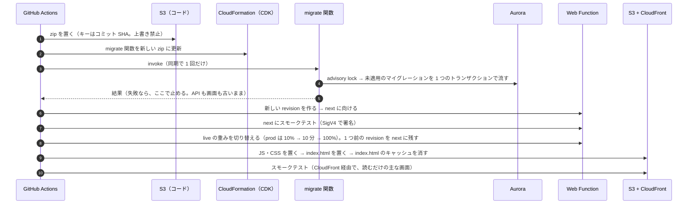
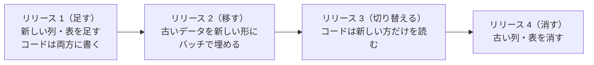

# 本番環境（AWS）の計画

このキットを顧客案件の本番に載せるときの、AWS の構成・デプロイの手順・マイグレーション（ALTER）の流し方・運用の計画です。

| 項目 | 内容 |
|---|---|
| 状態 | **計画**（AWS 側はまだ作っていません。ここにある構成はまだどこにも構築していません） |
| 最終更新 | 2026-11-15 |
| 前提 | リージョンは東京（ap-northeast-1）。画面は今の SPA、サーバーは `src/server` をそのまま使う |
| API の実行環境 | **AWS Lambda Web Functions**。制約に当たって載らないものだけを ECS on Fargate で動かす（[Fargate を使うとき](#fargate-を使うとき)） |
| このリポジトリで済んでいるもの | 構成図、この計画、マイグレーションの検査（`npm run check:migrations`、CI で実行） |

目次: [構成](#構成) / [設計の判断](#設計の判断) / [Fargate を使うとき](#fargate-を使うとき) / [環境](#環境) / [リポジトリに足すもの](#リポジトリに足すもの) / [デプロイ](#デプロイ) / [マイグレーション](#マイグレーション) / [運用](#運用) / [進め方](#進め方) / [未確定のこと](#未確定のこと)

## 構成


元の図は [`architecture/aws-production.drawio`](architecture/aws-production.drawio) です（draw.io で開いて編集し、「ファイル → エクスポート → PNG（拡大率 200%）」で同じ名前に書き出す）。

| 帯 | 置くもの | 役割 |
|---|---|---|
| Edge & Auth | Route 53、CloudFront、AWS WAF、S3、ACM、（Phase 4）Cognito | 1 つのドメインで画面と API を配る。`/*` は S3 の SPA、`/api/*` は Web Function へ。WAF でよくある攻撃と大量アクセスを止める |
| Compute | Lambda Web Function（API）、Network Connector、Lambda 関数（migrate）、VPC endpoint。必要なときだけ ECS on Fargate | API は Hono で `src/server/routes.ts` を登録した Node 24 の HTTP サーバー。Lambda が実行環境を用意して増減させる（使われないと 0 まで減る）。マイグレーションはデプロイの中で Lambda 関数を 1 回だけ呼んで流す |
| Data & Storage | Aurora PostgreSQL 18 Serverless v2、Secrets Manager、KMS、AWS Backup | Writer に読み書きを集め、Reader は別 AZ のフェイルオーバー先にする。DB の利用者はアプリ用とマイグレーション用に分ける |

リクエストの流れ:

1. 利用者が `https://app.example.com` を開くと、CloudFront が S3 から `index.html` と JS・CSS を返す（S3 は OAC で CloudFront からだけ読める）
2. 画面の `fetch('/api/...')` は同じドメインなので、CloudFront が Web Function の endpoint（`live`）に送る（CORS もクッキーの設定もいらない）。
   CloudFront はリクエストに SigV4 で署名し（OAC）、endpoint は署名のないリクエストを断る（`IamAuth`）。endpoint のドメインはインターネットから見えるが、直接たたいても WAF を迂回できない
3. Web Function は VPC の外（Lambda が管理する実行環境）で動き、外向きの通信だけを **Network Connector** で VPC のプライベートサブネットに出す。そこから Aurora の Writer に接続する
4. 外向きの通信はすべて VPC を通るので、Secrets Manager へは VPC endpoint で出る（NAT Gateway は置かない。ログは Lambda が標準出力から集めるので、VPC を通らない）

## 設計の判断

| 決めたこと | 選んだもの | 主な理由 | 選ばなかったもの |
|---|---|---|---|
| API の実行環境 | **Lambda Web Functions**（Node 24、Arm64） | `src/server` は Web 標準の `Request` / `Response` で書いてあり、Hono の HTTP サーバーをそのまま載せられる（アダプターがいらない）。1 つの実行環境が複数のリクエストを同時に受けるので、DB の接続プールを使い回せる。使わない間は 0 まで減り、課金は CPU を使った時間（DB の応答を待つ間は数えない）とメモリ | ECS on Fargate: 常に 2 タスク以上を動かし、ALB・VPC オリジン・ECR・イメージの管理が増える。[制約に当たったときだけ使う](#fargate-を使うとき)。Lambda（Event Functions）+ API Gateway: 1 つの実行環境が 1 リクエストずつなので接続数が増えやすく、RDS Proxy を前に置くことになる |
| マイグレーションの実行役 | Lambda 関数（Event Function、VPC 内、最大 15 分） | デプロイの手順から 1 回だけ同期で呼べ、成否が戻り値で分かる。API と同じ Node 24 のコードを使う | Web Function: HTTP で呼べる形にするとマイグレーションを外から起動できてしまう。Fargate の RunTask: 15 分を超えるものだけに使う |
| DB | Aurora PostgreSQL 18（Serverless v2） | ブラウザの PGlite 0.5 が **PostgreSQL 18.6** なので、プロトタイプと本番のメジャーバージョンがそろう。開発・検証環境は使わない間 0 ACU で止められる | RDS for PostgreSQL: 安いが、容量の自動調整とフェイルオーバーの速さで Aurora を選ぶ。Aurora DSQL: PostgreSQL 16 互換で、使えない機能があり、確かめ直しになる |
| 画面と API の入口 | CloudFront 1 つ（同じドメイン） | 画面の API の向き先は既定で `/api` なので、ビルドの設定がいらない。WAF も 1 か所でよい。Web Function の endpoint は独自ドメインと WAF を直接付けられないので、どのみち前に置く | API 用に別ドメイン: CORS とクッキーの設定が増える |
| CloudFront 以外から呼ばせない | endpoint を `IamAuth` にし、CloudFront の OAC で署名する。Web Function のリソースポリシーで、このディストリビューションだけに `lambda:InvokeWebFunctionEndpoint` を許す | 署名のないリクエストは Lambda が断るので、アプリに合言葉を持たせなくてよい。POST・PUT・PATCH は本文を署名に含めない方式（`UNSIGNED-PAYLOAD`）で CloudFront が署名するので、画面は何も変えなくてよい | `ApplicationManaged`（公開）+ 合言葉のヘッダー: 設定の漏れで迂回される |
| 外への通信 | Network Connector + VPC endpoint（Secrets Manager）だけ。NAT なし | API は外部の API を呼ばない。出口がないので、乗っ取られても外へ送りにくい | NAT Gateway: 外部の API を呼ぶようになったら足す（Connector を付けると外向きの通信はすべて VPC を通るため） |
| DB の認証 | Secrets Manager のパスワード（利用者ごと）。アプリが起動後に読み出す | 環境変数に置くと、revision の設定を読める人に平文で見える。1 秒あたりの新しい接続数の上限もない | IAM 認証: 新しい接続の数に上限があり、実行環境が増減するたびに接続を作り直すこの構成とは合わない |
| リリースと戻し方 | revision と endpoint の重みはデプロイの手順（AWS CLI）で動かす。`next`（確認用）で確かめてから `live` を切り替え、1 つ前の revision を `next` に残す | 戻すのが「重みを前の revision に戻す」1 回の操作で済み、作り直しを待たない（数秒）。公式のベストプラクティスも、本番は重みを手で動かし、戻し先の revision を endpoint に残すこと | CDK の `WebFunction`（L2）だけで出す: デプロイのたびに前の revision を消すので、戻すには前のコードで作り直す（数分）。重みを CloudFormation で持つと、次の `cdk deploy` が手で戻した重みを上書きする |
| IaC | AWS CDK（TypeScript） | アプリと同じ言語で書け、型で間違いに気づける。Web Function・Network Connector・リソースポリシーも CloudFormation のリソースがある | Terraform: チームに知見があるなら差し替えてよい |
| CI/CD | GitHub Actions（OIDC で AWS に入る） | 今の CI をそのまま伸ばせる。長期のアクセスキーを持たない | CodePipeline: GitHub の承認・レビューと二重になる |
| 認証 | Phase 4 で Amazon Cognito | 画面のログインは Cognito のマネージドログイン、API は JWT を検証する（Hono のミドルウェア） | endpoint の `IamAuth` で利用者を見分ける: 利用者ごとの IAM の資格情報が要り、画面から扱いにくい（`IamAuth` は CloudFront を通ったかの確認だけに使う） |

> **認証を入れる前に、本番のデータを載せて公開しないでください。** 今の API には「誰が呼んだか」がありません（README の「まだ入っていないもの」）。
> 認証が間に合わないときは、WAF で社内の IP アドレスだけを通すなど、入口で絞ってから使い始めます。

Web Functions の主な制約（[Lambda のクォータ](https://docs.aws.amazon.com/lambda/latest/dg/gettingstarted-limits.html)）と、このアプリでの扱い:

| 制約 | 値 | このアプリ |
|---|---|---|
| ランタイム | Node.js 24（`nodejs24.x`）、Arm64 のみ | 既存のテスト 130 件が Node 24.22 で通ることを確かめた。CI も Phase 1 で 22 から 24 に上げる。ネイティブモジュールは使っていない（`pg` は JS だけ） |
| 1 リクエストの時間 | 既定 30 秒（3〜900 秒） | 30 秒のまま。DB 側でもアプリ用の利用者に `statement_timeout = '20s'` を付け、リクエストより先に SQL を止める |
| 1 つの実行環境 | 2 vCPU・2 GB、同時 64 リクエスト（1〜128）、`/tmp` 512 MB | I/O が中心で足りる。CPU を長く使う処理（大きなファイルの生成など）は入れない |
| 起動 | 10 秒以内に `AWS_LAMBDA_HTTP_ENDPOINT` で listen する | DB には最初のリクエストでつなぐ。試作で 0.15 秒（後述） |
| 止まるとき | `SIGTERM` のあと 1 秒 | 接続プールを閉じて終わる。試作で 12 ms。閉じきれなかった接続は DB 側の `idle_session_timeout` が消す |
| 状態 | 実行環境はいつ消えてもよい。同じ利用者のリクエストが同じ環境に来るとは限らない | `src/server` はモジュールの変数に状態を持たない（確かめた）。状態はすべて DB |
| コード | S3 の zip（展開後 512 MB まで）。コンテナイメージは使えない | esbuild で 1 ファイル（試作で 1.7 MB）にまとめる |
| 通信 | HTTP/1.1。WebSocket は使えない（SSE は使える）。endpoint は常にインターネットから見える（PrivateLink は使えない） | WebSocket は使っていない。入口を閉じたネットワークだけにする必要が出たら、[Fargate に切り替える](#fargate-を使うとき) |
| VPC | Network Connector は `HomeRegion` の endpoint だけ | 東京だけで動かす（マルチリージョンにしない） |
| 規模 | endpoint あたり 10,000 RPS、アカウント・リージョンあたり Arm64 の vCPU 2,000（実行環境 1,000 個分） | 十分。実行環境の上限（`maxEnvironments`）は DB の接続数から決める（[環境](#環境)） |

## Fargate を使うとき

API も、マイグレーションも、まず Lambda で動かします。次の表の「Lambda のままにする工夫」でも足りないときだけ、その処理を ECS on Fargate で動かします。
Fargate は最初は作りません（ECR・タスク定義・ECR と CloudWatch Logs の VPC endpoint も、必要になったときに足す）。

| 当たる制約 | 例 | Lambda のままにする工夫 | それでも足りなければ |
|---|---|---|---|
| 1 つの SQL が 15 分で終わらない | 大きな表への `CREATE INDEX CONCURRENTLY`（事前の SQL） | [リハーサル](#リハーサル)で時間を測る。実行役の `statement_timeout` は 10 分 | リハーサルで 10 分を超えたものは、同じコードを Fargate の RunTask で流す |
| たくさんの行の書き換えが 15 分で終わらない | 列を移すバッチ | ID の範囲で区切り、1 回の呼び出しを 15 分に収め、何度も呼ぶ（何度流しても同じ結果になるように書く） | 区切れないものは Fargate の RunTask |
| 1 リクエストが 900 秒を超える・CPU やメモリが足りない | 大きな CSV・PDF の生成、画像の変換 | 非同期にする（受け付けて ID を返し、Lambda 関数で作って S3 に置き、画面は状態を見に来る） | 2 vCPU・2 GB を超える、15 分を超える、OS のパッケージやヘッドレスブラウザが要るものは Fargate のタスク |
| 双方向の常時接続 | WebSocket でのリアルタイムな共同編集 | 片方向で足りるなら SSE（Web Functions で使える）。双方向なら API Gateway の WebSocket API | 接続を持ち続けるサーバーが要るなら Fargate |
| API の入口をインターネットに置けない | 閉域網だけで使う、PrivateLink で受けることが求められる | — | 前の案の構成にする: CloudFront の VPC オリジン（または閉域からの直接の接続）→ 内部 ALB → ECS on Fargate。`src/server` と `server/app.ts` はそのまま使え、入口のファイル（listen の仕方）だけが変わる |
| DB の接続数が足りない | 実行環境の上限 × プールの上限が `max_connections` に近い | プールの上限を下げる。RDS Proxy を前に置く | （Fargate に移しても接続数の問題は同じなので、移す理由にはならない） |

Fargate で動かすときも、コード（`server/`）と DB の利用者（`migrator` / `app`）、Secrets Manager の読み方は同じです。違うのは、入れ物（zip ではなくコンテナイメージ）と起動の仕方だけです。

## 環境

AWS アカウントを環境ごとに分けます（間違えて本番を壊さない、権限と請求を分けられる）。値は最初の目安で、負荷試験のあとで見直します。

| | dev | stg | prod |
|---|---|---|---|
| 目的 | 開発者が自由に試す | 本番と同じ手順でデプロイを確かめる。マイグレーションのリハーサル | 本番 |
| デプロイ | 手動（`cdk deploy` と同じスクリプト） | `main` に入ったら自動 | GitHub Environments の承認のあと |
| Aurora | Writer のみ、0〜4 ACU（自動で一時停止） | Writer のみ、0〜8 ACU（自動で一時停止） | Writer + Reader（別 AZ）、1〜16 ACU（停止しない） |
| Web Function の実行環境の上限（`maxEnvironments`） | 2 | 5 | 20 |
| 接続プールの上限（1 つの実行環境あたり） | 5 | 10 | 10 |
| 新しい版の出し方 | `next` で確かめて `live` を切り替える | 同じ | 同じ。間に `live` の 10% を 10 分流す（カナリア） |
| 削除保護 | なし | あり | あり |
| バックアップ | 1 日 | 7 日 | 35 日（PITR）+ AWS Backup で月 1 回を 1 年 |
| ログの保存 | 7 日 | 30 日 | 90 日（長く残す決まりがあれば S3 へ書き出す） |

- **接続数**: 「`maxEnvironments` × プールの上限 + migrate（1）+ 運用（数本）」が Aurora の `max_connections`（最大 ACU で決まる）の 8 割を超えないようにします。prod は 20 × 10 = 200 本です。
  CDK で式にして、どれかを変えたら気づけるようにします。実行環境はリクエストが来ないと 0 まで減り、接続も一緒に減ります。
- 実行環境が 0 のときの最初のリクエストは、起動と DB への接続の分だけ遅くなります（stg で測り、[未確定のこと](#未確定のこと)で判断する）。
- 自動で一時停止した Aurora は、最初の接続から 15 秒ほどで戻ります。dev / stg では接続のタイムアウトを 15 秒より長くし、接続に失敗したらやり直すようにします。
- 本番の最小 ACU を 0 にしないのは、朝一番の利用者を 15 秒待たせないためです。

## リポジトリに足すもの

今のリポジトリには `src/server`（業務ロジック・ルート表・HTTP の境界）があり、サーバーの入口・ビルド・IaC はまだありません。Phase 1〜3 で次を足します。

```
server/
  index.ts          Web Function の入口。AWS_LAMBDA_HTTP_ENDPOINT の host:port で listen し、SIGTERM で接続プールを閉じる
  app.ts            Hono に src/server/routes.ts を登録する（README の例と同じ）。/api/readyz を足す
  db.ts             node-postgres の接続プール。パスワードは最初のリクエストで Secrets Manager から読む（後述）
  migrate.ts        マイグレーションの実行役（Lambda 関数のハンドラー。ローカルと Fargate 用に CLI としても動く）。事前 SQL（pre）も流せる
  log.ts            1 行 1 JSON のログ（ルート・状態コード・所要時間・ビルドの SHA。本文や個人情報は出さない）
scripts/
  build-server.mjs  esbuild で api/index.js と migrate/index.mjs にまとめ、zip にする
  deploy/           revision の作成・next での確認・live の切り替え・戻す（後述）。最初の endpoint を作る bootstrap
infra/              AWS CDK
  bin/app.ts        環境（dev / stg / prod）ごとにスタックを並べる
  lib/network.ts    VPC（3 AZ のプライベートサブネット）・VPC endpoint（Secrets Manager）
  lib/data.ts       Aurora・Secrets Manager・KMS・AWS Backup
  lib/api.ts        Web Function・Network Connector・実行ロール・コード用の S3・ロググループ・リソースポリシー・revision の設定（SSM パラメーター）
  lib/migrate.ts    migrate の Lambda 関数（API より先に更新するので、別のスタックにする）
  lib/edge.ts       CloudFront（OAC は S3 用と Lambda 用）・S3・WAF・CloudFront Function（SPA のパスを index.html に）・Route 53
  lib/ci.ts         GitHub OIDC の IDプロバイダーとデプロイ用の IAM ロール
  lib/monitoring.ts ダッシュボード・アラーム・SNS・チャット通知
.github/workflows/
  deploy.yml        main → stg、承認 → prod（後述の手順）
```

`src/server` は書き換えません。本物の PostgreSQL 18.6 に node-postgres でつなぎ、結合テスト（`src/**/*.integration.test.*`、78 件）を全部流して通ることを確かめてあります
（テスト用の DB の作り方だけを一時的に差し替えて確かめた。Phase 1 で `TEST_DATABASE_URL` を渡すと本物の PostgreSQL を使うようにし、CI でも流す）。

`server/index.ts` の試作を作り、Web Functions の決まりどおりに動くかを Node 24.22 と PostgreSQL 18.6 で確かめました（AWS の上ではまだ動かしていません）。

| 確かめたこと | 結果 |
|---|---|
| `AWS_LAMBDA_HTTP_ENDPOINT` の host:port で listen するまで（決まりは 10 秒以内） | 0.15 秒。DB にはまだつながない |
| 1 つの実行環境に 64 本を同時に送る（POST と GET を混ぜる） | 5xx なし。DB の接続は 10 本（プールの上限）を超えない |
| DB 側から待機中の接続を全部切る（フェイルオーバーの代わり） | プロセスは落ちず、ログを出し、次のリクエストは 200 |
| DB につながらない | listen はでき、`/api/readyz` は 503、API は中身を隠した 500 |
| `SIGTERM`（決まりは 1 秒以内） | 12 ms で終わり、接続は残らない |
| `ALTER ROLE ... SET idle_session_timeout` | 放置された接続を DB が切る |

サーバーで気をつけること:

- **listen の仕方**: `AWS_LAMBDA_HTTP_ENDPOINT`（`host:port`）を読み、その host と port で listen します（ポートを決め打ちしない、`localhost` に限らない）。
  ローカルでは変数がないので `127.0.0.1:3000` にします。

  ```ts
  const [hostname, port] = (process.env.AWS_LAMBDA_HTTP_ENDPOINT ?? '127.0.0.1:3000').split(':')
  serve({ fetch: app.fetch, hostname, port: Number(port) }) // @hono/node-server
  ```

- **DB には最初のリクエストでつなぐ**: listen の前に DB や Secrets Manager を待つと、10 秒の決まりと DB の一時停止（15 秒）が重なって起動に失敗します。
  同時に来た最初のリクエストが何本あっても準備は 1 回にし（Promise を共有する）、失敗したら次のリクエストでやり直します。`respond` は `Promise<Db>` を受け取れるので、`src/server` は変えません。
- **パスワード**: 環境変数には Secrets Manager の ARN だけを置き、値は起動後に読みます（revision の環境変数は、読める人に平文で見える）。
  読んだ値は 1 時間だけ使い回し、認証に失敗したら（`28P01`）読み直してプールを作り直します。AWS SDK はランタイムに入っていないので、バンドルに含めます。
- **接続プール**: 上限は環境ごとの表のとおり。使わない接続は 30 秒で閉じ（`idleTimeoutMillis`）、`pool.on('error', ...)` を必ず付けます（付けないと、待機中の接続が切れたときにプロセスが落ちる）。
- **止め方**: `SIGTERM` のあと 1 秒しかないので、`server.close()` と `pool.end()` を 0.5 秒だけ待って終わります。
  ハードウェアの障害などで後片付けが走らないこともあるので、DB 側でもアプリ用の利用者に `idle_session_timeout = '15min'` を付けておきます。
- **状態を持たない**: 1 つのプロセスが複数のリクエストを同時に処理します。リクエストごとの値をモジュールの変数に入れません（今の `src/server` にはない）。
- **ログ**: `console.log` の出力は Lambda が JSON にし、リクエスト ID（`lambda-web-request-id`）を付けて CloudWatch Logs に送ります。アプリはルートの形・状態コード・所要時間・ビルドの SHA を足します。
- **Node のバージョン**: Web Functions は Node 24 だけなので、CI とローカルも 24 にそろえます（Phase 1）。

## デプロイ

### 初回の構築（環境ごとに 1 回）

1. **アカウントと人の入り方**: dev / stg / prod のアカウントを用意し、人は IAM Identity Center から入る（IAM ユーザーとアクセスキーは作らない）。
2. **CDK の準備**: `npx cdk bootstrap aws://<アカウント>/ap-northeast-1 aws://<アカウント>/us-east-1`
   （CloudFront に付ける ACM の証明書と WAF は us-east-1 に作るため、両方のリージョンで行う）。
3. **ドメイン**: Route 53 のホストゾーンを用意し、`lib/edge.ts` で証明書（DNS 検証）とレコードを作る。
4. **基盤**: `npx cdk deploy <env>-Network <env>-Data`。Aurora の管理者のパスワードは RDS が Secrets Manager で管理し、ローテーションも任せる（`ManageMasterUserPassword`）。
5. **DB の利用者を作る（1 回だけ、管理者で）**: アプリ用（`app`）とマイグレーション用（`migrator`）を分ける。パスワードは CDK が Secrets Manager に作り、
   `db-bootstrap` 関数（Lambda 関数、管理者の秘密情報を読めるのはこの関数だけ）を 1 回呼んで次の SQL を流す。

   ```sql
   CREATE ROLE migrator LOGIN PASSWORD :'migrator_password';
   CREATE ROLE app LOGIN PASSWORD :'app_password';
   GRANT CONNECT ON DATABASE app TO migrator, app;
   GRANT CREATE ON DATABASE app TO migrator;            -- Drizzle は毎回 CREATE SCHEMA IF NOT EXISTS "drizzle" を流すので必要
   GRANT USAGE, CREATE ON SCHEMA public TO migrator;
   GRANT USAGE ON SCHEMA public TO app;
   -- migrator が作った表・連番に、app が読み書きできるようにする（DDL はできない）
   ALTER DEFAULT PRIVILEGES FOR ROLE migrator IN SCHEMA public GRANT SELECT, INSERT, UPDATE, DELETE ON TABLES TO app;
   ALTER DEFAULT PRIVILEGES FOR ROLE migrator IN SCHEMA public GRANT USAGE, SELECT ON SEQUENCES TO app;
   -- リクエスト（30 秒）より先に SQL を止める。後片付けされなかった接続を消す
   ALTER ROLE app SET statement_timeout = '20s';
   ALTER ROLE app SET idle_in_transaction_session_timeout = '30s';
   ALTER ROLE app SET idle_session_timeout = '15min';
   ```

   この権限で、`migrator` がマイグレーションを流せること、`app` が読み書きでき `DROP TABLE`・`ALTER TABLE`・`TRUNCATE` は拒否されることを、PostgreSQL 18.6 で確かめてあります。
   `GRANT CREATE ON DATABASE` がないと、`drizzle` スキーマがすでにあっても migrator は `permission denied for database` で失敗します。
6. **API**: `npx cdk deploy <env>-Api <env>-Migrate`。Web Function（名前だけ）・Network Connector・実行ロール・コード用の S3（バージョニングあり）・ロググループ（KMS）を作り、
   revision の設定（実行ロール、Network Connector のバージョン付きの ARN、環境変数、タイムアウト、ログの設定）を SSM パラメーターに書く。
7. **endpoint を作る（1 回だけ）**: `scripts/deploy/bootstrap.sh <env>` が最初の revision を作り、`live` と `next` の 2 つの endpoint（どちらも `HomeRegion`・`IamAuth`・自動デプロイなし）を作って、
   `live` のドメインを SSM パラメーターに書く。endpoint は CloudFormation で持ちません（重みをデプロイの手順で動かすため。[設計の判断](#設計の判断)）。
8. **入口**: `npx cdk deploy <env>-Edge`。CloudFront の `/api/*` のオリジンを `live` のドメインにし、Lambda 用の OAC（`lambda`・`always-amz-auth`・`sigv4`）を付ける。
   Web Function のリソースポリシーで、このディストリビューション（`aws:SourceArn` にディストリビューションの ARN。ID ではない）だけに `live` の呼び出しを許す。
   `/api/*` のキャッシュは無効にし、オリジンへは Host を除いたヘッダー・クッキー・クエリを送る（`AllViewerExceptHostHeader`。Host を送ると endpoint が 404 を返す）。
9. **GitHub**: `npx cdk deploy <env>-Ci` で OIDC の ID プロバイダーとデプロイ用ロールを作る。ロールの信頼ポリシーは、このリポジトリのその環境
   （`repo:<owner>/<repo>:environment:production` など）からだけ引き受けられるように絞る。GitHub Environments の `production` には承認者を設定する。
   デプロイ用ロールには `next` の呼び出し（スモークテスト）を許し、`live` は CloudFront だけにする。
10. 最初のリリースを、次の「いつものリリース」の手順で流す。

### いつものリリース

`main` に入ると stg へ自動で、承認すると prod へ同じ手順で入ります。順番に意味があり、入れ替えません。



1. **ビルド**: サーバー（`node scripts/build-server.mjs`。Arm64 の Node 24 で、esbuild で 1 ファイルにまとめて zip にする）と画面（`VITE_USE_MOCK=false npm run build`）。
   同じドメインで配るので `VITE_API_BASE` はいりません（既定で `/api`）。`check:no-mock-build` と同じ検査をここでも通す。
2. **zip を置く**: `s3://<コード用のバケット>/api/<SHA>.zip` と `migrate/<SHA>.zip`。同じキーに上書きしません（revision は S3 のオブジェクトのバージョンを指して作る）。
3. **migrate 関数を更新**: `npx cdk deploy <env>-Migrate -c buildSha=<SHA>`。API とは別のスタックなので、API はまだ古いままです。
4. **マイグレーション**: 同期で 1 回だけ呼び、関数のエラーと戻り値を確かめる。

   ```bash
   # 待ち時間は関数の最大（900 秒）より長くし、CLI のやり直しは止める（タイムアウトで 2 回流さない）
   AWS_MAX_ATTEMPTS=1 aws lambda invoke --function-name "$ENV-migrate" --payload '{"mode":"migrate"}' \
     --cli-binary-format raw-in-base64-out --cli-read-timeout 960 out.json > meta.json
   test "$(jq -r '.FunctionError // empty' meta.json)" = "" && test "$(jq -r .ok out.json)" = true
   ```

   migrate 関数は同時に 1 つしか動かないようにします（予約済みの同時実行数を 1。実行役の advisory lock と二重に防ぐ）。
5. **API の revision を作って確かめる**: `scripts/deploy/release.sh <env> <SHA>`。

   ```bash
   CFG=$(aws ssm get-parameter --name "/app/$ENV/api/revision-config" --query Parameter.Value --output text)
   VER=$(aws s3api head-object --bucket "$BUCKET" --key "api/$SHA.zip" --query VersionId --output text)
   NEW=$(aws lambda-web create-web-function-revision --function-name "$FN" \
     --build-config "{\"codeConfig\":{\"s3Object\":{\"bucket\":\"$BUCKET\",\"key\":\"api/$SHA.zip\",\"versionId\":\"$VER\"}},\"runtimeConfig\":{\"runtime\":\"nodejs24.x\"}}" \
     --service-config "$(jq -c --arg sha "$SHA" '.environmentVariables.BUILD_SHA = $sha' <<<"$CFG")" \
     --query revisionId --output text)
   aws lambda-web wait web-function-revision-active --function-name "$FN" --revision-id "$NEW"
   OLD=$(aws lambda-web get-web-function-endpoint --function-name "$FN" --endpoint-name live --query 'revisionWeights[0].revisionId' --output text)
   aws lambda-web update-web-function-endpoint --function-name "$FN" --endpoint-name next --revision-weights "[{\"revisionId\":\"$NEW\",\"weight\":100}]"
   aws lambda-web wait web-function-endpoint-updated --function-name "$FN" --endpoint-name next
   node scripts/deploy/smoke.mjs "https://$NEXT_DOMAIN"   # SigV4（サービス名 lambda）。X-Amz-Content-SHA256 ヘッダーが必須
   ```

   revision は起動に失敗しても `Active` になります。必ず `next` に実際のリクエスト（`/api/readyz` と、データを変えない主な GET）を送って確かめます。
   新しい revision は前の設定を引き継がないので、設定はいつも SSM パラメーターの全体から作ります（環境変数やタイムアウトを落とさない）。
6. **live を切り替える**: stg はそのまま 100%。prod は 10% を 10 分流し、5xx の割合のアラームが鳴らなければ 100% にします。
   Web Functions の標準のメトリクスには revision の区別がないので、カナリアの間はログの `BUILD_SHA` ごとの 5xx の数も見ます。
   切り替えたら `next` を 1 つ前の revision に向けます（戻し先を残す。どの endpoint からも使われない古い revision は、50 個を超えると自動で消える）。

   ```bash
   aws lambda-web update-web-function-endpoint --function-name "$FN" --endpoint-name live \
     --revision-weights "[{\"revisionId\":\"$OLD\",\"weight\":90},{\"revisionId\":\"$NEW\",\"weight\":10}]"   # prod のみ
   aws lambda-web update-web-function-endpoint --function-name "$FN" --endpoint-name live --revision-weights "[{\"revisionId\":\"$NEW\",\"weight\":100}]"
   aws lambda-web update-web-function-endpoint --function-name "$FN" --endpoint-name next --revision-weights "[{\"revisionId\":\"$OLD\",\"weight\":100}]"
   ```

   endpoint の更新は非同期なので、1 回ごとに `aws lambda-web wait web-function-endpoint-updated` で終わるのを待ちます。
7. **画面**: ファイル名にハッシュが付いた JS・CSS（`assets/`）を先に置き、`index.html` を最後に置く。
   古いファイルは消しません。ビルドには後から読み込む JS（例: `assets/sheet-presentation-*.js`）があり、開いたままの画面が古いものを読みに来るためです。
   消すなら「直近の数回のビルドに含まれないもの」だけにします（日付で消すと、変わらずに使い続けているファイルまで消える）。

   ```bash
   aws s3 sync dist/assets "s3://$BUCKET/assets" --cache-control 'public,max-age=31536000,immutable'
   aws s3 sync dist "s3://$BUCKET" --exclude 'assets/*' --exclude index.html --exclude 404.html --cache-control 'public,max-age=300'
   aws s3 cp dist/index.html "s3://$BUCKET/index.html" --cache-control 'no-cache'
   aws cloudfront create-invalidation --distribution-id "$DIST" --paths /index.html
   ```

8. **スモークテスト**: CloudFront 経由で `/api/readyz` と、データを変えない主な画面を Playwright で開く。失敗したら通知し、prod への承認を止める。

画面の URL（`/projects/1` など）は、CloudFront Function でファイル名のないパスを `/index.html` に書き換えて返します（S3 のビヘイビアのビューワーリクエストに付ける）。
CloudFront の「カスタムエラーレスポンス」はディストリビューション全体に効き、API の 404（JSON）まで `index.html` に変えてしまうので使いません。
Web Function のオリジンには Lambda@Edge のオリジンリクエスト・オリジンレスポンスのトリガーを付けられません（OAC を使うとき）。

### 戻すとき

| 戻したいもの | やり方 | 前提 |
|---|---|---|
| API | `scripts/deploy/rollback.sh <env>`: `live` を `next` にある 1 つ前の revision に 100% で向ける（数秒。作り直さない） | 同じリリースの DB の変更が「足すだけ」であること（[互換性の決まり](#互換性の決まり)）。2 つ以上前に戻すときは、その SHA の zip から revision を作り直す |
| 画面 | 前のビルド（GitHub Actions の成果物に残す）の `index.html` を置き直し、キャッシュを消す | JS・CSS を消していないこと |
| DB のスキーマ | **戻しません。** 直すマイグレーションを足して前に進める | Drizzle に down マイグレーションはない |
| DB のデータ（誤って消した・壊した） | PITR で**別のクラスター**に復元し、必要な行を戻す（[運用](#データを誤って消した)） | バックアップの保存期間内であること |

戻し先の revision は、実行環境が 0 になっていることがあります。切り替えた直後のリクエストは起動を待つので、少し遅くなります。

## マイグレーション

スキーマの変更は、今と同じく `src/db/schema.ts` を直して `npm run db:generate -- --name <変更内容>` で `drizzle/` に SQL を足します。
ブラウザの PGlite も本番の Aurora も、同じ `drizzle/*.sql` を同じ Drizzle の処理（`dialect.migrate`）で流します。

### Drizzle の migrator の性質（確かめたこと）

drizzle-orm 0.45.4 のソースを読み、PostgreSQL 18.6 で動かして確かめました。運用の決まりは、ほとんどがここから来ています。

| 性質 | 何が起きるか | 決まり |
|---|---|---|
| 未適用のマイグレーションを **1 つのトランザクション**で流す | 2 本目が失敗すると 1 本目も戻る（中途半端に残らない） | 失敗したら直して流し直せばよい |
| 同じトランザクションなので、`CREATE INDEX CONCURRENTLY` は書けない | `cannot run inside a transaction block` で必ず失敗する | [事前の SQL](#索引を足す既存の表) に分ける。`check:migrations` が失敗にする |
| 同じトランザクションなので、enum に足した値をあとのマイグレーションで使えない | `unsafe use of new value` で失敗する（1 本ずつ流せば通る） | 値を足すデプロイと、使うデプロイを分ける |
| 適用済みかどうかは「最後に適用したものの `when` より新しいか」だけで決める | `when` が古いマイグレーションは**エラーにならず黙って飛ばされる** | [並行して作ったマイグレーション](#並行して作ったマイグレーション)。`check:migrations` が失敗にする |
| 適用済みのファイルの hash を照合しない | 適用済みのファイルを書き換えても、何も起きない（気づけない） | 適用済みのものは変えない。`check:migrations` が `main` との差を失敗にする |
| 同時に流すことを防がない | 2 つ同時に流すと、片方が `duplicate key` で失敗する | 実行役が advisory lock を取る（下記） |
| 毎回 `CREATE SCHEMA IF NOT EXISTS "drizzle"` を流す | スキーマがあっても、DB への `CREATE` 権限がないと失敗する | migrator に `GRANT CREATE ON DATABASE` |

`drizzle-kit check` も CI で流します。並行して作ったマイグレーションのスナップショットの衝突は見つけて失敗にしますが、
衝突を手で直して `when` の順番だけが崩れた状態では**警告を出すだけで成功します**（確かめた）。そのため `scripts/check-migrations.mjs` を足しました。

### 流し方（実行役）

マイグレーションはアプリの起動時には流しません（実行環境が同時にいくつも起動すると同時に流れる。失敗した環境が起動を繰り返す）。
デプロイの手順の中で、migrate 関数（Lambda 関数）を 1 回だけ同期で呼びます。実行役（`server/migrate.ts`、Phase 1 で作る）の中身:

```ts
import { drizzle } from 'drizzle-orm/node-postgres'
import { migrate } from 'drizzle-orm/node-postgres/migrator'
import pg from 'pg'
import { migratorDatabaseUrl } from './db' // Secrets Manager の migrator の秘密情報から作る
import { runPreSql } from './pre-sql' // drizzle/pre/*.sql をトランザクションの外で 1 文ずつ流す（後述の「索引を足す」）

const LOCK_ID = 727_001 // このアプリのマイグレーション用の固定値

export async function runMigrations(deadline: number) {
  for (let attempt = 1; ; attempt++) {
    // 接続は 1 本だけにする（advisory lock と SET はその接続にだけ効く）
    const client = new pg.Client({ connectionString: await migratorDatabaseUrl(), application_name: 'migrate', connectionTimeoutMillis: 30_000 })
    await client.connect()
    try {
      await client.query('SELECT pg_advisory_lock($1)', [LOCK_ID]) // 同時に流さない（2 つ目は 1 つ目が終わるのを待つ）
      await client.query(`SET lock_timeout = '5s'`) // ロックを待つ間、ほかの読み書きを止めない
      await client.query(`SET statement_timeout = '10min'`) // Lambda の 15 分より前に止める
      await migrate(drizzle(client), { migrationsFolder: './drizzle' })
      return { ok: true, attempts: attempt }
    } catch (e) {
      const code = (e as { cause?: { code?: string } }).cause?.code
      // 55P03 = lock_timeout。全体が戻っているので、待ってやり直してよい（残り時間があるときだけ）
      if (code !== '55P03' || attempt >= 5 || Date.now() + 5_000 * attempt + 11 * 60_000 > deadline) throw e
      await new Promise((r) => setTimeout(r, 5_000 * attempt))
    } finally {
      await client.end()
    }
  }
}

// Lambda 関数のハンドラー（ローカルと Fargate では同じ関数を CLI から呼ぶ）
export const handler = async (event: { mode: 'migrate' | 'pre' }, context: { getRemainingTimeInMillis(): number }) =>
  event.mode === 'pre' ? runPreSql(Date.now() + context.getRemainingTimeInMillis()) : runMigrations(Date.now() + context.getRemainingTimeInMillis())
```

migrate 関数は VPC のプライベートサブネットに置き（Lambda 関数の VPC の設定）、`migrator` の秘密情報だけを読めるようにします。タイムアウトは 900 秒、予約済みの同時実行数は 1 です。
`drizzle/` のフォルダーは zip に入れます（`migrationsFolder` は zip の中を指す）。

**`lock_timeout` が要る理由**（確かめたこと）: `ALTER TABLE` は一瞬で終わる変更でも、表の最も強いロックを取ります。
長いトランザクション（集計や、閉じ忘れた接続）がその表を読んでいる間、`ALTER` はロックを待ち、**その後ろに並んだ普通の `SELECT` まで止まります**。

| | ALTER | 後から来た SELECT |
|---|---|---|
| `lock_timeout` なし | 前のトランザクションが終わるまで待つ | 一緒に止まる（3 秒で打ち切った） |
| `lock_timeout = '1s'` | 1 秒であきらめて失敗する（`55P03`） | 待たずに返る |

あきらめたマイグレーションは全体が戻っているので、少し待ってやり直します。上のコード（待ち時間だけ短くしたもの）で、長いトランザクションが終わったあとの 2 回目に成功すること、
残り時間が足りなければやり直さずに失敗し、何も変わらないことを PostgreSQL 18.6 で確かめました。
5 回やり直しても通らないときは、`pg_stat_activity` で長いトランザクションを探します（[運用](#マイグレーションが失敗した)）。

### 互換性の決まり

`live` を切り替える間（prod のカナリアの 10 分も）は**新旧の API が同時に動き**、利用者の画面は**開いたままの古い JS** が新しい API を呼びます。
マイグレーションは API より先に流すので、次の 2 つを守ります。

1. **新しいスキーマで、1 つ前のバージョンの API が動くこと**（列を消す・名前を変える・型を変えるは、1 回のリリースではしない）
2. **新しい API が、1 つ前のバージョンの画面からのリクエストを受け付けること**（必須の項目を増やすときは、まず省略可で受ける）

壊す変更は「足す → 移す → 消す」（expand / contract）に分け、リリースをまたいで進めます。



Drizzle は `select()` でスキーマに書いた列を名前で並べます。列を消すマイグレーションを流したあとも古い API はその列を読もうとするので、
「コードから消すリリース」と「DB から消すリリース」は必ず分けます。

### ALTER の書き方

`check:migrations` は、新しく足したマイグレーションにこの表の「そのまま書くと危ないもの」があると、CI で警告を出します（失敗にはしない。レビューで判断する）。
「書き直す」はテーブル全体を新しいファイルに書き直すこと（その間は読み書きが止まる）で、20 万行の表で `relfilenode` が変わるかを見て確かめました。

| やりたいこと | そのまま書くと | 安全な書き方 |
|---|---|---|
| 列を足す（NULL 可、または定数の DEFAULT 付き） | 書き直さない。速い | そのまま。`now()` の DEFAULT も書き直さない（確かめた） |
| 列を足す（`gen_random_uuid()` など、行ごとに違う DEFAULT） | **書き直す** | NULL 可で足す → バッチで埋める → DEFAULT と NOT NULL を付ける |
| NOT NULL にする | 全行を読み終わるまで止まる | `ADD CONSTRAINT ... CHECK (col IS NOT NULL) NOT VALID` → 次のマイグレーションで `VALIDATE CONSTRAINT` → `SET NOT NULL` → CHECK を消す（有効な CHECK があると `SET NOT NULL` は表を読まない。確かめた） |
| 列の型を変える（`integer → bigint`、`text → varchar(500)` など） | **書き直す** | 新しい列を足して移す（名前の変更と同じ手順）。`varchar(n) → text` のように広げるだけなら書き直さない（確かめた） |
| 索引を足す（既存の表） | 作り終わるまで書き込みが止まる | [下記](#索引を足す既存の表) |
| 外部キー・CHECK を足す（既存の表） | 全行を確かめる間ロックを持つ | `NOT VALID` で足し、`VALIDATE CONSTRAINT` を別のマイグレーションにする（VALIDATE の間も読み書きはできる） |
| UNIQUE を足す（既存の表） | 索引を作り終わるまで書き込みが止まる | 事前の SQL で `CREATE UNIQUE INDEX CONCURRENTLY`、マイグレーションで `ADD CONSTRAINT ... UNIQUE USING INDEX` |
| enum に値を足す | 同じデプロイの後続で使うと失敗する（確かめた） | 足すデプロイと、使う（DEFAULT にする・書き込む）デプロイを分ける。画面とサーバーの Zod スキーマも、使うリリースで足す |
| enum の値を消す | PostgreSQL にはできない（名前の変更はできる） | 新しい型を作って列を移す。値が増減しそうなものは、enum ではなく `text` + CHECK にしておく |
| 列・表を消す、名前を変える | 動いている古い API が壊れる | [互換性の決まり](#互換性の決まり)の 4 段階。drizzle-kit が「名前の変更か」と聞いてきたら、本番では「新しく作る」を選ぶ |
| たくさんの行を書き換える | 1 つの長いトランザクションになり、ロックが長くなる | マイグレーションに書かない。ID の範囲で少しずつ更新するバッチを、migrate と同じコードの Lambda 関数で、1 回 15 分に収まるように区切って何度も呼ぶ（何度流しても同じ結果になるように書く。区切れなければ [Fargate](#fargate-を使うとき)） |

自分で SQL を書くとき（`NOT VALID` の CHECK など）は、`npm run db:generate -- --custom --name <内容>` で空のマイグレーションを作って書きます。
生成された SQL は必ず読み、PR の説明に「ロックの種類と長さ」「1 つ前の API で動くか」を書きます。

#### 例: NOT NULL の列を足す（`tasks.estimate`）

| リリース | マイグレーション | コード |
|---|---|---|
| 1 | `ADD COLUMN estimate integer`（NULL 可） | 書くときは必ず値を入れる。読むときは NULL を許す |
| 2 | （バッチ）`UPDATE tasks SET estimate = 0 WHERE estimate IS NULL AND id BETWEEN ...` を少しずつ | 変更なし |
| 3 | `ADD CONSTRAINT tasks_estimate_nn CHECK (estimate IS NOT NULL) NOT VALID` → `VALIDATE CONSTRAINT` → `SET NOT NULL` → `DROP CONSTRAINT tasks_estimate_nn` | スキーマに `.notNull()` を付ける |

#### 索引を足す（既存の表）

`CONCURRENTLY` はマイグレーションに書けないので、2 つに分けます。

1. **事前の SQL**（`drizzle/pre/<タグ>.sql`、何度流しても同じになるように書く）を、デプロイの手順でマイグレーションの前に流す（migrate 関数を `{"mode":"pre"}` で呼ぶ。トランザクションの外で 1 文ずつ流す。
   リハーサルで 10 分を超えたものは、同じコードを Fargate の RunTask で流す）

   ```sql
   CREATE INDEX CONCURRENTLY IF NOT EXISTS "tasks_due_date_idx" ON "tasks" ("due_date");
   ```

2. **マイグレーション**は drizzle-kit が生成したものに `IF NOT EXISTS` を足す。本番ではすでにあるので何もせず、ブラウザの PGlite とテストの DB ではここで作られる

   ```sql
   CREATE INDEX IF NOT EXISTS "tasks_due_date_idx" ON "tasks" USING btree ("due_date");
   ```

この 2 段で通ることを PostgreSQL 18.6 で確かめてあります。`CONCURRENTLY` が途中で失敗すると**使えない索引（INVALID）が残り、`IF NOT EXISTS` はそれを「ある」とみなします**。
事前の SQL を流す前に `SELECT indexrelid::regclass FROM pg_index WHERE NOT indisvalid` で探し、あれば `DROP INDEX CONCURRENTLY` してから流し直します（実行役で自動にする）。

### 並行して作ったマイグレーション

ブランチ A と B が同じ `main` から別々にマイグレーションを作り、**B の方が先に生成した（`when` が小さい）のに、A が先にマージされた**場合です。
B をそのままマージすると、本番（A まで適用済み）では **B のマイグレーションが黙って飛ばされます**（列が増えないまま、API がその列を読んで 500 になる）。
これを PostgreSQL 18.6 で再現し、`check:migrations` が失敗にすることを確かめました。

直し方は 1 つだけです。**`main` にマイグレーションが入ったら、自分のマイグレーションを消して作り直す。**

```bash
git fetch origin && git rebase origin/main      # drizzle/meta がぶつかったら、いったんどちらでもよいので解決して進める
git checkout origin/main -- drizzle/meta        # スナップショットと _journal.json を main の状態に戻す
git rm drizzle/<自分のマイグレーション>.sql      # 自分の SQL を消す（スキーマの変更 src/db/schema.ts は残す）
npm run db:generate -- --name <変更内容>        # main の最新のあとに、新しい番号と when で作り直される
npm run check:migrations
```

自分のスナップショットは、分岐元の次の番号（main に入ったものと同じ番号）なので、`git checkout origin/main -- drizzle/meta` で main のものに置き換わります。

`main` にマージしたマイグレーションは「適用済み」として扱い、書き換えません（stg には `main` に入った時点で流れています）。間違えていたら、直すマイグレーションを足します。

### リハーサル

次のどれかに当たるマイグレーションは、prod に流す前に、**prod の Aurora のクローン**で流して時間とロックを測ります。

- `check:migrations` が警告を出したもの
- 10 万行を超える表への ALTER、バッチでの書き換え

Aurora のクローンは書き込みのあった分だけ容量を使う（copy-on-write）ので、数分で作れて、終わったら消します。stg のデータは少ないので、時間の見積もりには使えません。

測った時間で、どこで流すかを決めます。マイグレーションも事前の SQL も、1 文が 10 分（実行役の `statement_timeout`）を超えるなら Lambda 関数では流せないので、Fargate の RunTask で流します（[Fargate を使うとき](#fargate-を使うとき)）。

### 失敗したとき

| 起きたこと | 状態 | やること |
|---|---|---|
| `lock_timeout` で 5 回失敗した | 何も変わっていない。API は古いまま | 長いトランザクションを探して終わらせ（[運用](#マイグレーションが失敗した)）、デプロイをやり直す |
| SQL のエラー（型の誤りなど） | 何も変わっていない（全体が戻る） | 直す PR を出す。適用されていないので、同じマイグレーションを書き換えてよい（stg で流れていなければ） |
| stg では通り、prod で失敗した | prod は何も変わっていない。stg は適用済み | 書き換えない。直すマイグレーションを足し、stg と prod の両方に流す |
| 事前の SQL（CONCURRENTLY）が途中で失敗した | INVALID の索引が残る | 上の手順で消してから流し直す |
| マイグレーションは通ったが、新しい API が動かない | スキーマは新しい。新しい API は `next` の確認で止まり、`live` は古いまま（`live` に出したあとなら `rollback.sh` で戻す） | 互換性の決まりを守っていれば、古い API のまま動く。直して出し直す |

### ブラウザの PGlite との違い

- メジャーバージョン（18）をそろえます。PGlite を上げたら、Aurora のメジャーバージョンアップを計画します（逆も）。
- 拡張機能（`pg_trgm` など）を使うときは、PGlite と Aurora の両方にあるかを確かめてから使います。
- この節の決まり（`when` の順番、適用済みのファイルを変えない）は、デモサイトの利用者の IndexedDB にある DB にも同じように効きます。

## 運用

### 監視とアラーム

アラームは「利用者が困っているか」と「このままだと困るか」に絞り、SNS からチャット（Amazon Q Developer in chat applications、Slack）へ送ります。
しきい値は最初の目安で、1 か月動かしてから見直します。

| 見るもの | アラームの条件（目安） | 鳴ったら |
|---|---|---|
| Web Function: 5xx の割合（`HTTPResponseStatusClass5XX` ÷ `ExecutedRequests`。5xx は 0 件のときに値が出ないので `FILL(m5xx, 0)` で 0 にする） | 5 分間で 1% を超える | ログで `level=error` を見る。直前にデプロイしていれば `rollback.sh` |
| API の応答時間（p95。アプリが埋め込みメトリクス形式（EMF）でログに出す所要時間。Web Functions の標準のメトリクスには応答時間がない） | 5 分間 1 秒を超える | Database Insights で遅い SQL を探す。ACU が上限に張り付いていないか |
| 起動の失敗（ログの `platform.initReport` が `status: failure`） | 1 回でも | 新しい revision なら戻す。revision は起動に失敗しても `Active` になるので、ここで気づく |
| スロットリング（`AWS/Lambda/Web/Usage` の `EndpointActiveEnvironmentThrottles`・`AccountActiveVCPUArm64Throttles`。429 を返した数） | 1 回でも | 実行環境の上限（`maxEnvironments`）かアカウントの vCPU の上限に届いた。上げるなら DB の接続数と一緒に見直す |
| 実行環境の数（`EndpointActiveEnvironments`） | 15 分間、`maxEnvironments` の 80% を超える | 上限に近い。同時に処理しているリクエスト数（`EnvironmentConcurrentRequests`）と一緒に見る |
| 実行環境のメモリ（`EnvironmentMaxMemoryUsage`） | 1.6 GB を超える（上限は 2 GB） | メモリの漏れか、大きな応答を作っていないか |
| Aurora: ACU の使用率 | 15 分間、最大 ACU の 80% を超える | 最大 ACU を上げる、遅い SQL を直す |
| Aurora: 接続数 | `max_connections` の 80% を超える | `maxEnvironments` × プールの上限を見直す。閉じられていない接続がないか（`application_name` ごとに数える） |
| Aurora: デッドロック | 1 回でも | ログの SQL を見て、更新の順番をそろえる |
| CloudFront: 5xx の割合 | 5 分間で 1% を超える | オリジン（Web Function）側か、CloudFront 側かを切り分ける。403 が急に増えたら OAC かリソースポリシーの設定を疑う |
| アプリのログ: 想定外の例外 | `respond` の 500（`console.error`）が 5 分で 10 件 | スタックトレースを見る（利用者には中身を見せていない） |
| 画面: JS のエラー | CloudWatch RUM のエラー数が普段の 3 倍 | `src/lib/report-error.ts` から RUM へ送る（Phase 1 で足す） |
| デプロイ: migrate の失敗 | migrate 関数がエラーを返す | パイプラインが止まり通知する。[マイグレーションが失敗した](#マイグレーションが失敗した) |
| 費用 | AWS Budgets で月の予算の 80% | Cost Explorer でサービスごとに見る |

Web Functions のメトリクスは 0 件の期間に値を出さないもの（5xx・スロットリング）があるので、アラームは「データがないときは正常」として扱います。

ダッシュボードは 1 枚にし、上から「利用者から見た状態（CloudFront・Web Function の状態コード）」「API（実行環境の数・同時リクエスト・スロットリング）」「DB（Aurora）」の順に並べます。

### ログ

- API は 1 行 1 JSON で出します: 時刻、リクエスト ID（Lambda が付ける `requestId`。応答ヘッダーの `lambda-web-request-id` と同じ）、メソッド、**ルートの形**（`/projects/:id/tasks`。実際の ID は別の項目）、状態コード、所要時間、ビルドの SHA。
- ロググループは `/aws/lambda/web/<関数名>` で、KMS のカスタマー管理キーで暗号化します。X-Ray のトレースは Web Functions では使えないので、リクエスト ID でたどります。
- 本文・クエリ文字列の検索語・メールアドレスは出しません。500 のときだけ、例外のメッセージとスタックトレースを出します。
- マイグレーションは、流したタグ・所要時間・やり直しの回数を出します。

### バックアップと復旧

| 目標 | 値（案） | どう実現するか |
|---|---|---|
| RPO（失ってよいデータ） | 5 分 | Aurora の継続的なバックアップ（PITR、35 日） |
| RTO（戻るまでの時間） | 2 時間 | PITR で新しいクラスターに復元し、アプリの接続先を切り替える（手順を stg で練習しておく） |
| 長期の保管 | 1 年 | AWS Backup で月 1 回のスナップショット |

**3 か月に 1 回、stg で復元の練習をします**（復元にかかった時間を測り、RTO を見直す）。練習していないバックアップは、戻せるかどうか分かりません。

### 手順書（ランブック）

#### デプロイが失敗した

1. GitHub Actions のどの手順で止まったかを見る。migrate より前なら、何も変わっていない。
2. `next` の確認で止まったら、`live` は古いまま。`live` を切り替えたあと（カナリアの間も）に異常なら、`rollback.sh <env>` で `next` にある 1 つ前の revision に戻す。
3. 画面のアップロードで止まったら、もう一度流す（何度流しても同じ結果になる）。

#### マイグレーションが失敗した

1. migrate 関数のログ（CloudWatch Logs）で、失敗した文とエラーコードを見る。
2. `55P03`（lock_timeout）なら、長いトランザクションを探す。

   ```sql
   SELECT pid, usename, application_name, state, now() - xact_start AS 経過, left(query, 120)
   FROM pg_stat_activity WHERE xact_start IS NOT NULL ORDER BY xact_start LIMIT 10;
   ```

   アプリの接続なら終わるのを待つ。閉じ忘れなら `SELECT pg_cancel_backend(pid)`（それでも残れば `pg_terminate_backend`）。そのあとデプロイをやり直す。
3. SQL のエラーなら、何も変わっていない。[失敗したとき](#失敗したとき)の表に従って直す。

#### DB がフェイルオーバーした

Writer が落ちると、Aurora は別 AZ の Reader を Writer にします。その間（数十秒）、API は 500 を返し、実行環境ごとの接続プールの古い接続は切れます。
node-postgres のプールは切れた接続を捨てて作り直すので、アプリの再起動はいりません（DB 側から接続を全部切って、次のリクエストが通ることを確かめた）。
ただし `pool.on('error', ...)` を必ず付けておきます（付けないと、待機中の接続が切れたときにプロセスが落ちる）。
終わったら、5xx が止まったことと、元の Writer が Reader として戻ったことを確かめます。

#### データを誤って消した

1. いつ消したかを、ログ（DELETE のリクエスト）と利用者の話から決める。
2. その少し前の時刻で、PITR で**新しいクラスター**に復元する（本番のクラスターは上書きしない）。
3. 復元したクラスターから必要な行だけを取り出し、本番に入れ直す（ID がぶつからないか、関連する行も含めて確かめる）。
4. 全体を戻すしかないときは、アプリの接続先を復元したクラスターに切り替える。それ以降に書かれたデータは失われるので、利用者に知らせてから行う。

#### DB に直接入る

ふだんは入りません。調べ物や障害の対応で必要なときは、**CloudShell の VPC 環境**から、読み取り専用の利用者（Phase 2 で作る）でつなぎます。
管理者のパスワードは、手順書に書いた承認を得てから Secrets Manager で取り出し、使い終わったらローテーションします。

#### 秘密情報のローテーション

- 管理者: RDS が管理し、自動でローテーションする。
- `app` / `migrator`: Secrets Manager のローテーションで、2 つの利用者を交互に使う方式にする（切り替えの瞬間に接続が切れない）。
  アプリは読んだパスワードを 1 時間だけ使い回し、認証に失敗したら読み直すので、ローテーションのあとに入れ替える作業はいりません
  （交互に使う方式では、前の利用者のパスワードも次のローテーションまで使える）。

#### DB のメジャーバージョンアップ

PGlite のメジャーバージョンが上がったら計画します。RDS の Blue/Green デプロイで新しいバージョンの環境を作り、stg で一通り確かめてから切り替えます。
アプリ側は、同じバージョンの PostgreSQL で結合テストを通してから進めます。

### セキュリティの基本

- アカウント全体: CloudTrail（全リージョン）、GuardDuty、Security Hub、IAM Access Analyzer を有効にする。
- 人は IAM Identity Center から入り、本番の権限は普段は読み取りだけにする。書き込みは承認つきで一時的に渡す。
- デプロイ用の IAM ロールは環境ごとに分け、GitHub の環境（`environment:production`）からだけ引き受けられるようにする。
- DB・S3・ログ・Secrets Manager は KMS で暗号化する。S3 はパブリックアクセスをすべて止め、CloudFront（OAC）からだけ読めるようにする。
- Web Function の endpoint は必ず `IamAuth` にする（`ApplicationManaged` は誰でも呼べる）。AWS Organizations の SCP で、`ApplicationManaged` の endpoint を作れないようにする。
- Web Function の実行ロールは、`app` の秘密情報の読み取りとログの書き込みだけにする。migrate 関数は `migrator` の秘密情報だけ。管理者の秘密情報は `db-bootstrap` 関数だけ。
- コード用の S3 はバージョニングを有効にし、zip を上書き・削除しない（戻し先の revision が読めなくなると `Failed` になる）。
- WAF: AWS のマネージドルール（よくある攻撃、既知の悪い入力、IP の評判）と、IP ごとの回数制限を付ける。最初の 2 週間は「数えるだけ」にして誤検知を見てから止める。
- 依存パッケージ: Dependabot と `npm audit`（Fargate を使うときは ECR のイメージスキャンも）。Node のランタイムのパッチは Lambda が自動で当てる（止められない）。

### 費用の考え方

金額は使い方で大きく変わるので、ここでは何で決まるかだけを挙げます（構築前に AWS Pricing Calculator で見積もる）。

| 主な費用 | 決まり方 | 抑え方 |
|---|---|---|
| Aurora Serverless v2 | 動いている ACU × 時間、ストレージ、I/O | dev / stg は 0 ACU で一時停止。prod の最小 ACU は負荷を見て決める |
| Lambda Web Functions | CPU を使った時間（DB の応答を待つ間は数えない）、使ったメモリ、リクエスト数、転送量 | 使わない間は 0 まで減る。1 つの実行環境に同時に多くのリクエストを載せる（既定の 64）。CPU を長く使う処理を入れない |
| Lambda 関数（migrate） | 呼び出しの回数 × 時間 | デプロイのたびに 1 回だけ |
| VPC endpoint（Secrets Manager） | エンドポイント × AZ × 時間 | 使うのは Secrets Manager だけ。外部の API を呼ぶようになったら NAT Gateway と比べて決める |
| CloudFront・WAF | リクエスト数、転送量、ルールの数 | JS・CSS を長くキャッシュする |
| CloudWatch | ログの取り込み量、保存期間、アラームの数 | 1 リクエスト 1 行に絞る（アプリのログのレベルは `INFO`、Lambda のシステムログは `WARN`）。保存期間を決める |
| （使うときだけ）Fargate | vCPU とメモリ × タスクが動いた時間。ECR と、そのための VPC endpoint | RunTask で流す間だけ動く |

## 進め方

上から順に進めます。各段階の「終わり」を満たしてから次へ進みます。

| 段階 | やること | 終わり |
|---|---|---|
| Phase 0（このブランチ） | 構成図、この計画、マイグレーションの検査（`check:migrations` を CI に追加）、Web Function の入口の試作（リポジトリには入れていない） | レビューで構成と決まりに合意する |
| Phase 1: サーバー | Node 24 にそろえる（CI・`.nvmrc`）、`server/`（Web Function の入口・migrate・readyz・ログ・止め方）、`scripts/build-server.mjs`、`TEST_DATABASE_URL` で本物の PostgreSQL 18 に結合テストを流す（CI のサービスコンテナ）、RUM への送信 | ローカルで `AWS_LAMBDA_HTTP_ENDPOINT` を渡して zip の中身が動き、結合テストが CI で通る |
| Phase 2: 基盤 | `infra/`（CDK）。dev に構築し、stg を作る。最初に、CloudFront（OAC）→ `IamAuth` の endpoint で GET と POST・PATCH・DELETE が通ること、直接の呼び出しが 403 になることを確かめる | stg で画面が開き、API が DB に読み書きできる |
| Phase 3: デプロイ | `deploy.yml`（OIDC、stg は自動、prod は承認）、`scripts/deploy/`（release・rollback・smoke）、戻す練習。実行環境が 0 からの最初のリクエストの遅さを測る | `main` へのマージだけで stg に出て、前の revision に数秒で戻せる |
| Phase 4: 認証 | Cognito、API の JWT の検証、「誰が呼んだか」をサーバー層に渡す、プロジェクトのメンバーで読み書きを制限 | ログインした人が、自分のプロジェクトだけを読み書きできる |
| Phase 5: 本番の開始 | prod の構築、アラームとダッシュボード、負荷試験（`maxEnvironments` とプールの上限を決める）、復元の練習、WAF の誤検知の確認、手順書の読み合わせ | 本番の利用者を受け入れる（認証が済むまでは IP で絞る） |

## 未確定のこと

| 項目 | 決め方 |
|---|---|
| ドメイン名と、社内の IP だけで使うのか、インターネットに公開するのか | 案件ごとに決める（WAF と認証の強さが変わる）。API の入口を閉域網だけにする必要があれば、[Fargate の構成](#fargate-を使うとき)にする |
| Aurora の最小・最大 ACU、`maxEnvironments`、プールの上限 | Phase 5 の負荷試験で決める |
| 実行環境が 0 からの最初のリクエストの遅さ | Phase 3 に stg で測る（試作の起動は 0.15 秒。これに AWS の起動と DB への接続が足される）。業務で困るなら、決まった時間に `/api/readyz` を呼んでおくなどを考える（Web Functions には最小の実行環境の数を決める設定がない） |
| Phase 4 で `Authorization` ヘッダーを使うときの CloudFront の設定 | GET・HEAD では、キャッシュポリシーに `Authorization` を入れないと CloudFront が外して送る（OAC の決まり）。`/api/*` 用のキャッシュポリシーを作る。クッキーで済ませるなら不要 |
| Aurora のストレージの種類（標準 / I/O-Optimized） | 1 か月動かして、I/O の費用の割合で決める |
| ログ・バックアップの保存期間 | 顧客の決まり（監査・個人情報）に合わせる |
| NAT Gateway の要否 | 外部の API（メール送信など）を呼ぶようになったら足す |
| 個人情報の扱い（メールアドレスなど） | 削除の依頼にどう応えるか、バックアップからいつ消えるかを決める |
| Aurora PostgreSQL 18 で Serverless v2 の自動一時停止が使えること | 構築時に確かめる（自動一時停止は 16.3 などの新しいバージョンで使える機能で、18 の資料はまだ確かめていない） |
| Lambda Web Functions は 2026-10 に一般提供が始まったばかり | Phase 2 で、この計画に書いた振る舞い（OAC と `IamAuth`、Network Connector、`next` と `live` の切り替え、起動に失敗した revision の見え方）を stg で 1 つずつ確かめてから進める |

## 参考

Lambda Web Functions:

- [AWS Lambda announces Lambda Web Functions](https://aws.amazon.com/about-aws/whats-new/2026/10/aws-lambda-web-functions/)（2026-10）、[Announcing AWS Lambda Web Functions（AWS News Blog）](https://aws.amazon.com/blogs/aws/announcing-aws-lambda-web-functions-for-fast-consistent-web-app-performance-anywhere/)
- [Lambda quotas（Lambda Web Functions）](https://docs.aws.amazon.com/lambda/latest/dg/gettingstarted-limits.html)（実行環境・リクエストの時間・endpoint・ネットワークの制約）
- [Lambda Web Function runtimes](https://docs.aws.amazon.com/lambda/latest/dg/web-functions-runtimes.html)（`nodejs24.x`、`AWS_LAMBDA_HTTP_ENDPOINT`、2 GB とヒープ）
- [Execution environment lifecycle](https://docs.aws.amazon.com/lambda/latest/dg/web-functions-env-lifecycle.html)（10 秒以内に listen、`SIGTERM` のあと 1 秒、0 まで減る）
- [Configuring networking for AWS Lambda Web Functions](https://docs.aws.amazon.com/lambda/latest/dg/web-functions-networking.html)（Network Connector、endpoint は常に公開、Host ヘッダー）
- [Lambda Web Function endpoint access control](https://docs.aws.amazon.com/lambda/latest/dg/web-functions-endpoint-access-control.html)（`IamAuth`、SigV4 のサービス名 `lambda`、`X-Amz-Content-SHA256`、CloudFront の OAC、SCP）
- [Restrict access to an AWS Lambda Web Function origin（CloudFront）](https://docs.aws.amazon.com/AmazonCloudFront/latest/DeveloperGuide/private-content-restricting-access-to-lambda-web.html)（`always-amz-auth`、`UNSIGNED-PAYLOAD`、`AllViewerExceptHostHeader`、Lambda@Edge の制約）
- [Deployment patterns](https://docs.aws.amazon.com/lambda/latest/dg/web-functions-deployment.html)、[Best practices for Lambda Web Functions](https://docs.aws.amazon.com/lambda/latest/dg/web-functions-best-practices.html)（重み・テスト用の endpoint・戻し先の revision を残す）
- [HTTP requests and responses](https://docs.aws.amazon.com/lambda/latest/dg/web-functions-http.html)、[Using CloudWatch metrics with Lambda Web Functions](https://docs.aws.amazon.com/lambda/latest/dg/web-functions-monitoring-metrics.html)
- [AWS CDK: aws-lambda（WebFunction・NetworkConnector）](https://docs.aws.amazon.com/cdk/api/v2/docs/aws-cdk-lib.aws_lambda-readme.html)（L2 は revision を 1 つしか持たず、重みは扱わない）、[AWS::Serverless::WebFunction（SAM）](https://docs.aws.amazon.com/serverless-application-model/latest/developerguide/sam-resource-webfunction.html)
- [serverless-patterns: lambda-web-cloudfront-oac](https://github.com/aws-samples/serverless-patterns/tree/main/lambda-web-cloudfront-oac)

そのほか:

- （Fargate に切り替えるとき）[Restrict access with VPC origins（CloudFront）](https://docs.aws.amazon.com/AmazonCloudFront/latest/DeveloperGuide/private-content-vpc-origins.html)
- （Fargate に切り替えるとき）[Introducing CloudFront Virtual Private Cloud (VPC) Origins](https://aws.amazon.com/blogs/networking-and-content-delivery/introducing-cloudfront-virtual-private-cloud-vpc-origins-shield-your-web-applications-from-public-internet/)
- [Amazon Aurora now supports PostgreSQL major version 18](https://aws.amazon.com/about-aws/whats-new/2026/06/amazon-aurora-postgresql-major-version-18/)（2026-06）
- [Scaling to Zero ACUs with automatic pause and resume for Aurora serverless](https://docs.aws.amazon.com/AmazonRDS/latest/AuroraUserGuide/aurora-serverless-v2-auto-pause.html)
- [Introducing scaling to 0 capacity with Amazon Aurora Serverless v2](https://aws.amazon.com/blogs/database/introducing-scaling-to-0-capacity-with-amazon-aurora-serverless-v2/)（再開は 15 秒未満）
- （Fargate に切り替えるとき）[Announcing Amazon ECS Express Mode](https://aws.amazon.com/about-aws/whats-new/2025/11/announcing-amazon-ecs-express-mode/)（2025-11）、[Extending Amazon ECS Express Mode](https://aws.amazon.com/blogs/containers/extending-amazon-ecs-express-mode-to-build-an-optimal-container-environment/)
- （Fargate に切り替えるとき）[Automate rollbacks for Amazon ECS rolling deployments with CloudWatch alarms](https://aws.amazon.com/blogs/containers/automate-rollbacks-for-amazon-ecs-rolling-deployments-with-cloudwatch-alarms/)
- （Fargate に切り替えるとき）[Extending deployment pipelines with Amazon ECS blue green deployments and lifecycle hooks](https://aws.amazon.com/blogs/containers/extending-deployment-pipelines-with-amazon-ecs-blue-green-deployments-and-lifecycle-hooks/)（カナリアやテスト用のトラフィックが要るようになったら、ローリング更新から移る）
- [IAM database authentication（Aurora）](https://docs.aws.amazon.com/AmazonRDS/latest/AuroraUserGuide/UsingWithRDS.IAMDBAuth.html)
- [Cloning a volume for an Amazon Aurora DB cluster](https://docs.aws.amazon.com/AmazonRDS/latest/AuroraUserGuide/Aurora.Managing.Clone.html)
- [CloudWatch Database Insights](https://docs.aws.amazon.com/AmazonCloudWatch/latest/monitoring/Database-Insights.html)（Performance Insights は 2026-07-31 で終了し、Database Insights に移った）
- [Connect to Private Amazon RDS PostgreSQL Database Using AWS CloudShell](https://docs.aws.amazon.com/hands-on/latest/connect-to-private-amazon-rds-for-postgresql-from-aws-cloudshell/connect-to-private-amazon-rds-postgresql-database-using-aws-cloudshell.html)
- [Create a Secrets Manager secret for an Amazon RDS / Aurora admin（ManageMasterUserPassword）](https://docs.aws.amazon.com/secretsmanager/latest/userguide/cfn-example_RDSsecret.html)
