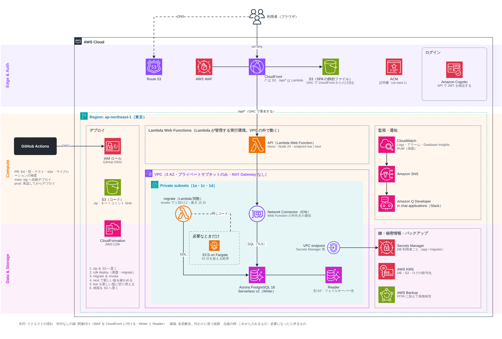
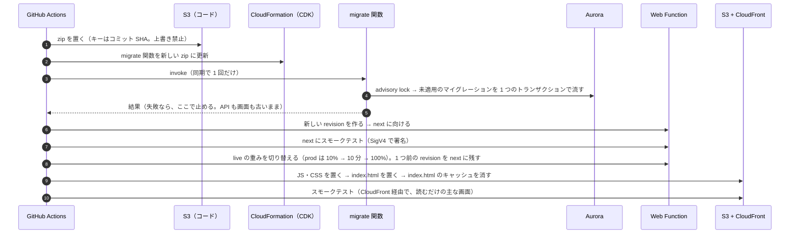
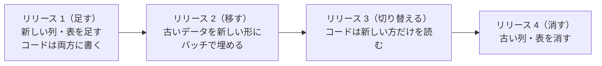

# 本番環境（AWS）

このキットを顧客案件の本番に載せるときの、AWS の構成・デプロイの手順・マイグレーション（ALTER）の流し方・運用です。

| 項目 | 内容 |
|---|---|
| 状態 | **実装済み・AWS へは未デプロイ**。サーバー・CDK・デプロイの手順・認証・監視・運用のスクリプトはリポジトリにあり、テストと CI で確かめてある。AWS の上で確かめることは[AWS の上でまだ確かめていないこと](#aws-の上でまだ確かめていないこと)にまとめた |
| 最終更新 | 2026-11-15 |
| 前提 | リージョンは東京（ap-northeast-1）。画面は今の SPA、サーバーは `src/server` をそのまま使う |
| API の実行環境 | **AWS Lambda Web Functions**。制約に当たって載らないものだけを ECS on Fargate で動かす（[Fargate を使うとき](#fargate-を使うとき)） |
| リポジトリにあるもの | `server/`（API の入口・マイグレーションの実行役・DB の利用者・ログイン）、`infra/`（CDK と、デプロイ・運用のスクリプト）、`.github/workflows/deploy*.yml`、`src/auth`（画面のログイン）、`scripts/build-server.mjs`・`load-test.mjs` |

目次: [構成](#構成) / [設計の判断](#設計の判断) / [Fargate を使うとき](#fargate-を使うとき) / [環境](#環境) / [リポジトリの中身](#リポジトリの中身) / [認証と認可](#認証と認可) / [デプロイ](#デプロイ) / [マイグレーション](#マイグレーション) / [運用](#運用) / [進め方](#進め方) / [AWS の上でまだ確かめていないこと](#aws-の上でまだ確かめていないこと) / [未確定のこと](#未確定のこと)

## 構成



元の図は [`architecture/aws-production.drawio`](architecture/aws-production.drawio) です（draw.io で開いて編集し、「ファイル → エクスポート → PNG（拡大率 200%）」で同じ名前に書き出す）。

| 帯 | 置くもの | 役割 |
|---|---|---|
| Edge & Auth | Route 53、CloudFront、AWS WAF、S3、ACM、（Phase 4）Cognito | 1 つのドメインで画面と API を配る。`/*` は S3 の SPA、`/api/*` は Web Function へ。WAF でよくある攻撃と大量アクセスを止める |
| Compute | Lambda Web Function（API）、Network Connector、Lambda 関数（migrate）、VPC endpoint。必要なときだけ ECS on Fargate | API は Hono で `src/server/routes.ts` を登録した Node 24 の HTTP サーバー。Lambda が実行環境を用意して増減させる（使われないと 0 まで減る）。マイグレーションはデプロイの中で Lambda 関数を 1 回だけ呼んで流す |
| Data & Storage | Aurora PostgreSQL 18 Serverless v2、Secrets Manager、KMS、AWS Backup | Writer に読み書きを集め、Reader は別 AZ のフェイルオーバー先にする。DB の利用者はアプリ用とマイグレーション用に分ける |

リクエストの流れ:

1. 利用者が `https://app.example.com` を開くと、CloudFront が S3 から `index.html` と JS・CSS を返す（S3 は OAC で CloudFront からだけ読める）
2. 画面の `fetch('/api/...')` は同じドメインなので、CloudFront が Web Function の endpoint（`live`）に送る（CORS もクッキーの設定もいらない）。
   CloudFront はリクエストに SigV4 で署名し（OAC）、endpoint は署名のないリクエストを断る（`IamAuth`）。endpoint のドメインはインターネットから見えるが、直接たたいても WAF を迂回できない
3. Web Function は VPC の外（Lambda が管理する実行環境）で動き、外向きの通信だけを **Network Connector** で VPC のプライベートサブネットに出す。そこから Aurora の Writer に接続する
4. 外向きの通信はすべて VPC を通るので、Secrets Manager へは VPC endpoint で出る（NAT Gateway は置かない。ログは Lambda が標準出力から集めるので、VPC を通らない）

## 設計の判断

| 決めたこと | 選んだもの | 主な理由 | 選ばなかったもの |
|---|---|---|---|
| API の実行環境 | **Lambda Web Functions**（Node 24、Arm64） | `src/server` は Web 標準の `Request` / `Response` で書いてあり、Hono の HTTP サーバーをそのまま載せられる（アダプターがいらない）。1 つの実行環境が複数のリクエストを同時に受けるので、DB の接続プールを使い回せる。使わない間は 0 まで減り、課金は CPU を使った時間（DB の応答を待つ間は数えない）とメモリ | ECS on Fargate: 常に 2 タスク以上を動かし、ALB・VPC オリジン・ECR・イメージの管理が増える。[制約に当たったときだけ使う](#fargate-を使うとき)。Lambda（Event Functions）+ API Gateway: 1 つの実行環境が 1 リクエストずつなので接続数が増えやすく、RDS Proxy を前に置くことになる |
| マイグレーションの実行役 | Lambda 関数（Event Function、VPC 内、最大 15 分） | デプロイの手順から 1 回だけ同期で呼べ、成否が戻り値で分かる。API と同じ Node 24 のコードを使う | Web Function: HTTP で呼べる形にするとマイグレーションを外から起動できてしまう。Fargate の RunTask: 15 分を超えるものだけに使う |
| DB | Aurora PostgreSQL 18（Serverless v2） | ブラウザの PGlite 0.5 が **PostgreSQL 18.6** なので、プロトタイプと本番のメジャーバージョンがそろう。開発・検証環境は使わない間 0 ACU で止められる | RDS for PostgreSQL: 安いが、容量の自動調整とフェイルオーバーの速さで Aurora を選ぶ。Aurora DSQL: PostgreSQL 16 互換で、使えない機能があり、確かめ直しになる |
| 画面と API の入口 | CloudFront 1 つ（同じドメイン） | 画面の API の向き先は既定で `/api` なので、ビルドの設定がいらない。WAF も 1 か所でよい。Web Function の endpoint は独自ドメインと WAF を直接付けられないので、どのみち前に置く | API 用に別ドメイン: CORS とクッキーの設定が増える |
| CloudFront 以外から呼ばせない | endpoint を `IamAuth` にし、CloudFront の OAC で署名する。Web Function のリソースポリシーで、このディストリビューションだけに `lambda:InvokeWebFunctionEndpoint` を許す | 署名のないリクエストは Lambda が断るので、アプリに合言葉を持たせなくてよい。POST・PUT・PATCH は本文を署名に含めない方式（`UNSIGNED-PAYLOAD`）で CloudFront が署名するので、画面は何も変えなくてよい | `ApplicationManaged`（公開）+ 合言葉のヘッダー: 設定の漏れで迂回される |
| 外への通信 | Network Connector + VPC endpoint（Secrets Manager）だけ。NAT なし | API は外部の API を呼ばない。出口がないので、乗っ取られても外へ送りにくい | NAT Gateway: 外部の API を呼ぶようになったら足す（Connector を付けると外向きの通信はすべて VPC を通るため） |
| DB の認証 | Secrets Manager のパスワード（利用者ごと）。アプリが起動後に読み出す | 環境変数に置くと、revision の設定を読める人に平文で見える。1 秒あたりの新しい接続数の上限もない | IAM 認証: 新しい接続の数に上限があり、実行環境が増減するたびに接続を作り直すこの構成とは合わない |
| リリースと戻し方 | revision と endpoint の重みはデプロイの手順（AWS CLI）で動かす。`next`（確認用）で確かめてから `live` を切り替え、1 つ前の revision を `next` に残す | 戻すのが「重みを前の revision に戻す」1 回の操作で済み、作り直しを待たない（数秒）。公式のベストプラクティスも、本番は重みを手で動かし、戻し先の revision を endpoint に残すこと | CDK の `WebFunction`（L2）だけで出す: デプロイのたびに前の revision を消すので、戻すには前のコードで作り直す（数分）。重みを CloudFormation で持つと、次の `cdk deploy` が手で戻した重みを上書きする |
| IaC | AWS CDK（TypeScript） | アプリと同じ言語で書け、型で間違いに気づける。Web Function・Network Connector・リソースポリシーも CloudFormation のリソースがある | Terraform: チームに知見があるなら差し替えてよい |
| CI/CD | GitHub Actions（OIDC で AWS に入る） | 今の CI をそのまま伸ばせる。長期のアクセスキーを持たない | CodePipeline: GitHub の承認・レビューと二重になる |
| 認証 | Amazon Cognito（[認証と認可](#認証と認可)） | 画面のログインは Cognito のマネージドログイン（認可コード + PKCE）、API は ID トークンを検証し、メールアドレスでメンバーにつなぐ | endpoint の `IamAuth` で利用者を見分ける: 利用者ごとの IAM の資格情報が要り、画面から扱いにくい（`IamAuth` は CloudFront を通ったかの確認だけに使う） |

> **prod は認証なしでは動きません**（`server/config.ts` が `AUTH_MODE=none` を断り、CDK も prod の認証なしを合成しない）。
> 公開する範囲を絞るときは、WAF で許す IP アドレスを決めます（`-c allowedCidrs.prod=203.0.113.0/24`。この CIDR 以外は、数えるだけの期間でも止める）。

Web Functions の主な制約（[Lambda のクォータ](https://docs.aws.amazon.com/lambda/latest/dg/gettingstarted-limits.html)）と、このアプリでの扱い:

| 制約 | 値 | このアプリ |
|---|---|---|
| ランタイム | Node.js 24（`nodejs24.x`）、Arm64 のみ | CI・`.nvmrc`・engines を 24 にした。ネイティブモジュールは使っていない（`pg` は JS だけ） |
| 1 リクエストの時間 | 既定 30 秒（3〜900 秒） | 30 秒のまま。DB 側でもアプリ用の利用者に `statement_timeout = '20s'` を付け、リクエストより先に SQL を止める |
| 1 つの実行環境 | 2 vCPU・2 GB、同時 64 リクエスト（1〜128）、`/tmp` 512 MB | I/O が中心で足りる。CPU を長く使う処理（大きなファイルの生成など）は入れない |
| 起動 | 10 秒以内に `AWS_LAMBDA_HTTP_ENDPOINT` で listen する | DB には最初のリクエストでつなぐ。ビルドした zip で 0.16〜0.19 秒（手元で 5 回） |
| 止まるとき | `SIGTERM` のあと 1 秒 | 接続プールを閉じて終わる。ビルドした zip で 7〜13 ms（手元で 5 回）。閉じきれなかった接続は DB 側の `idle_session_timeout` が消す |
| 状態 | 実行環境はいつ消えてもよい。同じ利用者のリクエストが同じ環境に来るとは限らない | `src/server` はモジュールの変数に状態を持たない（確かめた）。状態はすべて DB |
| コード | S3 の zip（展開後 512 MB まで）。コンテナイメージは使えない | esbuild で 1 ファイルにまとめる。`api.zip` は 1.3 MB（展開 6.2 MB。ソースマップと RDS の CA を含む） |
| 通信 | HTTP/1.1。WebSocket は使えない（SSE は使える）。endpoint は常にインターネットから見える（PrivateLink は使えない） | WebSocket は使っていない。入口を閉じたネットワークだけにする必要が出たら、[Fargate に切り替える](#fargate-を使うとき) |
| VPC | Network Connector は `HomeRegion` の endpoint だけ | 東京だけで動かす（マルチリージョンにしない） |
| 規模 | endpoint あたり 10,000 RPS、アカウント・リージョンあたり Arm64 の vCPU 2,000（実行環境 1,000 個分） | 十分。実行環境の上限（`maxEnvironments`）は DB の接続数から決める（[環境](#環境)） |

## Fargate を使うとき

API も、マイグレーションも、まず Lambda で動かします。次の表の「Lambda のままにする工夫」でも足りないときだけ、その処理を ECS on Fargate で動かします。
Fargate は最初は作りません（ECR・タスク定義・ECR と CloudWatch Logs の VPC endpoint も、必要になったときに足す）。

| 当たる制約 | 例 | Lambda のままにする工夫 | それでも足りなければ |
|---|---|---|---|
| 1 つの SQL が 15 分で終わらない | 大きな表への `CREATE INDEX CONCURRENTLY`（事前の SQL） | [リハーサル](#リハーサル)で時間を測る。実行役の `statement_timeout` は 10 分 | リハーサルで 10 分を超えたものは、同じコードを Fargate の RunTask で流す |
| たくさんの行の書き換えが 15 分で終わらない | 列を移すバッチ | ID の範囲で区切り、1 回の呼び出しを 15 分に収め、何度も呼ぶ（何度流しても同じ結果になるように書く） | 区切れないものは Fargate の RunTask |
| 1 リクエストが 900 秒を超える・CPU やメモリが足りない | 大きな CSV・PDF の生成、画像の変換 | 非同期にする（受け付けて ID を返し、Lambda 関数で作って S3 に置き、画面は状態を見に来る） | 2 vCPU・2 GB を超える、15 分を超える、OS のパッケージやヘッドレスブラウザが要るものは Fargate のタスク |
| 双方向の常時接続 | WebSocket でのリアルタイムな共同編集 | 片方向で足りるなら SSE（Web Functions で使える）。双方向なら API Gateway の WebSocket API | 接続を持ち続けるサーバーが要るなら Fargate |
| API の入口をインターネットに置けない | 閉域網だけで使う、PrivateLink で受けることが求められる | — | 前の案の構成にする: CloudFront の VPC オリジン（または閉域からの直接の接続）→ 内部 ALB → ECS on Fargate。`src/server` と `server/app.ts` はそのまま使え、入口のファイル（listen の仕方）だけが変わる |
| DB の接続数が足りない | 実行環境の上限 × プールの上限が `max_connections` に近い | プールの上限を下げる。RDS Proxy を前に置く | （Fargate に移しても接続数の問題は同じなので、移す理由にはならない） |

Fargate で動かすときも、コード（`server/`）と DB の利用者（`migrator` / `app`）、Secrets Manager の読み方は同じです。違うのは、入れ物（zip ではなくコンテナイメージ）と起動の仕方だけです。

## 環境

AWS アカウントを環境ごとに分けます（間違えて本番を壊さない、権限と請求を分けられる）。値は最初の目安で、負荷試験のあとで見直します。

| | dev | stg | prod |
|---|---|---|---|
| 目的 | 開発者が自由に試す | 本番と同じ手順でデプロイを確かめる。マイグレーションのリハーサル | 本番 |
| デプロイ | 手動（`cdk deploy` と同じスクリプト） | `main` に入ったら自動 | GitHub Environments の承認のあと |
| Aurora | Writer のみ、0〜4 ACU（自動で一時停止） | Writer のみ、0〜8 ACU（自動で一時停止） | Writer + Reader（別 AZ）、1〜16 ACU（停止しない） |
| Web Function の実行環境の上限（`maxEnvironments`） | 2 | 5 | 20 |
| 接続プールの上限（1 つの実行環境あたり） | 5 | 10 | 10 |
| 新しい版の出し方 | `next` で確かめて `live` を切り替える | 同じ | 同じ。間に `live` の 10% を 10 分流す（カナリア） |
| 削除保護 | なし | あり | あり |
| バックアップ | 1 日 | 7 日 | 35 日（PITR）+ AWS Backup で月 1 回を 1 年 |
| ログの保存 | 7 日 | 30 日 | 90 日（長く残す決まりがあれば S3 へ書き出す） |

- **接続数**: 「`maxEnvironments` × プールの上限 + migrate（1）+ 運用（数本）」が Aurora の `max_connections`（最大 ACU で決まる）の 8 割を超えないようにします。prod は 20 × 10 = 200 本です。
  CDK で式にして、どれかを変えたら気づけるようにします。実行環境はリクエストが来ないと 0 まで減り、接続も一緒に減ります。
- 実行環境が 0 のときの最初のリクエストは、起動と DB への接続の分だけ遅くなります（stg で測り、[未確定のこと](#未確定のこと)で判断する）。
- 自動で一時停止した Aurora は、最初の接続から 15 秒ほどで戻ります。dev / stg では接続のタイムアウトを 15 秒より長くし、接続に失敗したらやり直すようにします。
- 本番の最小 ACU を 0 にしないのは、朝一番の利用者を 15 秒待たせないためです。

## リポジトリの中身

```
server/                 本番の API（Lambda Web Function）とマイグレーションの実行役（Lambda 関数）。src/server をそのまま載せる
  index.ts              Web Function の入口（zip の index.js）。AWS_LAMBDA_HTTP_ENDPOINT の host:port で listen し、SIGTERM で 0.5 秒だけ待って終わる
  app.ts                Hono に src/server/routes.ts を登録する。/api/readyz、本文の上限（413）、1 リクエスト 1 行のログ、ログイン
  auth.ts               ID トークンの検証（aws-jwt-verify）。JWKS は環境変数で受け取る（認証と認可）
  config.ts             環境変数の読み方（足りない・おかしい値は起動時に止める。prod で認証なしにできない）
  db.ts・secrets.ts     接続プール（最初のリクエストでつなぐ、28P01 で秘密情報を読み直してプールを作り直す、RDS の CA で証明書を確かめる）
  log.ts                ログ（console にオブジェクトを渡す。Lambda が JSON の message に入れる）
  migrate.ts・pre-sql.ts・migrations.ts  マイグレーションの実行役（Lambda 関数のハンドラー。CLI としても動く）
  bootstrap.ts          DB の利用者を作る（db-bootstrap 関数）
  certs/                RDS の CA（global-bundle.pem）
scripts/
  build-server.mjs      esbuild で dist-server/api.zip（index.js）と migrate.zip（drizzle/ を含む）を作る。同じ中身なら同じバイト列（zip.mjs）
  load-test.mjs         負荷試験
infra/                  AWS CDK（Node 24 が TypeScript をそのまま動かす。npm は別）
  bin/app.ts・lib/      スタック（下の表）。lib/config.ts が環境ごとの値、lib/nag.ts が cdk-nag で認めたもの（理由つき）
  scripts/deploy/       upload・migrate・bootstrap・release・rollback・smoke・publish-web・web-env（デプロイの手順）
  scripts/ops/          restore-drill（復元の練習）
  test/                 テンプレートの決まり・cdk-nag・デプロイの手順・運用のスクリプト（node --test）
src/auth/               画面のログイン（認可コード + PKCE）。VITE_AUTH_MODE=cognito のビルドだけ
.github/workflows/      ci.yml（check・integration-postgres・infra・e2e）、deploy.yml・deploy-env.yml（AWS へのデプロイ）
```

| スタック（`<app>-<env>-`） | 中身 | リージョン |
|---|---|---|
| Network | VPC（3 AZ・app / db のサブネット・NAT なし）、Secrets Manager の VPC endpoint、セキュリティグループ、フローログ | 東京 |
| Data | Aurora PostgreSQL 18.6（Serverless v2）、KMS、パラメーター（`rds.force_ssl` など）、app / migrator / readonly の秘密情報とローテーション、AWS Backup（prod） | 東京 |
| Api | Web Function（入れ物）、Network Connector、実行ロール、コードのバケット、ロググループ（`.local` も）、revision の設定の SSM パラメーター | 東京 |
| Migrate | migrate 関数・db-bootstrap 関数（コードは `migrate/<SHA>.zip`） | 東京 |
| EdgeGlobal | WAF の Web ACL、証明書（独自ドメインのとき） | us-east-1 |
| Edge | CloudFront（S3 と Web Function の OAC）、S3、CloudFront Function、Web Function のリソースポリシー、Route 53 | 東京 |
| Auth | Cognito（User Pool・admin グループ・マネージドログイン・公開クライアント） | 東京 |
| EdgeAlarms | CloudFront の 5xx のアラーム | us-east-1 |
| Monitoring | アラーム・ダッシュボード・ログのメトリクス・RUM・Budgets・Slack への通知 | 東京 |
| Ci | GitHub OIDC と、環境ごとのデプロイ用ロール | 東京 |

`src/server` は、読み書きの制限（[認証と認可](#認証と認可)）のために各関数が `access` を受け取るようにした以外は変えていません。
結合テスト（`src/**/*.integration.test.*`）は、`TEST_DATABASE_URL` を渡すと本物の PostgreSQL に流れます（CI の integration-postgres は `postgres:18.6`）。

ビルドした zip を展開して Node 24.22 で動かし、Web Functions の決まりどおりに動くかを確かめています（`server/bundle.pg.test.ts`。AWS の上ではまだ動かしていない）。

| 確かめたこと | 結果 |
|---|---|
| `AWS_LAMBDA_HTTP_ENDPOINT` の host:port で listen するまで（決まりは 10 秒以内） | 2 秒以内（テストの上限）。DB にはまだつながない（接続 0） |
| 1 つの実行環境に 64 本を同時に送る（POST と GET を混ぜる） | 5xx なし。DB の接続はプールの上限（10）を超えない |
| DB 側から待機中の接続を全部切る（フェイルオーバーの代わり） | プロセスは落ちず、次のリクエストは通る（`server/db.pg.test.ts`） |
| DB のパスワードが変わる（ローテーション） | 失敗した 1 本は 500、次からは読み直したパスワードで通る |
| DB につながらない | listen はでき、`/api/readyz` は 503、API は中身を隠した 500 |
| `SIGTERM`（決まりは 1 秒以内） | 1 秒以内に終了コード 0、接続は残らない |
| ログイン（`AUTH_MODE=cognito`） | トークンなしは 401、メンバーでなければ 403、メンバーは自分のプロジェクトだけ。readyz はログインなし |

サーバーで気をつけること:

- **listen の仕方**: `AWS_LAMBDA_HTTP_ENDPOINT`（`host:port`。IPv6 は `[::1]:8080`）を読み、その host と port で listen します。ローカルでは `127.0.0.1:3000`。
- **DB には最初のリクエストでつなぐ**: listen の前に DB や Secrets Manager を待つと、10 秒の決まりと DB の一時停止（15 秒）が重なって起動に失敗します。
  同時に来た最初のリクエストが何本あっても準備は 1 回にし（Promise を共有する）、失敗したら次のリクエストでやり直します。
- **パスワード**: 環境変数には Secrets Manager の ARN だけを置き、値は起動後に読みます（revision の環境変数は、読める人に平文で見える）。
  読んだ値は 1 時間だけ使い回し、認証に失敗したら（`28P01`）読み直してプールを作り直します。AWS SDK はランタイムに入っていないので、バンドルに含めます。
- **接続ごとの設定**: `statement_timeout = 20s`・`idle_in_transaction_session_timeout = 30s`・`idle_session_timeout = 15min`・`TimeZone = UTC` を接続のたびに付けます。
  DB の利用者の設定（`ALTER ROLE app SET ...`）は、ローテーションで作られる複製の利用者（`app_clone`）には引き継がれないためです。
- **TLS**: Aurora は `rds.force_ssl = 1`。アプリは RDS の CA（`server/certs`）で証明書とホスト名を確かめます。
- **止め方**: `SIGTERM` のあと 1 秒しかないので、`server.close()` と `pool.end()` を 0.5 秒だけ待って終わります。閉じきれなかった接続は DB 側の `idle_session_timeout` が消します。
- **状態を持たない**: 1 つのプロセスが複数のリクエストを同時に処理します。リクエストごとの値をモジュールの変数に入れません。
- **ログ**: `console.info` にオブジェクトを渡すと、Lambda がそれを JSON の `message` に入れ、`requestId`・`endpointName` を足します（文字列にすると中の項目で検索できない）。
  アプリはルートの形・状態コード・所要時間・ビルドの SHA を出し、監視のメトリクスはこの形から作ります（`$.message.durationMs` など）。

## 認証と認可

| | 内容 |
|---|---|
| ログイン | Cognito のマネージドログイン。画面は認可コード + PKCE でトークンを受け取り、タブの sessionStorage に置く（`src/auth`）。期限の 1 分前に取り直し、取り直せなければログインし直す |
| 自分で登録できるか | できない。管理者が Cognito で利用者を招待し、同じメールアドレスでメンバーを登録する。prod は MFA 必須 |
| API に送るもの | ID トークンを `Authorization: Bearer`。CloudFront の OAC（`always-amz-auth`）は利用者の `Authorization` をそのまま渡し、Lambda は AWS の署名（`AWS4-`）だけを外す。GET でも渡るよう、`/api/*` のキャッシュポリシーに `Authorization` を入れる（最大 1 秒。API は `no-store`） |
| 検証 | `token_use = id`、発行元（User Pool）、宛先（クライアント ID）、期限、署名、`email_verified`。鍵（JWKS）はデプロイのときに読んで環境変数 `COGNITO_JWKS` で渡す（Web Function はインターネットに出ない）。鍵が替わったら release を流し直す |
| メンバーとのつなぎ | メールアドレス（大文字・小文字を区別しない）。メンバーとして登録されていない人は 403。管理者（`admin` グループ）だけは、自分を登録するために入れる |

読み書きの制限（`src/server/access.ts`。表は `src/server/access.integration.test.ts`）:

| 対象 | ログインした人ができること | できないとき |
|---|---|---|
| プロジェクト | 自分がメンバーのものだけ一覧・取得・変更・削除・メンバーの変更。作ったプロジェクトには自分が入る。自分をメンバーから外すことはできない | 404（ないものと同じ。あることを知らせない）。自分を外すのは 400 |
| タスク | 自分がメンバーのプロジェクトのものだけ | 404 |
| コメント | 書ける（投稿者はログイン中の利用者。送られてきた `authorId` は使わない）。消せるのは自分のものと、投稿者が削除されたもの。管理者はどれでも | 404 / 403 |
| メンバー | 一覧は誰でも。本人は名前と肩書きを変えられる（メールアドレスは変えられない）。登録・削除・他人の変更は管理者だけ | 403 |
| タグ | 一覧と作成は誰でも。削除は管理者だけ | 403 |
| ダッシュボード | 自分がメンバーのプロジェクトとそのタスクだけを数える（メンバーの数は全体） | — |

モック（MSW + ブラウザの PGlite）とテストは、今までどおり制限なし（`ALL`）です。メンバーの一覧の「参加プロジェクト数」「未完了のタスク数」は全体の数なので、ほかの人がどのくらい抱えているかは見えます（中身は見えない）。

## デプロイ

### 初回の構築（環境ごとに 1 回）

コマンドは `infra/` で流します（`cd infra && npm ci`）。`<app>` は `infra/cdk.json` の `context.app`（既定は `tasks`）、`<env>` は `dev` / `stg` / `prod`。
案件ごとの値は `cdk.json` の context か `-c` で渡します: `account.<env>`（必須）、`domain.<env>`・`hostedZoneId.<env>`・`hostedZoneName.<env>`、
`alarmEmail.<env>`、`slackWorkspaceId`・`slackChannelId.<env>`、`allowedCidrs.<env>`、`wafMode.prod`、`cognitoDomainPrefix.<env>`、`githubRepository`、`githubOidcProviderArn`。

1. **アカウントと人の入り方**: dev / stg / prod のアカウントを用意し、人は IAM Identity Center から入る（IAM ユーザーとアクセスキーは作らない）。
2. **CDK の準備**: `npx cdk bootstrap aws://<アカウント>/ap-northeast-1 aws://<アカウント>/us-east-1`
   （CloudFront に付ける ACM の証明書と WAF は us-east-1 に作るため、両方のリージョンで行う）。
3. **基盤**: `npx cdk deploy <app>-<env>-Network <app>-<env>-Data <app>-<env>-Api -c env=<env> -c account.<env>=<アカウント>`。
   Aurora の管理者のパスワードは RDS が Secrets Manager で管理する（`ManageMasterUserPassword`）。app / migrator / readonly の秘密情報とローテーションは CDK が作る。
4. **サーバーの zip を置き、migrate 関数を作る**: リポジトリの直下で `npm run build:server` のあと、
   `node scripts/deploy/upload.ts <env> <SHA> ../dist-server` → `npx cdk deploy <app>-<env>-Migrate -c env=<env> -c buildSha=<SHA> ...`。
5. **DB の利用者・マイグレーション・endpoint**: `node scripts/deploy/bootstrap.ts <env> <SHA>`。何度流しても同じ結果になる。
   1. `db-bootstrap` 関数（管理者の秘密情報を読めるのはこの関数とローテーションの関数だけ）が `migrator`・`app`・`readonly` を作る（`server/bootstrap.ts`。既存の利用者のパスワードは変えない）
   2. 事前の SQL とマイグレーションを流す
   3. 最初の revision を作り、`next` の endpoint を作ってスモークテストし、`live` の endpoint を作る（どちらも `HomeRegion`・`IamAuth`・自動デプロイなし）
   4. 2 つの endpoint のドメインを SSM パラメーター（`/<app>/<env>/api/live-domain`・`next-domain`）に書く。endpoint は CloudFormation で持たない（重みをデプロイの手順で動かすため）

   DB の利用者の権限（`server/bootstrap.ts` の SQL）:

   ```sql
   CREATE ROLE migrator LOGIN PASSWORD '...';   -- パスワードは CDK が作った秘密情報の値
   CREATE ROLE app LOGIN PASSWORD '...';
   GRANT CONNECT ON DATABASE app TO migrator, app;
   GRANT CREATE ON DATABASE app TO migrator;            -- Drizzle は毎回 CREATE SCHEMA IF NOT EXISTS "drizzle" を流すので必要
   GRANT USAGE, CREATE ON SCHEMA public TO migrator;
   GRANT USAGE ON SCHEMA public TO app;
   -- migrator が作った表・連番に、app が読み書きできるようにする（DDL はできない）
   ALTER DEFAULT PRIVILEGES FOR ROLE migrator IN SCHEMA public GRANT SELECT, INSERT, UPDATE, DELETE ON TABLES TO app;
   ALTER DEFAULT PRIVILEGES FOR ROLE migrator IN SCHEMA public GRANT USAGE, SELECT ON SEQUENCES TO app;
   -- リクエスト（30 秒）より先に SQL を止める。後片付けされなかった接続を消す（API は接続ごとにも同じ値を付ける）
   ALTER ROLE app SET statement_timeout = '20s';
   ALTER ROLE app SET idle_in_transaction_session_timeout = '30s';
   ALTER ROLE app SET idle_session_timeout = '15min';
   -- 調べ物用。読むだけ
   GRANT pg_read_all_data TO readonly;
   ALTER ROLE readonly SET default_transaction_read_only = on;
   ```

   この権限で、`migrator` がマイグレーションを流せること、`app` が読み書きでき `DROP TABLE`・`ALTER TABLE`・`TRUNCATE`・`CREATE TABLE` は拒否されること、
   `readonly` が読むだけであることを PostgreSQL 18.6 で確かめてあります（`server/bootstrap.pg.test.ts`）。
   ローテーション（交互に使う方式）が作る複製の利用者（`migrator_clone`）でも、実行役が `SET ROLE migrator` するので、表の持ち主は `migrator` にそろいます（同じテストで確かめた）。
6. **入口**: `npx cdk deploy <app>-<env>-EdgeGlobal <app>-<env>-Edge ...`。CloudFront の `/api/*` のオリジンを `live` のドメインにし、Lambda 用の OAC（`lambda`・`always-amz-auth`・`sigv4`）を付ける。
   Web Function のリソースポリシーで、このディストリビューション（`aws:SourceArn` にディストリビューションの ARN）だけに `live` の呼び出しを許す。
   オリジンへは Host を除いたヘッダー・クッキー・クエリを送る（`AllViewerExceptHostHeader`。Host を送ると endpoint が 404 を返す）。
7. **認証と監視**: `npx cdk deploy <app>-<env>-Auth <app>-<env>-EdgeAlarms <app>-<env>-Monitoring ...`。Cognito の User Pool に最初の管理者を招待し、`admin` グループに入れる。
   その人が画面にログインし、メンバーの画面で自分を登録する（同じメールアドレス）。Slack に送るときは、先に Amazon Q Developer in chat applications でワークスペースを登録しておく。
8. **GitHub**: `npx cdk deploy <app>-<env>-Ci ...` で OIDC の ID プロバイダーとデプロイ用ロールを作る（アカウントに ID プロバイダーがすでにあれば `githubOidcProviderArn` を渡す）。
   ロールの信頼ポリシーは、このリポジトリのその環境（`repo:<owner>/<repo>:environment:production` など）からだけ引き受けられる。
   GitHub Environments（`development`・`staging`・`production`）に変数 `AWS_ACCOUNT_ID`・`AWS_DEPLOY_ROLE_ARN` を置き、`production` には承認者を設定する。
   最後にリポジトリの変数 `AWS_DEPLOY_ENABLED` を `true` にすると、`main` の CI のあとにデプロイが流れ始める。

### いつものリリース

`main` に入ると stg へ自動で、承認すると prod へ同じ手順で入ります。順番に意味があり、入れ替えません。



1. **ビルド**: サーバー（`npm run build:server`。esbuild で 1 ファイルにまとめて zip にする。同じ中身なら同じバイト列）。1 回だけ作り、stg と prod に同じ zip を出す。
   画面は環境ごとに、`node infra/scripts/deploy/web-env.ts <env> <SHA>` の値（`VITE_USE_MOCK=false`・Cognito・RUM）でビルドする。同じドメインで配るので `VITE_API_BASE` はいらない。
2. **zip を置く**: `node scripts/deploy/upload.ts <env> <SHA>`。`s3://<app>-<env>-code-<アカウント>/api/<SHA>.zip` と `migrate/<SHA>.zip`。
   `If-None-Match: *` で、同じキーに上書きしない（同じ中身で流し直したときだけ通す）。revision は S3 のオブジェクトのバージョンを指して作る。
3. **migrate 関数を更新**: `npx cdk deploy <app>-<env>-Migrate -c buildSha=<SHA> --exclusively`。API とは別のスタックなので、API はまだ古いままです。
4. **マイグレーション**: `node scripts/deploy/migrate.ts <env> pre` → `node scripts/deploy/migrate.ts <env> migrate`。migrate 関数を同期で 1 回だけ呼び、
   関数のエラー（`FunctionError`）と戻り値の `ok` を確かめる。SDK のやり直しは止める（タイムアウトで 2 回流さない）。
   migrate 関数は同時に 1 つしか動かない（予約済みの同時実行数を 1。実行役の advisory lock と二重に防ぐ）。
5. **API の revision を作って確かめる**: `node scripts/deploy/release.ts <env> <SHA>`（`infra/scripts/deploy/release.ts`）。
   1. SSM の revision の設定の全体に、ビルドの SHA（`BUILD_SHA`）と認証の値（`COGNITO_*`、JWKS）を足して、`api/<SHA>.zip` のバージョンを指す revision を作る。
      新しい revision は前の設定を引き継がないので、いつも全体から作る（環境変数やタイムアウトを落とさない）
   2. `Active` になるのを待ち（`Failed` なら止める）、`next` に 100% で向ける
   3. `next` にスモークテスト（SigV4 のサービス名 `lambda`、`X-Amz-Content-SHA256: UNSIGNED-PAYLOAD`）: `/api/readyz` が 200 で新しい `BUILD_SHA` を返す、ない API は JSON の 404、
      ログインなしの `/api/projects` は 401。revision は起動に失敗しても `Active` になるので、ここで必ず実際のリクエストを送る。失敗したら `next` を前の revision に戻して止める（`live` はそのまま）
6. **live を切り替える**（同じ release の続き）: stg はそのまま 100%。prod は 10% を 10 分流し、30 秒ごとに 5xx の割合と起動の失敗のアラーム、
   新しいビルドの 5xx（ログから作るメトリクス `App/Api ServerErrors`、次元 `Build`）を見る。Web Functions の標準のメトリクスには revision の区別がないため。
   異常があれば `live` と `next` を前の revision に戻して失敗にする。通れば `live` を 100% にし、`next` を 1 つ前の revision に向ける（戻し先を残す）。
   endpoint の更新は非同期なので、1 回ごとに終わるのを待つ。切り替えのたびに `maxEnvironments` を CDK の値にそろえる。
7. **画面**: `node scripts/deploy/publish-web.ts <env> ../dist`。ファイル名にハッシュが付いた JS・CSS（`assets/`）を先に置き（1 年キャッシュ、同じ名前は上書きしない）、
   そのほかのファイル、最後に `index.html`（キャッシュさせない）を置いて、`index.html` のキャッシュだけを消す。
   古いファイルは消しません。ビルドには後から読み込む JS（例: `assets/sheet-presentation-*.js`）があり、開いたままの画面が古いものを読みに来るためです。
   GitHub Pages 用の `404.html` は置きません。
8. **スモークテスト**: `node scripts/deploy/smoke.ts https://<サイト> --site --auth cognito --build <SHA>`。CloudFront 経由で、画面（`/`）、
   画面の URL（`/projects/1` も `index.html`）、ない JS は `index.html` にしない、API（OAC の署名）、本文のある POST が API まで届く（ログインなしは 401。データは変わらない）を確かめる。

GitHub Actions（`.github/workflows/deploy.yml`・`deploy-env.yml`）はこの順番で流します。サーバーの zip は 1 回だけ作り（成果物として残す）、stg と prod に同じものを出します。
画面のビルドは成果物として 30 日残します（画面を戻すとき）。

画面の URL（`/projects/1` など）は、CloudFront Function でファイル名のないパスを `/index.html` に書き換えて返します（S3 のビヘイビアのビューワーリクエストに付ける）。
CloudFront の「カスタムエラーレスポンス」はディストリビューション全体に効き、API の 404（JSON）まで `index.html` に変えてしまうので使いません。
Web Function のオリジンには Lambda@Edge のオリジンリクエスト・オリジンレスポンスのトリガーを付けられません（OAC を使うとき）。

### 戻すとき

| 戻したいもの | やり方 | 前提 |
|---|---|---|
| API | `node scripts/deploy/rollback.ts <env>`: `live` を `next` にある 1 つ前の revision に 100% で向け、`next` には戻す前の revision を残す（数秒。作り直さない。もう一度流すと元に戻る） | 同じリリースの DB の変更が「足すだけ」であること（[互換性の決まり](#互換性の決まり)）。2 つ以上前に戻すときは、その SHA の zip から revision を作り直す |
| 画面 | 前のビルド（GitHub Actions の成果物 `web-<env>-<SHA>`）を `publish-web.ts` で置き直す（`index.html` が前のものになる） | JS・CSS を消していないこと |
| DB のスキーマ | **戻しません。** 直すマイグレーションを足して前に進める | Drizzle に down マイグレーションはない |
| DB のデータ（誤って消した・壊した） | PITR で**別のクラスター**に復元し、必要な行を戻す（[運用](#データを誤って消した)） | バックアップの保存期間内であること |

戻し先の revision は、実行環境が 0 になっていることがあります。切り替えた直後のリクエストは起動を待つので、少し遅くなります。

## マイグレーション

スキーマの変更は、今と同じく `src/db/schema.ts` を直して `npm run db:generate -- --name <変更内容>` で `drizzle/` に SQL を足します。
ブラウザの PGlite も本番の Aurora も、同じ `drizzle/*.sql` を同じ Drizzle の処理（`dialect.migrate`）で流します。

### Drizzle の migrator の性質（確かめたこと）

drizzle-orm 0.45.4 のソースを読み、PostgreSQL 18.6 で動かして確かめました。運用の決まりは、ほとんどがここから来ています。

| 性質 | 何が起きるか | 決まり |
|---|---|---|
| 未適用のマイグレーションを **1 つのトランザクション**で流す | 2 本目が失敗すると 1 本目も戻る（中途半端に残らない） | 失敗したら直して流し直せばよい |
| 同じトランザクションなので、`CREATE INDEX CONCURRENTLY` は書けない | `cannot run inside a transaction block` で必ず失敗する | [事前の SQL](#索引を足す既存の表) に分ける。`check:migrations` が失敗にする |
| 同じトランザクションなので、enum に足した値をあとのマイグレーションで使えない | `unsafe use of new value` で失敗する（1 本ずつ流せば通る） | 値を足すデプロイと、使うデプロイを分ける |
| 適用済みかどうかは「最後に適用したものの `when` より新しいか」だけで決める | `when` が古いマイグレーションは**エラーにならず黙って飛ばされる** | [並行して作ったマイグレーション](#並行して作ったマイグレーション)。`check:migrations` が失敗にする |
| 適用済みのファイルの hash を照合しない | 適用済みのファイルを書き換えても、何も起きない（気づけない） | 適用済みのものは変えない。`check:migrations` が `main` との差を失敗にする |
| 同時に流すことを防がない | 2 つ同時に流すと、片方が `duplicate key` で失敗する | 実行役が advisory lock を取る（下記） |
| 毎回 `CREATE SCHEMA IF NOT EXISTS "drizzle"` を流す | スキーマがあっても、DB への `CREATE` 権限がないと失敗する | migrator に `GRANT CREATE ON DATABASE` |

`drizzle-kit check` も CI で流します。並行して作ったマイグレーションのスナップショットの衝突は見つけて失敗にしますが、
衝突を手で直して `when` の順番だけが崩れた状態では**警告を出すだけで成功します**（確かめた）。そのため `scripts/check-migrations.mjs` を足しました。

### 流し方（実行役）

マイグレーションはアプリの起動時には流しません（実行環境が同時にいくつも起動すると同時に流れる。失敗した環境が起動を繰り返す）。
デプロイの手順の中で、migrate 関数（Lambda 関数）を 1 回だけ同期で呼びます。実行役は `server/migrate.ts`・`server/migrations.ts`・`server/pre-sql.ts` です。

| 実行役がすること | 理由 |
|---|---|
| 接続は 1 本だけ（プールを使わない） | advisory lock と `SET` はその接続にだけ効く |
| `pg_advisory_lock(727001)` を取る | 同時に流さない（2 つ目は 1 つ目が終わるのを待つ）。Drizzle だけだと `duplicate key` で失敗する |
| `SET ROLE migrator` | ローテーションで複製された利用者（`migrator_clone`）でつないでも、作る表の持ち主を `migrator` にそろえる（`app` の権限は default privileges で付く） |
| `SET lock_timeout = '5s'` | ロックを待つ間、後ろに並んだ普通の SELECT まで止めない（下記） |
| `SET statement_timeout = '10min'` | Lambda の 15 分より前に止める。Fargate の RunTask では `MIGRATE_STATEMENT_TIMEOUT` で延ばす |
| `55P03`（lock_timeout）なら、待ってやり直す | 全体が戻っているので、やり直してよい。最大 5 回。残り時間（1 文に見込む 11 分 + 待ち）がなければやり直さずに失敗にする |
| 戻り値 `{ ok, applied, attempts, durationMs }` | デプロイの手順が `ok` と `FunctionError` を確かめる |

呼び方は `{"mode":"migrate"}`（本体）・`{"mode":"pre"}`（事前の SQL）・`{"mode":"status"}`（未適用のものを返すだけ）・`{"mode":"verify","host":"..."}`（復元したクラスターを読むだけで確かめる）。
ローカルと Fargate では同じ zip の `migrate/index.mjs` を CLI として動かします（`MIGRATOR_DATABASE_URL=... node index.mjs migrate`。`npm run migrate` も同じ）。
migrate 関数は VPC のプライベートサブネットに置き、`migrator` の秘密情報だけを読めます。タイムアウトは 900 秒、予約済みの同時実行数は 1 です。

**`lock_timeout` が要る理由**（確かめたこと）: `ALTER TABLE` は一瞬で終わる変更でも、表の最も強いロックを取ります。
長いトランザクション（集計や、閉じ忘れた接続）がその表を読んでいる間、`ALTER` はロックを待ち、**その後ろに並んだ普通の `SELECT` まで止まります**。

| | ALTER | 後から来た SELECT |
|---|---|---|
| `lock_timeout` なし | 前のトランザクションが終わるまで待つ | 一緒に止まる（3 秒で打ち切った） |
| `lock_timeout = '1s'` | 1 秒であきらめて失敗する（`55P03`） | 待たずに返る |

あきらめたマイグレーションは全体が戻っているので、少し待ってやり直します。長いトランザクションが終わったあとの 2 回目以降に成功すること、
待っている間もほかの SELECT が止まらないこと、残り時間が足りなければやり直さずに失敗し何も変わらないことを、PostgreSQL 18.6 で確かめてあります（`server/migrate.pg.test.ts`）。
5 回やり直しても通らないときは、`pg_stat_activity` で長いトランザクションを探します（[運用](#マイグレーションが失敗した)）。

### 互換性の決まり

`live` を切り替える間（prod のカナリアの 10 分も）は**新旧の API が同時に動き**、利用者の画面は**開いたままの古い JS** が新しい API を呼びます。
マイグレーションは API より先に流すので、次の 2 つを守ります。

1. **新しいスキーマで、1 つ前のバージョンの API が動くこと**（列を消す・名前を変える・型を変えるは、1 回のリリースではしない）
2. **新しい API が、1 つ前のバージョンの画面からのリクエストを受け付けること**（必須の項目を増やすときは、まず省略可で受ける）

壊す変更は「足す → 移す → 消す」（expand / contract）に分け、リリースをまたいで進めます。



Drizzle は `select()` でスキーマに書いた列を名前で並べます。列を消すマイグレーションを流したあとも古い API はその列を読もうとするので、
「コードから消すリリース」と「DB から消すリリース」は必ず分けます。

### ALTER の書き方

`check:migrations` は、新しく足したマイグレーションにこの表の「そのまま書くと危ないもの」があると、CI で警告を出します（失敗にはしない。レビューで判断する）。
「書き直す」はテーブル全体を新しいファイルに書き直すこと（その間は読み書きが止まる）で、20 万行の表で `relfilenode` が変わるかを見て確かめました。

| やりたいこと | そのまま書くと | 安全な書き方 |
|---|---|---|
| 列を足す（NULL 可、または定数の DEFAULT 付き） | 書き直さない。速い | そのまま。`now()` の DEFAULT も書き直さない（確かめた） |
| 列を足す（`gen_random_uuid()` など、行ごとに違う DEFAULT） | **書き直す** | NULL 可で足す → バッチで埋める → DEFAULT と NOT NULL を付ける |
| NOT NULL にする | 全行を読み終わるまで止まる | `ADD CONSTRAINT ... CHECK (col IS NOT NULL) NOT VALID` → 次のマイグレーションで `VALIDATE CONSTRAINT` → `SET NOT NULL` → CHECK を消す（有効な CHECK があると `SET NOT NULL` は表を読まない。確かめた） |
| 列の型を変える（`integer → bigint`、`text → varchar(500)` など） | **書き直す** | 新しい列を足して移す（名前の変更と同じ手順）。`varchar(n) → text` のように広げるだけなら書き直さない（確かめた） |
| 索引を足す（既存の表） | 作り終わるまで書き込みが止まる | [下記](#索引を足す既存の表) |
| 外部キー・CHECK を足す（既存の表） | 全行を確かめる間ロックを持つ | `NOT VALID` で足し、`VALIDATE CONSTRAINT` を別のマイグレーションにする（VALIDATE の間も読み書きはできる） |
| UNIQUE を足す（既存の表） | 索引を作り終わるまで書き込みが止まる | 事前の SQL で `CREATE UNIQUE INDEX CONCURRENTLY`、マイグレーションで `ADD CONSTRAINT ... UNIQUE USING INDEX` |
| enum に値を足す | 同じデプロイの後続で使うと失敗する（確かめた） | 足すデプロイと、使う（DEFAULT にする・書き込む）デプロイを分ける。画面とサーバーの Zod スキーマも、使うリリースで足す |
| enum の値を消す | PostgreSQL にはできない（名前の変更はできる） | 新しい型を作って列を移す。値が増減しそうなものは、enum ではなく `text` + CHECK にしておく |
| 列・表を消す、名前を変える | 動いている古い API が壊れる | [互換性の決まり](#互換性の決まり)の 4 段階。drizzle-kit が「名前の変更か」と聞いてきたら、本番では「新しく作る」を選ぶ |
| たくさんの行を書き換える | 1 つの長いトランザクションになり、ロックが長くなる | マイグレーションに書かない。ID の範囲で少しずつ更新するバッチを、migrate と同じコードの Lambda 関数で、1 回 15 分に収まるように区切って何度も呼ぶ（何度流しても同じ結果になるように書く。区切れなければ [Fargate](#fargate-を使うとき)） |

自分で SQL を書くとき（`NOT VALID` の CHECK など）は、`npm run db:generate -- --custom --name <内容>` で空のマイグレーションを作って書きます。
生成された SQL は必ず読み、PR の説明に「ロックの種類と長さ」「1 つ前の API で動くか」を書きます。

#### 例: NOT NULL の列を足す（`tasks.estimate`）

| リリース | マイグレーション | コード |
|---|---|---|
| 1 | `ADD COLUMN estimate integer`（NULL 可） | 書くときは必ず値を入れる。読むときは NULL を許す |
| 2 | （バッチ）`UPDATE tasks SET estimate = 0 WHERE estimate IS NULL AND id BETWEEN ...` を少しずつ | 変更なし |
| 3 | `ADD CONSTRAINT tasks_estimate_nn CHECK (estimate IS NOT NULL) NOT VALID` → `VALIDATE CONSTRAINT` → `SET NOT NULL` → `DROP CONSTRAINT tasks_estimate_nn` | スキーマに `.notNull()` を付ける |

#### 索引を足す（既存の表）

`CONCURRENTLY` はマイグレーションに書けないので、2 つに分けます。

1. **事前の SQL**（`drizzle/pre/<タグ>.sql`、何度流しても同じになるように書く）を、デプロイの手順でマイグレーションの前に流す（migrate 関数を `{"mode":"pre"}` で呼ぶ。トランザクションの外で 1 文ずつ流す。
   リハーサルで 10 分を超えたものは、同じコードを Fargate の RunTask で流す）

   ```sql
   CREATE INDEX CONCURRENTLY IF NOT EXISTS "tasks_due_date_idx" ON "tasks" ("due_date");
   ```

2. **マイグレーション**は drizzle-kit が生成したものに `IF NOT EXISTS` を足す。本番ではすでにあるので何もせず、ブラウザの PGlite とテストの DB ではここで作られる

   ```sql
   CREATE INDEX IF NOT EXISTS "tasks_due_date_idx" ON "tasks" USING btree ("due_date");
   ```

この 2 段で通ることを PostgreSQL 18.6 で確かめてあります。`CONCURRENTLY` が途中で失敗すると**使えない索引（INVALID）が残り、`IF NOT EXISTS` はそれを「ある」とみなします**。
事前の SQL を流す前に `SELECT indexrelid::regclass FROM pg_index WHERE NOT indisvalid` で探し、あれば `DROP INDEX CONCURRENTLY` してから流し直します（実行役で自動にする）。

### 並行して作ったマイグレーション

ブランチ A と B が同じ `main` から別々にマイグレーションを作り、**B の方が先に生成した（`when` が小さい）のに、A が先にマージされた**場合です。
B をそのままマージすると、本番（A まで適用済み）では **B のマイグレーションが黙って飛ばされます**（列が増えないまま、API がその列を読んで 500 になる）。
これを PostgreSQL 18.6 で再現し、`check:migrations` が失敗にすることを確かめました。

直し方は 1 つだけです。**`main` にマイグレーションが入ったら、自分のマイグレーションを消して作り直す。**

```bash
git fetch origin && git rebase origin/main      # drizzle/meta がぶつかったら、いったんどちらでもよいので解決して進める
git checkout origin/main -- drizzle/meta        # スナップショットと _journal.json を main の状態に戻す
git rm drizzle/<自分のマイグレーション>.sql      # 自分の SQL を消す（スキーマの変更 src/db/schema.ts は残す）
npm run db:generate -- --name <変更内容>        # main の最新のあとに、新しい番号と when で作り直される
npm run check:migrations
```

自分のスナップショットは、分岐元の次の番号（main に入ったものと同じ番号）なので、`git checkout origin/main -- drizzle/meta` で main のものに置き換わります。

`main` にマージしたマイグレーションは「適用済み」として扱い、書き換えません（stg には `main` に入った時点で流れています）。間違えていたら、直すマイグレーションを足します。

### リハーサル

次のどれかに当たるマイグレーションは、prod に流す前に、**prod の Aurora のクローン**で流して時間とロックを測ります。

- `check:migrations` が警告を出したもの
- 10 万行を超える表への ALTER、バッチでの書き換え

Aurora のクローンは書き込みのあった分だけ容量を使う（copy-on-write）ので、数分で作れて、終わったら消します。stg のデータは少ないので、時間の見積もりには使えません。

測った時間で、どこで流すかを決めます。マイグレーションも事前の SQL も、1 文が 10 分（実行役の `statement_timeout`）を超えるなら Lambda 関数では流せないので、Fargate の RunTask で流します（[Fargate を使うとき](#fargate-を使うとき)）。

### 失敗したとき

| 起きたこと | 状態 | やること |
|---|---|---|
| `lock_timeout` で 5 回失敗した | 何も変わっていない。API は古いまま | 長いトランザクションを探して終わらせ（[運用](#マイグレーションが失敗した)）、デプロイをやり直す |
| SQL のエラー（型の誤りなど） | 何も変わっていない（全体が戻る） | 直す PR を出す。適用されていないので、同じマイグレーションを書き換えてよい（stg で流れていなければ） |
| stg では通り、prod で失敗した | prod は何も変わっていない。stg は適用済み | 書き換えない。直すマイグレーションを足し、stg と prod の両方に流す |
| 事前の SQL（CONCURRENTLY）が途中で失敗した | INVALID の索引が残る | 上の手順で消してから流し直す |
| マイグレーションは通ったが、新しい API が動かない | スキーマは新しい。新しい API は `next` の確認で止まり、`live` は古いまま（`live` に出したあとなら `rollback.ts` で戻す） | 互換性の決まりを守っていれば、古い API のまま動く。直して出し直す |

### ブラウザの PGlite との違い

- メジャーバージョン（18）をそろえます。PGlite を上げたら、Aurora のメジャーバージョンアップを計画します（逆も）。
- 拡張機能（`pg_trgm` など）を使うときは、PGlite と Aurora の両方にあるかを確かめてから使います。
- この節の決まり（`when` の順番、適用済みのファイルを変えない）は、デモサイトの利用者の IndexedDB にある DB にも同じように効きます。

## 運用

### 監視とアラーム

アラームは「利用者が困っているか」と「このままだと困るか」に絞り、SNS からチャット（Amazon Q Developer in chat applications、Slack）へ送ります。
しきい値は最初の目安で、1 か月動かしてから見直します。

| 見るもの | アラームの条件（目安） | 鳴ったら |
|---|---|---|
| Web Function: 5xx の割合（`HTTPResponseStatusClass5XX` ÷ `ExecutedRequests`。5xx は 0 件のときに値が出ないので `FILL(m5xx, 0)` で 0 にする） | 5 分間で 1% を超える | ログで `level=error` を見る。直前にデプロイしていれば `infra/scripts/deploy/rollback.ts` |
| API の応答時間（p95。アプリのログの `durationMs` からメトリクスフィルターで作る `App/Api Latency`。Web Functions の標準のメトリクスには応答時間がない） | 5 分間 1 秒を超える | Database Insights で遅い SQL を探す。ACU が上限に張り付いていないか |
| 起動の失敗（ログの `platform.initReport` が `record.status = failure`。メトリクスフィルター `App/Api InitFailures`） | 1 回でも | 新しい revision なら戻す。revision は起動に失敗しても `Active` になるので、ここで気づく |
| スロットリング（`AWS/Lambda/Web/Usage` の `EndpointActiveEnvironmentThrottles`・`AccountActiveVCPUArm64Throttles`。429 を返した数） | 1 回でも | 実行環境の上限（`maxEnvironments`）かアカウントの vCPU の上限に届いた。上げるなら DB の接続数と一緒に見直す |
| 実行環境の数（`EndpointActiveEnvironments`） | 15 分間、`maxEnvironments` の 80% を超える | 上限に近い。同時に処理しているリクエスト数（`EnvironmentConcurrentRequests`）と一緒に見る |
| 実行環境のメモリ（`EnvironmentMaxMemoryUsage`） | 1.6 GB を超える（上限は 2 GB） | メモリの漏れか、大きな応答を作っていないか |
| Aurora: ACU の使用率 | 15 分間、最大 ACU の 80% を超える | 最大 ACU を上げる、遅い SQL を直す |
| Aurora: 接続数 | `max_connections` の 80% を超える | `maxEnvironments` × プールの上限を見直す。閉じられていない接続がないか（`application_name` ごとに数える） |
| Aurora: デッドロック | 1 回でも | ログの SQL を見て、更新の順番をそろえる |
| CloudFront: 5xx の割合 | 5 分間で 1% を超える | オリジン（Web Function）側か、CloudFront 側かを切り分ける。403 が急に増えたら OAC かリソースポリシーの設定を疑う |
| アプリのログ: 想定外の例外 | `route.error`・`unhandled` のログ（`App/Api UnexpectedErrors`）が 5 分で 10 件 | スタックトレースを見る（利用者には中身を見せていない） |
| 画面: JS のエラー | CloudWatch RUM の `JsErrorCount` が普段より大きく増えた（異常検知、標準偏差の 3 倍） | `src/lib/report-error.ts` → `src/lib/rum.ts` から送る（署名なし。アプリモニターのリソースポリシーで受ける） |
| デプロイ: migrate の失敗 | migrate 関数がエラーを返す | パイプラインが止まり通知する。[マイグレーションが失敗した](#マイグレーションが失敗した) |
| 費用 | AWS Budgets で月の予算の 80% | Cost Explorer でサービスごとに見る |

Web Functions のメトリクスは 0 件の期間に値を出さないもの（5xx・スロットリング）があるので、アラームは「データがないときは正常」として扱います。

ダッシュボードは 1 枚にし（`<app>-<env>-overview`）、上から「アラームの一覧」「API（リクエストと 5xx・応答時間・実行環境・メモリと CPU）」「DB（ACU と接続数・デッドロック）」「最近の 5xx（ルートとビルド）」の順に並べます。
アラームと通知先（SNS → メール・Slack）は `infra/lib/monitoring.ts`、CloudFront のアラームは us-east-1 の `EdgeAlarms` です。

### ログ

- API は 1 リクエスト 1 行で出します（`type: request`）: メソッド、**ルートの形**（`/api/projects/:id/tasks`。実際の ID とクエリ文字列は出さない）、状態コード、所要時間、ビルドの SHA。
  リクエスト ID は Lambda が足す（`requestId`。応答ヘッダーの `lambda-web-request-id` と同じ）。
- ロググループは `/aws/lambda/web/<関数名>` で、KMS のカスタマー管理キーで暗号化します。X-Ray のトレースは Web Functions では使えないので、リクエスト ID でたどります。
- 本文・クエリ文字列の検索語・メールアドレスは出しません。500 のときだけ、例外のメッセージとスタックトレースを出します。
- マイグレーションは、流したタグ・所要時間・やり直しの回数を出します。

### バックアップと復旧

| 目標 | 値（案） | どう実現するか |
|---|---|---|
| RPO（失ってよいデータ） | 5 分 | Aurora の継続的なバックアップ（PITR、35 日） |
| RTO（戻るまでの時間） | 2 時間 | PITR で新しいクラスターに復元し、アプリの接続先を切り替える（手順を stg で練習しておく） |
| 長期の保管 | 1 年 | AWS Backup で月 1 回のスナップショット |

**3 か月に 1 回、stg で復元の練習をします**（復元にかかった時間を測り、RTO を見直す）。練習していないバックアップは、戻せるかどうか分かりません。
`cd infra && node scripts/ops/restore-drill.ts stg` が、PITR で新しいクラスターに復元し、Writer を足し、migrate 関数の `verify` で中身を読み（読むだけ）、かかった分数を出して、最後に消します。
`--time <ISO 8601>` で戻す時刻を、`--keep` で残すことを選べます（調べ終わったら `--delete <ID>`。消せるのは練習の名前のクラスターだけ）。

### 手順書（ランブック）

#### デプロイが失敗した

1. GitHub Actions のどの手順で止まったかを見る。migrate より前なら、何も変わっていない。
2. `next` の確認で止まったら、`live` は古いまま。`live` を切り替えたあと（カナリアの間も）に異常なら、`cd infra && node scripts/deploy/rollback.ts <env>` で `next` にある 1 つ前の revision に戻す。
3. 画面のアップロードで止まったら、もう一度流す（何度流しても同じ結果になる）。

#### マイグレーションが失敗した

1. migrate 関数のログ（CloudWatch Logs）で、失敗した文とエラーコードを見る。
2. `55P03`（lock_timeout）なら、長いトランザクションを探す。

   ```sql
   SELECT pid, usename, application_name, state, now() - xact_start AS 経過, left(query, 120)
   FROM pg_stat_activity WHERE xact_start IS NOT NULL ORDER BY xact_start LIMIT 10;
   ```

   アプリの接続なら終わるのを待つ。閉じ忘れなら `SELECT pg_cancel_backend(pid)`（それでも残れば `pg_terminate_backend`）。そのあとデプロイをやり直す。
3. SQL のエラーなら、何も変わっていない。[失敗したとき](#失敗したとき)の表に従って直す。

#### DB がフェイルオーバーした

Writer が落ちると、Aurora は別 AZ の Reader を Writer にします。その間（数十秒）、API は 500 を返し、実行環境ごとの接続プールの古い接続は切れます。
node-postgres のプールは切れた接続を捨てて作り直すので、アプリの再起動はいりません（DB 側から接続を全部切って、次のリクエストが通ることを確かめた）。
ただし `pool.on('error', ...)` を必ず付けておきます（付けないと、待機中の接続が切れたときにプロセスが落ちる）。
終わったら、5xx が止まったことと、元の Writer が Reader として戻ったことを確かめます。

#### データを誤って消した

1. いつ消したかを、ログ（DELETE のリクエスト）と利用者の話から決める。
2. その少し前の時刻で、PITR で**新しいクラスター**に復元する（本番のクラスターは上書きしない）。
3. 復元したクラスターから必要な行だけを取り出し、本番に入れ直す（ID がぶつからないか、関連する行も含めて確かめる）。
4. 全体を戻すしかないときは、アプリの接続先を復元したクラスターに切り替える。それ以降に書かれたデータは失われるので、利用者に知らせてから行う。

#### DB に直接入る

ふだんは入りません。調べ物や障害の対応で必要なときは、**CloudShell の VPC 環境**から、読み取り専用の利用者（`readonly`。秘密情報は `<app>/<env>/db/readonly`）でつなぎます。
管理者のパスワードは、手順書に書いた承認を得てから Secrets Manager で取り出し、使い終わったらローテーションします。

#### 秘密情報のローテーション

- 管理者: RDS が管理し、自動でローテーションする。
- `app` / `migrator`: Secrets Manager のローテーションで、2 つの利用者を交互に使う方式にする（切り替えの瞬間に接続が切れない）。
  アプリは読んだパスワードを 1 時間だけ使い回し、認証に失敗したら読み直すので、ローテーションのあとに入れ替える作業はいりません
  （交互に使う方式では、前の利用者のパスワードも次のローテーションまで使える）。30 日ごと（`infra/lib/data.ts`）。
- `readonly`: 自分のパスワードを替える方式（調べ物の間だけつなぐので、切り替えの瞬間に切れても困らない）。

#### DB のメジャーバージョンアップ

PGlite のメジャーバージョンが上がったら計画します。RDS の Blue/Green デプロイで新しいバージョンの環境を作り、stg で一通り確かめてから切り替えます。
アプリ側は、同じバージョンの PostgreSQL で結合テストを通してから進めます。

### セキュリティの基本

- アカウント全体: CloudTrail（全リージョン）、GuardDuty、Security Hub、IAM Access Analyzer を有効にする。
- 人は IAM Identity Center から入り、本番の権限は普段は読み取りだけにする。書き込みは承認つきで一時的に渡す。
- デプロイ用の IAM ロールは環境ごとに分け、GitHub の環境（`environment:production`）からだけ引き受けられるようにする。
- DB・S3・ログ・Secrets Manager は KMS で暗号化する。S3 はパブリックアクセスをすべて止め、CloudFront（OAC）からだけ読めるようにする。
- Web Function の endpoint は必ず `IamAuth` にする（`ApplicationManaged` は誰でも呼べる）。AWS Organizations の SCP で、`ApplicationManaged` の endpoint を作れないようにする。
- Web Function の実行ロールは、`app` の秘密情報の読み取りとログの書き込みだけにする。migrate 関数は `migrator` の秘密情報だけ。管理者の秘密情報は `db-bootstrap` 関数だけ。
- コード用の S3 はバージョニングを有効にし、zip を上書き・削除しない（戻し先の revision が読めなくなると `Failed` になる）。
- WAF: AWS のマネージドルール（よくある攻撃、既知の悪い入力、IP の評判）と、IP ごとの回数制限を付ける。最初の 2 週間は「数えるだけ」にして誤検知を見てから止める。
- 依存パッケージ: Dependabot と `npm audit`（Fargate を使うときは ECR のイメージスキャンも）。Node のランタイムのパッチは Lambda が自動で当てる（止められない）。

### 費用の考え方

金額は使い方で大きく変わるので、ここでは何で決まるかだけを挙げます（構築前に AWS Pricing Calculator で見積もる）。

| 主な費用 | 決まり方 | 抑え方 |
|---|---|---|
| Aurora Serverless v2 | 動いている ACU × 時間、ストレージ、I/O | dev / stg は 0 ACU で一時停止。prod の最小 ACU は負荷を見て決める |
| Lambda Web Functions | CPU を使った時間（DB の応答を待つ間は数えない）、使ったメモリ、リクエスト数、転送量 | 使わない間は 0 まで減る。1 つの実行環境に同時に多くのリクエストを載せる（既定の 64）。CPU を長く使う処理を入れない |
| Lambda 関数（migrate） | 呼び出しの回数 × 時間 | デプロイのたびに 1 回だけ |
| VPC endpoint（Secrets Manager） | エンドポイント × AZ × 時間 | 使うのは Secrets Manager だけ。外部の API を呼ぶようになったら NAT Gateway と比べて決める |
| CloudFront・WAF | リクエスト数、転送量、ルールの数 | JS・CSS を長くキャッシュする |
| CloudWatch | ログの取り込み量、保存期間、アラームの数 | 1 リクエスト 1 行に絞る（アプリのログのレベルは `INFO`、Lambda のシステムログは `WARN`）。保存期間を決める |
| （使うときだけ）Fargate | vCPU とメモリ × タスクが動いた時間。ECR と、そのための VPC endpoint | RunTask で流す間だけ動く |

## 進め方

コードはすべてこのリポジトリにあります（「リポジトリ」の列）。AWS の上で確かめること（「AWS で」の列）は、アカウントができてから順に行います。

| 段階 | リポジトリ（済み） | AWS で（これから） |
|---|---|---|
| Phase 0 | 構成図、この文書、マイグレーションの検査（`check:migrations`。事前の SQL も） | — |
| Phase 1: サーバー | Node 24（CI・`.nvmrc`・engines）、`server/`、`scripts/build-server.mjs`、`TEST_DATABASE_URL` と CI の integration-postgres（`postgres:18.6`）、RUM への送信 | — |
| Phase 2: 基盤 | `infra/`（10 のスタック、cdk-nag、テンプレートのテスト）、CI の infra（資格情報なしで 3 環境を合成） | dev と stg を作る。OAC → `IamAuth` の endpoint で GET と POST・PATCH・DELETE が通ること、endpoint を直接呼ぶと 403 になることを確かめる |
| Phase 3: デプロイ | `infra/scripts/deploy/`（release・rollback・smoke など）、`deploy.yml`・`deploy-env.yml` | `AWS_DEPLOY_ENABLED` を true にして `main` から stg に出す。`rollback.ts` で戻す練習。実行環境が 0 からの最初のリクエストの遅さを測る |
| Phase 4: 認証 | Cognito のスタック、ID トークンの検証、サーバー層の認可（`access`）、画面のログイン | 最初の管理者を招待し、ログインからメンバーの登録・自分のプロジェクトだけが見えることまでを stg で通す |
| Phase 5: 本番の開始 | prod の値（Reader・1〜16 ACU・カナリア・MFA 必須・WAF は数えるだけから）、アラームとダッシュボード、`scripts/load-test.mjs`、`restore-drill.ts` | prod の構築、stg で負荷試験（`maxEnvironments` とプールの上限を決める）、復元の練習、WAF の誤検知を 2 週間見てから `-c wafMode.prod=block`、手順書の読み合わせ |

手元（展開した `api.zip` を Node 24.22 で 1 プロセス、PostgreSQL 18.6、プールの上限 10、負荷を出す側と同じ 2 vCPU のマシン）で負荷試験を流した結果です。
Lambda の実行環境（2 vCPU）とは CPU も DB も違うので、目安にもしません。stg で同じスクリプトを流して決めます。

| 同時に送る数 | 件/秒 | p50 | p95 | p99 | 5xx |
|---|---|---|---|---|---|
| 16 | 504.7 | 28 ms | 57 ms | 67.3 ms | 0 |
| 64 | 500.7 | 115.1 ms | 226.6 ms | 247 ms | 0 |
| 128 | 489.5 | 226.6 ms | 460.8 ms | 496.6 ms | 0 |

同時に送る数を増やしても件/秒は変わらず、待ち時間だけが伸びました（プールの上限を 20 にしても変わらなかった）。このマシンでは CPU で頭打ちになっています。
DB の接続はプールの上限（10）を超えませんでした。

## AWS の上でまだ確かめていないこと

ここに書いた振る舞いは、公式の資料と手元の確かめ（テスト）に基づきます。Lambda Web Functions は 2026-10 に一般提供が始まったばかりなので、stg で 1 つずつ確かめてから prod に進みます。

| 確かめること | どう確かめるか |
|---|---|
| CDK のスタックが deploy できる（とくに `AWS::Lambda::WebFunction`・`NetworkConnector`・`ResourcePolicy`、OAC の `always-amz-auth`、RUM のリソースポリシー） | dev に deploy する。合成とテンプレートのテストは CI で済んでいる |
| OAC → `IamAuth` の endpoint で、GET・POST・PATCH・DELETE と `Authorization: Bearer` が通る。endpoint を直接呼ぶと 403 | `smoke.ts --site`（POST まで）、`curl https://<live のドメイン>/api/readyz` が 403 |
| Network Connector 経由で Aurora と Secrets Manager の VPC endpoint に届く | `next` の `/api/readyz` が 200 |
| ログの形（`$.message.type` など）がメトリクスフィルターに合う | ダッシュボードの応答時間が出る。合わなければ `infra/lib/monitoring.ts` のパターンを直す |
| 起動に失敗した revision が `Active` になり、`next` のスモークテストで止まる | 壊した zip で release を流してみる（stg） |
| `next` と `live` の切り替え・カナリア・`rollback.ts` の速さ | stg で release と rollback を流し、かかった時間を測る |
| Aurora PostgreSQL 18.6 の自動一時停止（dev・stg） | CDK の資料では 18.6 で使える（`serverlessV2AutoPauseSupported`）。構築したら 0 ACU になることを見る |
| ローテーション（交互に使う方式）と、アプリの 28P01 からの立ち直り | stg でローテーションをすぐに流し、API の 5xx が 1 本ほどで止まることを見る |
| `max_connections` の目安（最大 ACU × 2 GiB ÷ 9531392） | `SHOW max_connections`。`infra/lib/config.ts` の `auroraMaxConnections` を合わせる |
| 実行環境が 0 からの最初のリクエストの遅さ | stg でしばらく置いてから `/api/readyz` を測る |

## 未確定のこと

| 項目 | 決め方 |
|---|---|
| ドメイン名と、社内の IP だけで使うのか、インターネットに公開するのか | 案件ごとに決める（`-c domain.<env>`・`allowedCidrs.<env>`）。API の入口を閉域網だけにする必要があれば、[Fargate の構成](#fargate-を使うとき)にする |
| Aurora の最小・最大 ACU、`maxEnvironments`、プールの上限 | stg の負荷試験で決める（`infra/lib/config.ts`。接続数の式を超えると合成しない） |
| 実行環境が 0 からの最初のリクエストの遅さ | stg で測る。業務で困るなら、決まった時間に `/api/readyz` を呼んでおくなどを考える（Web Functions には最小の実行環境の数を決める設定がない） |
| Cognito の脅威の保護（Plus）、パスワードの決まり、MFA を dev・stg でも必須にするか | 案件ごとに決める（`infra/lib/auth.ts`。今は Essentials、prod だけ MFA 必須） |
| CSP（Content-Security-Policy）のヘッダー | 画面・Cognito・RUM の送り先を書いた CSP を、まず Report-Only で付けて違反を見てから決める（今は付けていない。ほかのセキュリティのヘッダーは付けている） |
| Aurora のストレージの種類（標準 / I/O-Optimized） | 1 か月動かして、I/O の費用の割合で決める |
| ログ・バックアップの保存期間 | 顧客の決まり（監査・個人情報）に合わせる（`infra/lib/config.ts`） |
| NAT Gateway の要否 | 外部の API（メール送信など）を呼ぶようになったら足す |
| 個人情報の扱い（メールアドレスなど） | 削除の依頼にどう応えるか、バックアップからいつ消えるかを決める |

## 参考

Lambda Web Functions:

- [AWS Lambda announces Lambda Web Functions](https://aws.amazon.com/about-aws/whats-new/2026/10/aws-lambda-web-functions/)（2026-10）、[Announcing AWS Lambda Web Functions（AWS News Blog）](https://aws.amazon.com/blogs/aws/announcing-aws-lambda-web-functions-for-fast-consistent-web-app-performance-anywhere/)
- [Lambda quotas（Lambda Web Functions）](https://docs.aws.amazon.com/lambda/latest/dg/gettingstarted-limits.html)（実行環境・リクエストの時間・endpoint・ネットワークの制約）
- [Lambda Web Function runtimes](https://docs.aws.amazon.com/lambda/latest/dg/web-functions-runtimes.html)（`nodejs24.x`、`AWS_LAMBDA_HTTP_ENDPOINT`、2 GB とヒープ）
- [Execution environment lifecycle](https://docs.aws.amazon.com/lambda/latest/dg/web-functions-env-lifecycle.html)（10 秒以内に listen、`SIGTERM` のあと 1 秒、0 まで減る）
- [Configuring networking for AWS Lambda Web Functions](https://docs.aws.amazon.com/lambda/latest/dg/web-functions-networking.html)（Network Connector、endpoint は常に公開、Host ヘッダー）
- [Lambda Web Function endpoint access control](https://docs.aws.amazon.com/lambda/latest/dg/web-functions-endpoint-access-control.html)（`IamAuth`、SigV4 のサービス名 `lambda`、`X-Amz-Content-SHA256`、CloudFront の OAC、SCP）
- [Restrict access to an AWS Lambda Web Function origin（CloudFront）](https://docs.aws.amazon.com/AmazonCloudFront/latest/DeveloperGuide/private-content-restricting-access-to-lambda-web.html)（`always-amz-auth`、`UNSIGNED-PAYLOAD`、`AllViewerExceptHostHeader`、Lambda@Edge の制約）
- [Deployment patterns](https://docs.aws.amazon.com/lambda/latest/dg/web-functions-deployment.html)、[Best practices for Lambda Web Functions](https://docs.aws.amazon.com/lambda/latest/dg/web-functions-best-practices.html)（重み・テスト用の endpoint・戻し先の revision を残す）
- [HTTP requests and responses](https://docs.aws.amazon.com/lambda/latest/dg/web-functions-http.html)、[Using CloudWatch metrics with Lambda Web Functions](https://docs.aws.amazon.com/lambda/latest/dg/web-functions-monitoring-metrics.html)
- [AWS CDK: aws-lambda（WebFunction・NetworkConnector）](https://docs.aws.amazon.com/cdk/api/v2/docs/aws-cdk-lib.aws_lambda-readme.html)（L2 は revision を 1 つしか持たず、重みは扱わない）、[AWS::Serverless::WebFunction（SAM）](https://docs.aws.amazon.com/serverless-application-model/latest/developerguide/sam-resource-webfunction.html)
- [serverless-patterns: lambda-web-cloudfront-oac](https://github.com/aws-samples/serverless-patterns/tree/main/lambda-web-cloudfront-oac)

そのほか:

- （Fargate に切り替えるとき）[Restrict access with VPC origins（CloudFront）](https://docs.aws.amazon.com/AmazonCloudFront/latest/DeveloperGuide/private-content-vpc-origins.html)
- （Fargate に切り替えるとき）[Introducing CloudFront Virtual Private Cloud (VPC) Origins](https://aws.amazon.com/blogs/networking-and-content-delivery/introducing-cloudfront-virtual-private-cloud-vpc-origins-shield-your-web-applications-from-public-internet/)
- [Amazon Aurora now supports PostgreSQL major version 18](https://aws.amazon.com/about-aws/whats-new/2026/06/amazon-aurora-postgresql-major-version-18/)（2026-06）
- [Scaling to Zero ACUs with automatic pause and resume for Aurora serverless](https://docs.aws.amazon.com/AmazonRDS/latest/AuroraUserGuide/aurora-serverless-v2-auto-pause.html)
- [Introducing scaling to 0 capacity with Amazon Aurora Serverless v2](https://aws.amazon.com/blogs/database/introducing-scaling-to-0-capacity-with-amazon-aurora-serverless-v2/)（再開は 15 秒未満）
- （Fargate に切り替えるとき）[Announcing Amazon ECS Express Mode](https://aws.amazon.com/about-aws/whats-new/2025/11/announcing-amazon-ecs-express-mode/)（2025-11）、[Extending Amazon ECS Express Mode](https://aws.amazon.com/blogs/containers/extending-amazon-ecs-express-mode-to-build-an-optimal-container-environment/)
- （Fargate に切り替えるとき）[Automate rollbacks for Amazon ECS rolling deployments with CloudWatch alarms](https://aws.amazon.com/blogs/containers/automate-rollbacks-for-amazon-ecs-rolling-deployments-with-cloudwatch-alarms/)
- （Fargate に切り替えるとき）[Extending deployment pipelines with Amazon ECS blue green deployments and lifecycle hooks](https://aws.amazon.com/blogs/containers/extending-deployment-pipelines-with-amazon-ecs-blue-green-deployments-and-lifecycle-hooks/)（カナリアやテスト用のトラフィックが要るようになったら、ローリング更新から移る）
- [IAM database authentication（Aurora）](https://docs.aws.amazon.com/AmazonRDS/latest/AuroraUserGuide/UsingWithRDS.IAMDBAuth.html)
- [Cloning a volume for an Amazon Aurora DB cluster](https://docs.aws.amazon.com/AmazonRDS/latest/AuroraUserGuide/Aurora.Managing.Clone.html)
- [CloudWatch Database Insights](https://docs.aws.amazon.com/AmazonCloudWatch/latest/monitoring/Database-Insights.html)（Performance Insights は 2026-07-31 で終了し、Database Insights に移った）
- [Connect to Private Amazon RDS PostgreSQL Database Using AWS CloudShell](https://docs.aws.amazon.com/hands-on/latest/connect-to-private-amazon-rds-for-postgresql-from-aws-cloudshell/connect-to-private-amazon-rds-postgresql-database-using-aws-cloudshell.html)
- [Create a Secrets Manager secret for an Amazon RDS / Aurora admin（ManageMasterUserPassword）](https://docs.aws.amazon.com/secretsmanager/latest/userguide/cfn-example_RDSsecret.html)
